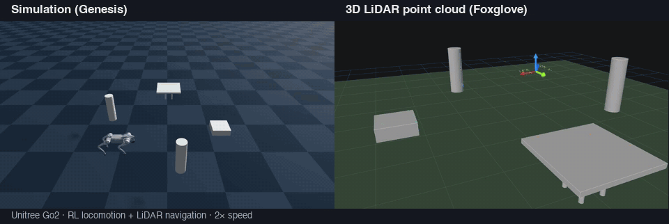
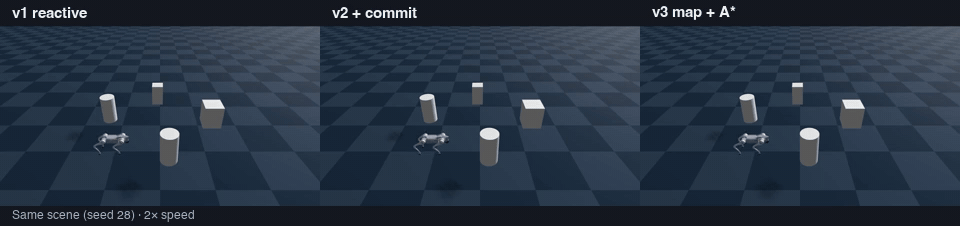

# go2-genesis-patrol



[](https://youtu.be/uhSM8Q9onhM)

**Unitree Go2 patrol in the Genesis simulator — RL locomotion + LiDAR navigation, evaluated on randomized scenes.**

- A walking policy trained with PPO (4,096 parallel envs, 9 min on an M1 Max) follows velocity commands; a deterministic navigation stack on top of it patrols a square route.
- The final navigation layer plans on an occupancy grid built from LiDAR and replans with A* every second; ablations against two map-free reactive controllers (v1, v2) show it reaches 100% patrol success with zero contacts over 45 randomized scenes (vs 9% without avoidance) and finishes 3–6 s faster (median, p < 0.0001).
- A 3D pseudo-LiDAR projected onto the body-height band detects low boxes and table tops that a 2D scan misses (success 3% → 100% over 30 scenes).
- Everything runs on a single Mac (Metal / CPU); logs export to MCAP for Foxglove.

📄 Report (Japanese): [docs/report/report.pdf](docs/report/report.pdf) · 🎬 Full video: [YouTube](https://youtu.be/uhSM8Q9onhM)

---

Unitree Go2 の歩行方策を Genesis 上で強化学習し、その上に疑似 LiDAR を使った巡回・障害物回避のナビゲーション層を載せて定量評価したプロジェクト(Physical AI 2026 応用編1 最終課題)。ナビゲーション層の中心は、LiDAR で描いた占有格子地図の上で A* により経路を引き直す地図による経路計画(v3)。乱数配置の 45 シーンで巡回成功率 9% → 100%、接触率 91% → 0%。地図の効果を切り分けるため、地図を持たない反応的回避 2 種(v1・v2)と比較した(対応ありの検定つき)。構成は実機 Go2 の「自己位置 → 地図・計画 → 速度指令 → 歩行」と同じ層構造。

- 提出動画: https://youtu.be/uhSM8Q9onhM
- レポート: [docs/report/report.pdf](docs/report/report.pdf)(HTML も同じフォルダ)
- 動画タイトル: `PAI最終課題_3164`(Omnicampus アカウント ID)

## 結果

障害物あり 45 配置(seed 5〜49、障害物 3〜5 個を乱数配置、60 s 上限)、拡張方策(指令範囲を広げて再学習した歩行方策)。成功 = 4/4 到達 かつ 転倒なし かつ 物理接触なし。数値は `results/eval_50/summary.md`。

| 条件 | 成功率 [Wilson 95% CI] | 接触率 | 所要 [s](成功分) | 経路効率(8.0 m / 走行距離) |
|---|---|---|---|---|
| 回避なし | 4/45 = 9% [4–21%] | 91% | 15.9 | 1.07 |
| v1 反応的回避 | 41/45 = 91% [79–96%] | 0% | 31.6 | 1.00 |
| v2 コミット区間つき | 43/45 = 96% [85–99%] | 0% | 31.7 | 0.81 |
| **v3 地図による経路計画(占有格子 + A\*)** | **45/45 = 100%** [92–100%] | **0%** | **24.2** | **1.05** |



同じ配置(seed 28)の v1 / v2 / v3(2 倍速、v3 の完走 + 1 s まで)。v1 は Box の前で振動、v2 は遠回り、v3 は計画経路で脇を抜ける。


- 回避なし → v1: 成功・接触とも McNemar 正確検定 p < 0.0001(n = 45、対応あり)
- v3 の所要時間(両方成功した配置の対応あり比較): v1 比 中央値 −3.4 s(v3 が速い 34 配置 / 遅い 3 配置、符号検定 p < 0.0001)、v2 比 中央値 −6.1 s(36 / 5、p < 0.0001)。成功率の差は v1 比 p = 0.125、v2 比 p = 0.5 で検定では示せない
- 既定例題の方策(前進 0.5 m/s のみ)は旋回できず、全条件で成功 0%(`results/eval/`、15 配置)
- 転倒は全エピソードで 0

### 3D LiDAR: 2D では見えない障害物(T12 / T13 / T14)

センサ面(z ≈ 0.44 m)より低い **箱(高さ 0.15 m)** と **テーブルの天板(0.32〜0.36 m)** は水平 2D スキャンに映らない。`--lidar 3d` では 72 × 16 層(垂直 ±30°、4° 刻み)の点群を胴体の高さ帯(0.05〜0.49 m)で切って 72 本に投影し、ナビ層はそのまま使う(実機の voxel layer と同じ処理)。混合配置 30 シーン(seed 100〜129、低い箱 + テーブル + 高い障害物、少なくとも 1 つが経路上)、v3。数値は `results/eval_3d/summary.md`。

| 条件 | 成功率 [95% CI] | 接触率 | 転倒 | 所要 [s](成功分) |
|---|---|---|---|---|
| v3 + 2D LiDAR | 1/30 = 3% [1–17%] | 97% | 6 | 16.6 |
| **v3 + 3D LiDAR(16 層 ±30°、既定)** | **30/30 = 100%** [89–100%] | **0%** | 0 | 27.5 |
| v3 + 3D 30 層(±12° 1° 刻み + 下向き 5 層、`--lidar 3d-dense`、試作) | 29/30 = 97% [83–99%] | 0% | 0 | 30.6 |
| v3 + 3D 25 層(±12° のみ、`--lidar 3d-dense-only`) | 10/30 = 33% | 67% | 18 | 24.8 |


- 2D → 3D(16 層): 成功・接触とも McNemar p < 0.0001。2D の失敗は低い箱を踏む(7 件、うち 6 件転倒)か天板に胴体が当たる(23 件)
- 層を密にした試作(30 層)は天板の縁の検出誤差を 0.37 m(90 パーセンタイル)から 0.03 m に下げたが、テーブルの脇で反応的回避の下層が減速する時間が増えて所要時間が伸びた(1 配置が時間切れ、接触なし)ので既定にしていない。±12° だけ(25 層)にすると近くの低い箱が見えなくなり踏む。詳細は `reports/13_lidar3d_dense_integrate.md`
- 3D の追加コストは +0.5〜0.8 ms/step(CPU)
- Foxglove での 3D 点群の表示(`/lidar/points` を z で色分け、減衰 60 s。`/lidar/points3d` で毎ステップの全点群)。seed 103、低い箱の上面・テーブルの天板・円柱の側面に点が積み上がる(T14)


## 構成


最終形 v3 の層構造。学習するのは歩行方策だけで、地図・計画と速度指令は決定的な規則(図: `scripts/make_arch.py`)。

| 層 | 実装 | 内容 |
|---|---|---|
| 歩行(学習) | `go2_train_patrol.py`, `go2_env.py` | Genesis 例題の Go2 環境で PPO(rsl-rl)。指令範囲を vx 0〜0.8 m/s、ωz ±0.8 rad/s に広げて 4096 env × 300 it(M1 Max / Metal で約 9 分)。方策は 50 Hz で 12 関節の目標角を出す |
| 知覚 | `nav/lidar.py` | Genesis の Raycaster を胴体に取り付けた疑似 2D LiDAR(72 本 / 5° / 5 m)。地面除去とセクタ最小距離。`--lidar 3d` では 72 × 16 層の 3D 点群を高さで分類(地面 / 胴体帯 / 頭上 / 自機)し、胴体帯の点だけを 72 本に投影してナビ層に渡す(空き更新はレイが低い高さにある区間のみ) |
| ナビゲーション | `nav/grid_map.py`, `nav/planner.py`, `nav/avoid.py`, `go2_patrol.py` | ウェイポイント追従の上で、v3(地図による経路計画)が速度指令 (vx, vy, ωz) を出す。比較用に地図なしの v1 / v2 に切り替えられる。姿勢は Genesis の真の値(SLAM なし) |

### 比較: 地図なし(v1・v2)と地図あり(v3)

| 回避則 | 仕組み | 特徴 |
|---|---|---|
| v1 | 進路幅 ±0.4 m の回廊に入った障害物に対して減速・旋回。旋回方向は毎ステップ決め直す | 速いが、経路を塞ぐ障害物の前で「停止 → 旋回 → 戻る」を繰り返して時間切れになることがある |
| v2 | v1 に回避側への 2 s コミットと 1 s の直進を追加 | 塞がれた経路を抜けられるが、経路脇の障害物でも大きく迂回する(経路効率 0.81) |
| v3 | LiDAR から 0.05 m の占有格子(log-odds)を作り、膨張 0.35 m の上で A* により次のウェイポイントまで 1 s ごとに再計画。経路上 0.8 m 先をローカル目標にし、v1 を安全停止の下層に残す | 全配置で完走、最短に近い経路、v1/v2 より速い |

## 環境

- macOS Apple Silicon(M1 Max 32 GB)で開発。Genesis は Metal バックエンドで **学習**、1 env の評価・録画は **CPU バックエンド**(`--backend cpu`。1 env では Metal より 10 倍速く、LiDAR の値は一致)
- Python 3.11、genesis-world 1.4.4(固定)、rsl-rl-lib ≥ 5.0、torch 2.14、foxglove-sdk ≥ 0.30(MCAP 書き出し)。`requirements.txt` 参照
- Linux + CUDA でも動く想定だが未検証

```bash
conda create -n py311_genesis python=3.11 -y
conda activate py311_genesis
pip install -r requirements.txt
```

## 再現手順

スクリプトはリポジトリ直下で実行する。初回実行は JIT コンパイルで 1〜3 分かかる。CPU バックエンドの物理は実行ごとに揺れる(後述)ので、個々の配置の結果は数値どおりに再現しないことがある。

```bash
# 1. 歩行方策の学習(約 10 分、Metal)。省略可: 学習済みの checkpoints/go2-patrol/model_299.pt を同梱
python go2_train_patrol.py -e go2-patrol -b 4096 --max-iterations 300
#    go2_patrol.py / go2_record.py は logs/<exp> が無ければ checkpoints/<exp> を自動で使う(--ckpt-dir で明示も可)

# 2. 台本(前進 → 旋回 → 停止)に沿った指令で歩かせて録画
python go2_record.py -e go2-patrol --ckpt 299 --backend cpu --out videos/walk.mp4 --follow

# 3. 正方形巡回(障害物シーン seed、回避則 v1|v2|v3、カメラ follow|overhead|overhead-close、MCAP)
python go2_patrol.py -e go2-patrol --ckpt 299 --backend cpu --seed 28 --avoid --avoid-version v3 --camera overhead-close --out videos/patrol.mp4
python go2_patrol.py -e go2-patrol --ckpt 299 --backend cpu --seed 10 --avoid --avoid-version v3 --no-video --mcap results/mcap/run.mcap
#    --seed -1 で障害物なし、--no-avoid で経路追従のみ。v3 では <out>_map.png と <out>_plan.csv も出力

# 3b. 3D LiDAR(低い箱・テーブル入りの混合配置 seed 100〜129。seed ≥ 100 は自動で mixed プロファイル)
python eval/scenes.py --seed 100 101 --profile mixed
python go2_patrol.py -e go2-patrol --ckpt 299 --backend cpu --seed 103 --avoid --avoid-version v3 --lidar 3d --camera overhead-close --out videos/patrol3d.mp4
#    --lidar 2d|3d(16 層、既定の 3D)|3d-dense(30 層、試作)|3d-dense-only(±12° のみ)。3D の --mcap には /lidar/points3d と /imu も入る

# 4. 定量評価(45 配置 × 条件、録画なし、約 6〜12 分/条件)と集計
python eval/run_eval.py --policies go2-patrol:299 --avoid both --seeds 5-49 --avoid-version v1 --backend cpu --out results/eval_50/episodes.csv
python eval/run_eval.py --policies go2-patrol:299 --avoid on   --seeds 5-49 --avoid-version v2 --backend cpu --out results/eval_50/episodes.csv
python eval/run_eval.py --policies go2-patrol:299 --avoid on   --seeds 5-49 --avoid-version v3 --backend cpu --out results/eval_50/episodes.csv
python eval/summarize.py --compare3 results/eval_50/episodes.csv --scenes 5-49 --out-dir results/eval_50
#    episodes.csv は 1 本ごとに追記され、済みの (policy, avoid, seed, version, lidar) はスキップする(中断・再開可)
# 4b. 3D LiDAR の評価(30 配置 × 2D / 3D、約 5 分/条件)
python eval/run_eval.py --policies go2-patrol:299 --avoid on --seeds 100-129 --avoid-version v3 --lidar 2d --backend cpu --out results/eval_3d/episodes.csv
python eval/run_eval.py --policies go2-patrol:299 --avoid on --seeds 100-129 --avoid-version v3 --lidar 3d --backend cpu --out results/eval_3d/episodes.csv
python eval/summarize.py --compare-lidar results/eval_3d/episodes.csv --scenes 100-129 --out-dir results/eval_3d

# 5. Foxglove で 3D 表示(LiDAR 点群・軌跡・障害物・TF・指令。v3 は /map と /plan も)
#    Foxglove アプリ: Open local file → results/mcap/t06_seed10.mcap、Layout → Import → docs/foxglove_layout.json
#    (3D パネルの表示フレームを world にする。Plot パネルは /nav/state.vx, .yaw_rate, .d_front)
#    3D 点群(T12 以降の results/mcap/t12_3d_seed103.mcap など)の表示設定:
#      表示フレーム world、フォローモード 固定
#      /lidar/points   : カラーマップ Turbo、カラーフィールド z、最小 0 / 最大 0.5、減衰 60 s
#      /lidar/points3d : 減衰 0、ポイントサイズ 2
#      /map            : フラット色・半透明
#      変換: ラベル オフ、軸のスケール 0.6

# 6. 提出動画の再生成(図 → 構成図 → カード → 結合。素材は videos/raw/ に同梱。3D のショットは videos/raw/t12_*、Foxglove 3D のショットは videos/raw/foxglove_3d_seed103.mp4 があれば入る)
python scripts/make_figs.py && python scripts/make_arch.py && python scripts/make_cards.py && python scripts/check_margins.py
python scripts/make_video.py --v1-seed28-start 14 --v2-seed28-start 6 --v3-seed28-start 9.7
python scripts/make_gifs.py      # README の GIF 2 本とソーシャルプレビュー画像(docs/media/)
```

## リポジトリ構成

| パス | 内容 |
|---|---|
| `go2_env.py`, `go2_train.py` | Genesis v1.4.4 例題由来の Go2 環境と学習(Apache-2.0、`NOTICE`)。環境にはカメラ / LiDAR / 障害物の差し込み口を追加 |
| `go2_train_patrol.py` | 指令範囲を広げた学習 |
| `go2_record.py`, `go2_patrol.py` | headless 録画 / ウェイポイント巡回(回避則の切替、MCAP、v3 の地図出力) |
| `nav/` | `lidar.py`(疑似 LiDAR 2D / 3D)、`avoid.py`(v1 / v2)、`grid_map.py`・`planner.py`(v3)、`mcap_logger.py` |
| `eval/` | `scenes.py`(乱数配置、mixed プロファイル)、`run_eval.py`(評価ループ)、`summarize.py`(集計・検定)、`plot_traj.py`、`lidar_test.py`、`lidar3d_test.py`、`geom_test.py`、`table_edge_test.py`、`map_test.py`、`repro_check.py` |
| `checkpoints/go2-patrol/` | 学習済み方策(`model_299.pt`、`cfgs.pkl`) |
| `results/` | 評価 CSV・図(`eval_50/` が 45 配置 × 4 条件、`eval_3d/` が混合 30 配置 × 2D / 3D、`eval/` が 15 配置 × 2 方策 × 2 条件)、シーン JSON(`scenes/`)、MCAP(`mcap/`) |
| `videos/` | 代表動画、`raw/`(動画素材)、`final/`(提出動画) |
| `figs/`, `scripts/` | 動画用の図・カードと、その生成・結合スクリプト |
| `docs/` | 設計書、実現可能性調査、Foxglove レイアウト、`report/`(レポート PDF・HTML・図)、`media/`(README の GIF・ソーシャルプレビュー) |
| `tasks/`, `reports/` | 作業タスクの仕様と報告(開発ログ) |

## 既知の制約・限界

- 自己位置は Genesis の真の姿勢を使っている(SLAM・オドメトリなし)。地図と計画の結果は「自己位置が正確なら」の上限
- 障害物は静止した Box / Cylinder のみ。動く障害物は扱っていない
- CPU バックエンドの物理には実行ごとの揺れがあり、同じ配置でも成功 / 失敗が変わることがある(`results/repro_seed12.csv`)。評価は集計値と信頼区間で比較している
- LiDAR は疑似(Raycaster)。2D は 72 本の水平スキャン、3D は垂直 ±30° の 16 層(4° 刻み)で、高さ分類は真の高さで行う。崖・段差・斜面は未対応。張り出し物(天板)の縁は層の粗さの分(最大 0.4 m 程度)遠くに検出される。層を密にすると縁は正確になるが、テーブルの脇で反応的回避の下層が減速して所要時間が伸びる(`reports/13_lidar3d_dense_integrate.md`)
- Metal バックエンドは 1 env では CPU より遅い(21 ms/step 対 2 ms/step)。学習は Metal、評価は CPU と使い分ける
- 衝突は物理接触で判定している。設計時の LiDAR 距離 < 0.25 m は正面の押し付けを検出できず、ニアミスの副指標に回した

## 開発ログ

| タスク | 内容 | 報告 |
|---|---|---|
| T01 | 指令範囲を広げた歩行方策の学習と正方形巡回 | `reports/01_patrol_policy.md` |
| T02 | 疑似 LiDAR(Raycaster)の組み込みと単体テスト(Metal / CPU) | `reports/02_lidar_sensor.md` |
| T03 | 乱数障害物シーンと反応的回避 v1 | `reports/03_obstacle_avoidance.md` |
| T04 | 定量評価(20 配置 × 方策 × 回避) | `reports/04_evaluation.md` |
| T05 | 回避則 v2(コミット区間)と検定、再現性 | `reports/05_avoid_v2.md` |
| T06 | MCAP 書き出しと Foxglove 可視化 | `reports/06_foxglove_mcap.md` |
| T07 | 45 配置への拡大と非決定性の切り分け | `reports/07_scale_eval.md` |
| T08 | 提出動画の素材作成と結合 | `reports/08_video.md` |
| T09 | 占有格子 + A* 大域計画(v3) | `reports/09_map_planner.md` |
| T10 | 動画 v2(v3 の反映、テロップ余白) | `reports/10_video_v2.md` |
| T11 | 構成図の作り直し、動画 v2.1、README、クリーンクローン検証 | `reports/11_arch_readme.md` |
| T12 | 3D 疑似 LiDAR と低い箱・テーブル(2D では見えない障害物) | `reports/12_lidar3d.md` |
| T13 | 3D の層を密にする(天板の縁)、動画 v3、README 反映 | `reports/13_lidar3d_dense_integrate.md` |
| T14 | Foxglove 3D 点群の画面収録を動画に追加(動画 v4) | `reports/14_foxglove3d_video.md` |
| T15 | README の冒頭 GIF・英語要約・比較 GIF、ソーシャルプレビュー | `reports/15_readme_showcase.md` |

## ライセンス・使用 OSS

Apache-2.0。`go2_env.py` と `go2_train.py` は [Genesis](https://github.com/Genesis-Embodied-AI/genesis-world)(Apache-2.0)の例題を改変・複製したもの(詳細は `NOTICE`)。学習には [rsl-rl](https://github.com/leggedrobotics/rsl_rl)(BSD-3)、MCAP 書き出しには [foxglove-sdk](https://github.com/foxglove/foxglove-sdk)(MIT)を使用。
