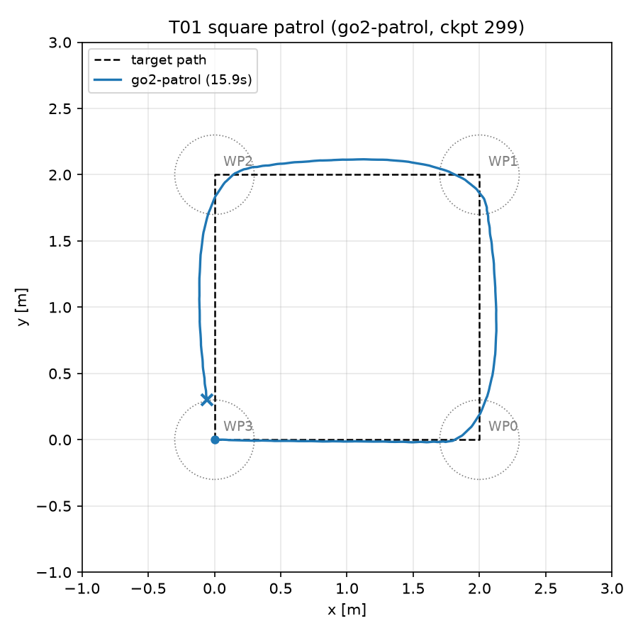
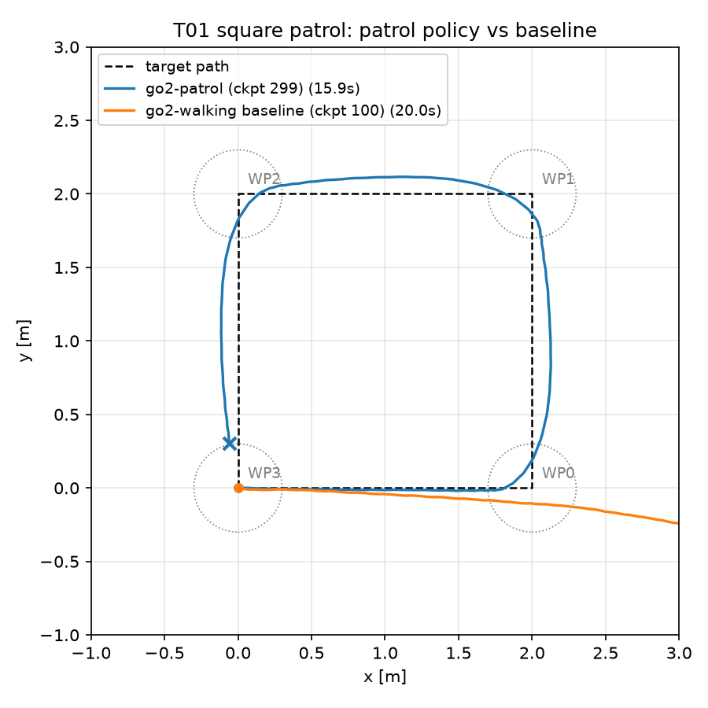

# T01 報告: 指令範囲を広げた歩行方策の学習と正方形巡回

対象タスク: `tasks/01_patrol_policy.md`。実行日 2026-10-20、環境は CLAUDE.md のとおり(M1 Max / Metal / `py311_genesis` / genesis-world 1.4.4)。

## 結論

受け入れ条件は **すべて満たした**。調整候補は使っていない。

| 受け入れ条件 | 判定 | 実測 |
|---|---|---|
| `logs/go2-patrol/model_299.pt` と `cfgs.pkl` が存在 | ✅ | `ls` で確認(下記) |
| 最終イテレーションで Mean episode length ≥ 900 | ✅ | 991.16 |
| 台本録画で `fell / reset` なし | ✅ | 700 frames / 14.0 s、`fell` 出力なし |
| 正方形巡回 4/4 かつ転倒なし、60 s 以内 | ✅ | 4/4、15.9 s、`fell` なし |
| `results/t01_square_traj.png` が正方形をなぞる | ✅ | 下図。角で約 0.1–0.15 m 外側に膨らむが 4 隅の到達円(0.3 m)に全て入る |
| 既定方策の waypoints reached < 4(参考) | ✅ | 1/4 |

## 実行したコマンド

```bash
conda activate py311_genesis
time python go2_train_patrol.py -e go2-patrol -b 4096 --max-iterations 300
python go2_record.py -e go2-patrol --ckpt 299 --out videos/t01_script.mp4 --follow
python go2_patrol.py -e go2-patrol --ckpt 299 --waypoints square --laps 1 --out videos/t01_square.mp4
python go2_patrol.py -e go2-walking --ckpt 100 --waypoints square --laps 1 --out videos/t01_square_baseline.mp4
python eval/plot_traj.py --log videos/t01_square_log.csv --label go2-patrol --out results/t01_square_traj.png
python eval/plot_traj.py --log videos/t01_square_log.csv videos/t01_square_baseline_log.csv \
    --label "go2-patrol (ckpt 299)" "go2-walking baseline (ckpt 100)" --out results/t01_square_traj_compare.png
```

## 1. 学習(go2-patrol, 4096 env × 300 it)

`gs.backend=gs.metal`, `gs.device=mps`、seed 0。合計時間 **8 分 53 秒**(`time` の real。うち rsl-rl の `Time elapsed` は 7:33、残りは JIT コンパイルと scene build)。

最終ブロック(iteration 299):

| 指標 | 値 |
|---|---|
| Mean reward | 19.72 |
| Mean episode length | 991.16(上限 1000 = 20 s / 0.02 s) |
| rew_tracking_lin_vel | 0.9705 |
| rew_tracking_ang_vel | 0.1860(スケール 0.2 なので達成率 ≈ 93%) |
| rew_action_rate | -0.0404 |
| Iteration time | 2.03 s(最終 it。通常は 1.3 s 前後、最終 it はチェックポイント保存込み) |
| Steps per second | 48,390(最終 it)。it 50–200 では 74,000–78,000 |

学習曲線の要点(ログから抜粋):

| it | Mean reward | Mean ep length | rew_tracking_lin_vel | rew_tracking_ang_vel |
|---|---|---|---|---|
| 0 | -0.11 | 22.5 | 0.006 | 0.001 |
| 50 | 2.99 | 300.8 | 0.224 | 0.031 |
| 100 | 12.32 | 962.5 | 0.839 | 0.118 |
| 150 | 16.97 | 1001.0 | 0.944 | 0.166 |
| 200 | 18.83 | 997.3 | 0.921 | 0.172 |
| 250 | 19.59 | 1001.0 | 0.971 | 0.185 |
| 299 | 19.72 | 991.2 | 0.971 | 0.186 |

it 100 の時点で転倒はほぼなくなり(ep length 962)、it 150 以降は報酬が緩やかに伸びる。300 it で頭打ちに近く、調整候補 1(600 it)の必要はなかった。

## 2. 台本録画(`videos/t01_script.mp4`)

台本: 前進 0.5 → 左旋回 0.5 rad/s → 前進 → 右旋回 -0.5 rad/s → 停止(計 14 s)。
700 frames、sim 14.0 s、wall 15.9 s(44.0 steps/s、描画込み)。**`fell / reset` の出力なし**。

動画は 1280×720 / 50 fps / 14.0 s(ffprobe で確認)。5 s 時点のフレームを抜き出して、ロボットが直立して歩いていることを目視確認した。

## 3. 正方形巡回(`videos/t01_square.mp4`)

| 項目 | 値 |
|---|---|
| waypoints reached | **4/4** |
| 合計シミュレーション秒数 | **15.9 s**(796 steps) |
| 転倒(`fell at`) | なし |
| 走行距離 / 理想経路長 | 7.51 m / 8.00 m(到達円 0.3 m で手前で折れるため短い) |
| 指令の範囲 | vx 0.11–0.60 m/s、ωz -0.01〜0.80 rad/s(学習範囲内) |

到達時刻: WP0 3.3 s、WP1 7.6 s、WP2 11.8 s、WP3 15.9 s(各辺 ≈ 4.2 s、直線 0.6 m/s + 角での減速旋回)。



角では追従則が vx を落としつつ ωz = 0.8 で旋回しており、軌跡は正方形の外側に 0.1–0.15 m 膨らむ。これは P 制御の `reach_dist=0.3` で手前で次の目標に切り替わることと、旋回中も vx>0 を残す設計(`cos(heading_err)` 重み)によるもので、方策の問題ではない。

## 4. ベースライン(既定方策 go2-walking, ckpt 100)との比較

| 方策 | waypoints reached | sim 秒数 | 終了理由 |
|---|---|---|---|
| go2-patrol (ckpt 299) | 4/4 | 15.9 s | 1 周完了 |
| go2-walking (ckpt 100) | **1/4** | 20.0 s | 環境のエピソード上限(20 s)でリセット |



既定方策は WP0(2, 0)には 3.3 s で到達するが、その後 vx=0 / ωz=0.8 の旋回指令を与えても **前進し続け**(0.3 m/s 程度)、20 s かけて yaw が 40° しか回らず、x=6.65 m まで直進してしまった。学習時の指令が vx=0.5 固定だったため、指令の値に関わらず「前進 0.5 m/s」の歩容しか出せないことが実測で確認できた。これが「巡回には指令範囲を広げた再学習が必要」の根拠になる。

注意: ベースラインのログに `fell at t=20.0s` と出ているが、これは転倒ではなく **`go2_env.py` のエピソード長上限(`episode_length_s=20`)によるタイムアウトリセット**(`episode_length_buf > max_episode_length` で `reset_buf` が立つ)。19 s 時点のフレームで直立歩行していることを確認した。`t01_metrics.csv` ではこれを `square_fell=0 (episode timeout at 20 s)` と記録している。

## 成果物

- `checkpoints/go2-patrol/model_299.pt`, `checkpoints/go2-patrol/cfgs.pkl`(`logs/go2-patrol/` からコピー。`logs/` は .gitignore)
- `videos/t01_script.mp4`(14 s), `videos/t01_square.mp4`(15.9 s), `videos/t01_square_baseline.mp4`(20 s、参考。タスクの「提出用ではない」に従いコミットせずローカルのみ)
- `results/t01_square_traj.png`, `results/t01_square_traj_compare.png`, `results/t01_metrics.csv`

## 変更したファイルと理由

| ファイル | 変更 |
|---|---|
| `go2_record.py` | `SCRIPT` をタスク指定の 5 区間台本に書き換え(旧台本はコメントで残した) |
| `eval/plot_traj.py` | **新規**。`*_log.csv` から xy 軌跡を描き、`WAYPOINT_SETS` の目標経路を破線で重ねる。複数ログの重ね描き可。T04 の図にも流用できる |
| `results/t01_metrics.csv` | 方策 × 指標の表 |

`go2_env.py` / `go2_train.py` / `go2_train_patrol.py` は変更していない(NOTICE の更新は不要)。

## 仮定したこと

- `t01_metrics.csv` の列構成はタスクに指定がないため、学習指標(go2-patrol のみ)と巡回指標(両方策)を 1 行 1 方策で並べた
- 軌跡図は go2-patrol 単体のもの(`t01_square_traj.png`)を受け入れ条件用とし、ベースラインを重ねた図は別ファイル(`t01_square_traj_compare.png`)にした
- 学習の「合計時間」は `time` の real(8:53)を採用。rsl-rl の `Time elapsed`(7:33)は JIT・build を含まない

## うまくいかなかったこと

なし。調整候補は未使用。

## 次タスクへの申し送り

1. **環境の 20 s エピソード上限に注意**: `go2_env.py` は `episode_length_s=20` を超えると `reset_buf` を立ててリセットする。`go2_patrol.py` は `dones` を転倒と見なして止まるため、`--max-time 60` で 20 s を超える巡回(障害物あり、T03/T04)は **20 s でリセット扱いになる**。評価時は `env_cfg["episode_length_s"]` を `max_time` 以上に上書きするか、`infos["time_outs"]` を見て転倒と区別する必要がある。今回の正方形 1 周は 15.9 s で収まったため顕在化しなかった
2. 巡回時の指令は vx ≤ 0.6、ωz ≤ 0.8 で学習範囲内。T03 の回避で ωz を加算する場合も ±0.8 でクリップすること
3. 角で約 0.15 m 外側に膨らむので、障害物をウェイポイントの外側近傍に置く場合は余裕を 0.3 m 以上取ると判定が安定する
4. 録画は 1280×720 で約 44 steps/s(学習なし・単体実行時)。初回 JIT を含めても 1 本 30–45 秒
5. `logs/*/events.out.tfevents.*` のファイル名にはホスト名が含まれる。`logs/` は .gitignore 済みなので問題ないが、`checkpoints/` にコピーするのは `model_*.pt` と `cfgs.pkl` だけにすること
