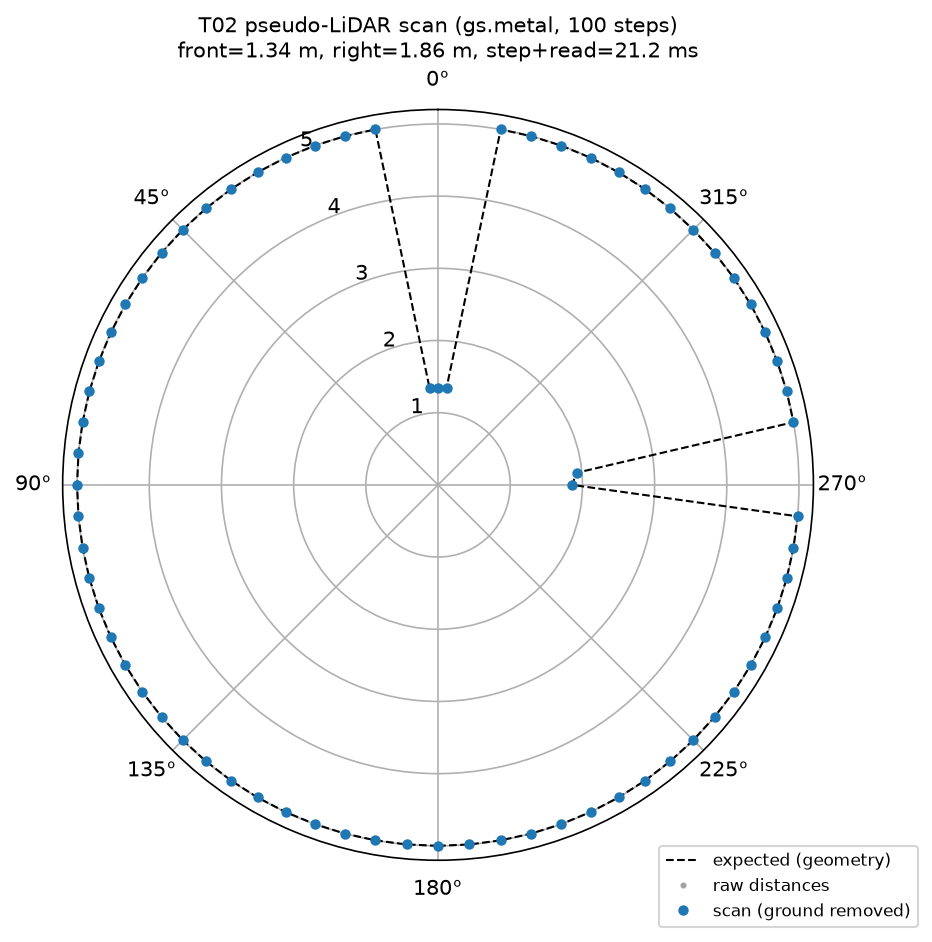

# T02 報告: 疑似 LiDAR(Raycaster)の組み込みと単体テスト

対象タスク: `tasks/02_lidar_sensor.md`。実行日 2026-10-21、環境は CLAUDE.md のとおり(M1 Max / Metal / `py311_genesis` / genesis-world 1.4.4)。

## 結論

- **Metal で Raycaster は動作する**。距離・ヒット点とも CPU バックエンドと完全一致(最大差 0.000 m)、幾何計算の期待値とも 2 mm 以内で一致
- 地面除去後、障害物以外のレイはすべて max_range(偽ヒット 0 本)。自己遮蔽なし
- **未達が 1 つ**: Metal での 1 ステップ(sim + read)は **21.2 ms** で条件の 10 ms を超える。内訳は下表のとおり LiDAR なしでも `env.step()` が 10.2 ms あり、Raycaster が約 +10 ms。`return_points=False` では改善しない(24.0 ms、差はノイズ範囲)。CPU バックエンドなら 2.1 ms。タスクの指示どおり対策案を本報告の末尾に書き、実装はしていない
- 正面距離は 1.341 m で、条件「1.24 ± 0.1」の上限 1.34 を **1 mm 超過**。幾何計算(base 実測位置からの距離 1.342 m)とは一致しており、差はタスクが前提にした base 位置(x ≈ +0.06)と実測(x = −0.042)の違いによる。センサ自体の誤差ではない
- 手順 5(20 s エピソード上限の対策)は完了。既定方策の巡回が 40 s まで走り `end reason: timeout` で終了した

| 受け入れ条件 | 判定 | 実測 |
|---|---|---|
| Metal で `lidar_test.py` がエラーなく動く | ✅ | exit 0、下記ログ |
| 正面 1.24 ± 0.1 m | △ | 1.341 m(上限 1.34 を 1 mm 超過。幾何期待値 1.342 と一致。前提の base 位置差) |
| 右 1.85 ± 0.1 m | ✅ | 1.856 m(期待 1.856) |
| 左・後方が max_range | ✅ | 5.000 / 5.000 |
| 地面除去後に障害物以外が max_range | ✅ | 偽ヒット 0 本(ヒットは 5 本、すべて障害物) |
| 1 ステップ ≤ 10 ms(Metal) | ❌ | 21.2 ms(LiDAR なし 10.2 ms、CPU なら 2.1 ms) |
| `results/t02_scan.png` と本報告(Metal/CPU 計測表) | ✅ | 下記 |
| 手順 5: 40 s まで走り `timeout` で終了 | ✅ | 2000 steps / 40.0 s、reached 1/4、`end reason: timeout` |

## 実行したコマンド

```bash
conda activate py311_genesis
python eval/lidar_test.py --backend gpu --out results/t02_scan.png --csv results/t02_timing.csv
python eval/lidar_test.py --backend gpu --no-points --out <scratch>/t02_scan_gpu_nopoints.png --csv results/t02_timing.csv
python eval/lidar_test.py --backend gpu --no-lidar --csv results/t02_timing.csv
python eval/lidar_test.py --backend cpu --out results/t02_scan_cpu.png --csv results/t02_timing.csv
python eval/lidar_test.py --backend cpu --no-lidar --csv results/t02_timing.csv
python go2_patrol.py -e go2-walking --ckpt 100 --waypoints square --max-time 40 --out /tmp/t02_timeout_check.mp4
```

## 1. スキャン結果(Metal、100 ステップ後)

`lidar_test.py --backend gpu` の出力(抜粋):

```
[lidar_test] gs.backend=gs.metal gs.device=mps
[lidar_test] n_rays=72 angles[0]=-180.0 angles[36]=0.0 min_range=0.3 max_range=5.0 pos_offset=(0.0, 0.0, 0.15)
[lidar_test] base pos after 100 steps: (-0.042, -0.000, 0.288)
[lidar_test] front(idx36)=1.341  right(idx18)=1.856  left(idx54)=5.000  back(idx0)=5.000  (expected front=1.342 right=1.856)
[lidar_test] hits (< max_range) after ground removal: 5 rays
    idx 18  angle   -90.0 deg  d=1.856  expected=1.856  raw=1.856
    idx 19  angle   -85.0 deg  d=1.929  expected=1.926  raw=1.929
    idx 35  angle    -5.0 deg  d=1.346  expected=1.347  raw=1.346
    idx 36  angle     0.0 deg  d=1.341  expected=1.342  raw=1.341
    idx 37  angle     5.0 deg  d=1.346  expected=1.347  raw=1.346
[lidar_test] hits < 1.0 m: []
[lidar_test] raw hits=5, removed as ground/min_range=0: []
[lidar_test] spurious hits on non-obstacle rays: 0
[lidar_test] |scan - expected|: max=0.002 mean=0.000
[lidar_test] sector_min(12) = [1.34 5. 5. 5. 5. 5. 5. 5. 5. 1.86 5. 5.]
```

| 方向 | index | 実測 [m] | 幾何期待値 [m] | タスクの期待 [m] |
|---|---|---|---|---|
| 正面 | 36 | 1.341 | 1.342 | 1.24 ± 0.1 |
| 右 | 18 | 1.856 | 1.856 | 1.85 ± 0.1 |
| 左 | 54 | 5.000 | 5.000 | 5.0 |
| 後方 | 0 | 5.000 | 5.000 | 5.0 |

- 角度の並びはタスク記載どおり(index 0 = −180°、36 = 0°、18 = −90° 右、54 = +90° 左)。右の Cylinder が idx 18・19 に、正面の Box が idx 35〜37 に出ており方向の対応も確認できた
- `sector_min(12)` はセクタ 0(正面)が 1.34、セクタ 9(−90°、右)が 1.86 で、反時計回りの定義どおり
- 幾何期待値は、センサ原点(base 実測位置 + pos_offset)から各レイと Box/Cylinder の 2D 交点までの距離を `eval/lidar_test.py::expected_scan` で計算したもの。斜めのレイ(idx 19、35、37)も 3 mm 以内で一致



### 立ち上がりの挙動(実測)

正面距離の時系列: s0〜s3 = 5.00、s5 = 1.30、s10 = 1.30、s20 = 1.33、s50 = 1.39、s99 = 1.34。
最初の 4 ステップで 5.0 になるのは、初期姿勢(base z = 0.42、センサ z = 0.57)では **Box の上面(z = 0.5)より高い位置からレイが出て Box を越える**ため。着地後(base z ≈ 0.29)に Box に当たる。これは地面除去ではなく幾何の問題で、`raw hits=5, removed=0` のとおり最終ステップでは地面ヒットは発生していない。その後 1.30→1.39→1.34 と数 cm 揺れるのは、`actions=0`(既定姿勢)で立たせたときの base の整定(前後に数 cm 動く)による。歩行中は胴体のピッチで床ヒットが出るはずなので、地面除去は T03 で歩行しながら確認する必要がある(本タスクでは立位のため発動しなかった)。

## 2. Metal と CPU の比較(`results/t02_timing.csv`)

| backend | return_points | step [ms] | read_scan [ms] | 合計 [ms] | 正面 [m] | 右 [m] | ヒット数 | 偽ヒット | 最大誤差 [m] |
|---|---|---|---|---|---|---|---|---|---|
| gs.metal | True | 20.57 | 0.67 | **21.24** | 1.341 | 1.856 | 5 | 0 | 0.002 |
| gs.metal | False | 23.54 | 0.49 | 24.03 | 1.341 | 1.856 | 5 | 0 | 0.002 |
| gs.metal | (LiDAR なし) | 10.17 | — | 10.17 | — | — | — | — | — |
| gs.cpu | True | 2.08 | 0.04 | **2.12** | 1.341 | 1.856 | 5 | 0 | 0.002 |
| gs.cpu | (LiDAR なし) | 1.01 | — | 1.01 | — | — | — | — | — |

- 1 env・100 ステップの平均(ウォームアップ 1 ステップ後)。`step` は `env.step()`、`read_scan` は `lidar.read()` + 前処理
- **スキャン値は Metal と CPU で完全一致**(`results/t02_scan.csv` と `results/t02_scan_cpu.csv` の差: 距離・raw とも最大 0.000 m)
- Metal は 1 env では CPU より 10 倍遅い。4096 env の学習では Metal が圧倒的に速いが、1 env の評価ではカーネル起動のオーバーヘッドが支配的と考えられる(推測)。Raycaster の追加コストは Metal で約 +10 ms、CPU で約 +1 ms
- `return_points=False` は Metal で速くならなかった(むしろ 2.8 ms 遅いが、同一条件の再実行でも ±2 ms 程度ぶれるためノイズと判断。推測)。docs の「コストが約 1/4 になる」は点群のメモリ・転送分の話で、Metal ではレイキャスト本体のカーネルが支配的と考えられる

## 3. 手順 5: 20 s エピソード上限の対策

`go2_patrol.py` で `cfgs.pkl` 読込後に `env_cfg["episode_length_s"] = args.max_time + 5.0` と上書きし、`dones` が立ったときは `infos["time_outs"][0]` で `timeout` / `fell` を区別、終了時に `end reason` を出力するようにした。

確認(既定方策、40 s):

```
[go2_patrol] trained command ranges: vx=[0.5, 0.5] vy=[0, 0] yaw=[0, 0]
[go2_patrol] t=  3.3s reached waypoint 0 at (1.72, -0.08)
[go2_patrol] wrote /tmp/t02_timeout_check.mp4: 2000 steps, sim 40.0s, wall 40.6s, waypoints reached 1/4, end reason: timeout
```

20 s でのリセットは起きず(2000 ステップ連続、`timeout (env episode limit)` の出力なし)、40 s の上限で `timeout` 終了。到達は T01 と同じ 1/4。

## 変更したファイルと理由

| ファイル | 変更 |
|---|---|
| `go2_env.py` | `Go2Env.__init__` に `lidar_cfg=None, obstacles=None` を追加。`scene.build()` の前に `obstacles`(morph のリスト)を `add_entity`、`lidar_cfg` を `Raycaster(**lidar_cfg)` で `add_sensor`。`entity_idx` が無ければ `self.robot.idx` を自動で入れる。`self.lidar`, `self.lidar_cfg`, `self.obstacles` を保持 |
| `NOTICE` | `go2_env.py` の modified 行に obstacles を追記 |
| `nav/__init__.py`, `nav/lidar.py` | **新規**。`ANGLES_DEG`、`DEFAULT_LIDAR_CFG`/`make_lidar_cfg()`(pattern は `gs.init()` 後に作る必要があるため関数化)、`read_scan(env)`(地面除去 z < 0.05、min_range 未満 → max_range)、`sector_min(scan, 12)`、`sector_angles_deg()` |
| `eval/lidar_test.py` | **新規**。既知配置での単体テスト。`--backend`, `--steps`, `--out`, `--csv`, `--no-points`, `--no-lidar`。幾何期待値の計算、極座標プロット、timing CSV への追記、スキャンの CSV 出力 |
| `go2_patrol.py` | `episode_length_s` の上書き、`time_outs` による `timeout`/`fell` の区別、`end reason` の出力 |
| `CLAUDE.md`, `tasks/02_lidar_sensor.md` | T01 後の更新(作業者による編集)を本コミットに含めた |

## 仮定したこと

- `lidar_cfg` は `Raycaster` の kwargs をそのまま dict で渡す形にした(`pattern` オブジェクトを含む)。`cfgs.pkl` には保存しない(pattern はテンソルを持つため)
- 「1.0 m 未満のヒット一覧」は自己遮蔽の検出用と解釈し、空であることを確認した上で、別途 max_range 未満の全ヒットも表示した
- タイミングは `env.step()` と `read_scan()` を分けて計測し、合計を「1 ステップ(sim + read)」とした。ウォームアップ 1 ステップを除外
- 図の極座標は正面を上、反時計回りを正(左が図の左側)にした
- 手順 5 の確認動画は指定どおり `/tmp/` に出力し、リポジトリには入れていない

## うまくいかなかったこと

- **Metal の 1 ステップ 21 ms(条件 10 ms)**。調整候補 1(自己遮蔽)・2(Raycaster が動かない)はどちらも該当しないため未実施。タスクの指示に従い、以下に対策案を書くに留めた(実装なし)
- 正面距離が条件の帯域を 1 mm 超えた件は上記のとおりセンサ誤差ではない。条件の数値を「幾何期待値 ± 0.1」とするのが適切

## Metal で 10 ms を超えることへの対策案(未実装)

1. **評価は CPU バックエンドで回す**(最有力、実測済み): 1 env では CPU が 2.1 ms/step(LiDAR 込み)で Metal の 10 倍速い。スキャン値は完全一致するので結果は変わらない。`go2_patrol.py` / T04 の評価ループに `--backend cpu` を指定するだけで済む。ただし録画(カメラ描画)が CPU バックエンドで動くかは未確認(CLAUDE.md の「描画が不安定なら cpu」という記述から動く見込み。推測)
2. `return_points=False` + 幾何近似の地面除去(タスク記載の案): レイは水平(仰角 0)なので、胴体ピッチ θ・センサ高さ h のとき、正面のレイが床に当たる距離は h / sin(θ)(θ > 0 で前傾)。各レイの方位 φ に対しては h / sin(θ cos φ − ρ sin φ)(ρ = ロール)で床までの幾何距離が出るので、「距離 ≥ 床までの幾何距離 − 余裕」のレイを max_range に置換する。ただし実測では `return_points=False` でも Metal の step は速くならなかったので、**この案は Metal では効果が薄い**
3. LiDAR を毎ステップではなく N ステップに 1 回(例: 5 ステップ = 10 Hz、実機の LiDAR 周期に近い)読む: `read()` 自体は 0.67 ms と軽いが、Raycaster の更新は `scene.step()` 内で毎ステップ走るため、add_sensor の更新頻度を下げる API がない限り効果は限定的(推測)

## 次タスクへの申し送り

1. **T03/T04 の評価は `--backend cpu` を推奨**(1 env で 10 倍速い、結果は一致)。60 s 巡回 = 3000 ステップが Metal で約 65 s(描画なし)、CPU で約 6 s。描画ありの場合は別途要確認
2. 歩行中の地面除去はまだ検証していない(立位では床ヒットが出なかった)。T03 で歩行時に `read_scan` の raw と除去後を比較し、偽ヒットが消えていることを確認すること
3. 初期姿勢(落下前)ではセンサが Box(高さ 0.5)より高く、最初の数ステップは障害物が見えない。評価ループでは着地後(5 ステップ程度)から LiDAR を使うこと。障害物の高さを 0.6 m 以上にすれば初期姿勢でも見える
4. `go2_env.py` の `max_collision_pairs=20` は障害物が増えると超える可能性がある(超えると例外)。T04 で 6 個置く場合は様子を見て増やす
5. `sector_min` のセクタ 0 は正面 ±15°、添字は反時計回り(セクタ 3 = 左 90°、セクタ 9 = 右 90°)。`sector_angles_deg()` で中心角が取れる
6. `Go2Env(obstacles=[...])` は morph のリストを受け取る。`fixed=True` を忘れると障害物が落下・移動する
