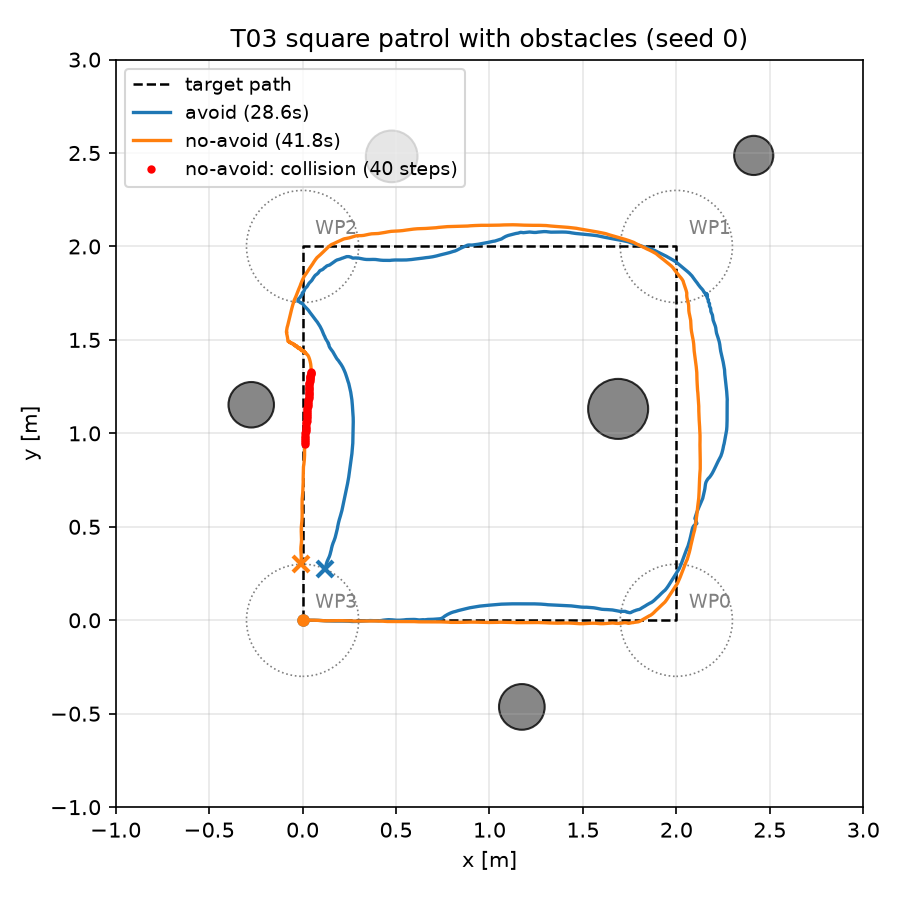
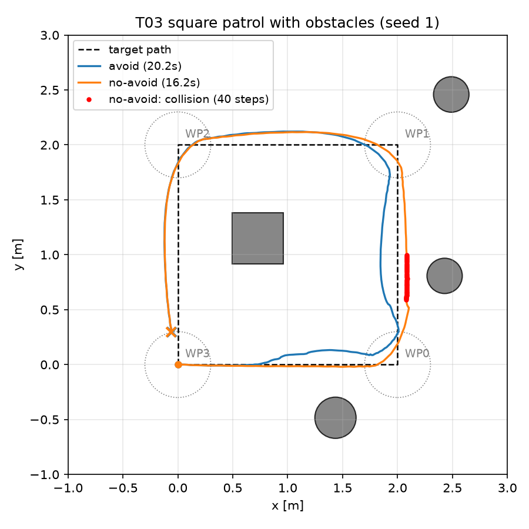
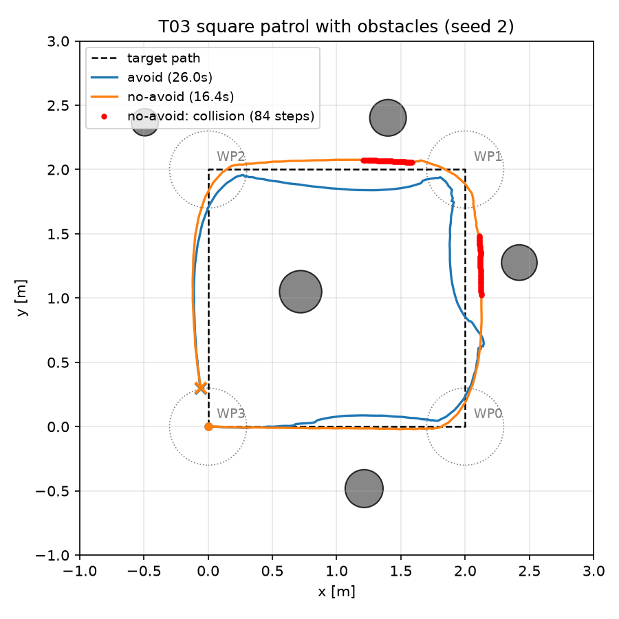

# T03 報告: ランダム障害物シーンと回避則

対象タスク: `tasks/03_obstacle_avoidance.md`。実行日 2026-10-21、環境は CLAUDE.md のとおり(M1 Max / `py311_genesis` / genesis-world 1.4.4)。評価・録画はすべて **`--backend cpu`**(T02 申し送り)。

## 結論

受け入れ条件は **すべて満たした**。ただしタスク記載の回避則(正面 3 セクタ + 左右セクタの空き具合で旋回方向を決める)では 3 配置中 2 配置が未到達だったため、正面判定と旋回方向の決め方を変更した(詳細は §4)。タスクの「調整候補」1・2 は使っていない。

| 受け入れ条件 | 判定 | 実測 |
|---|---|---|
| seed 0, 1, 2 で `--avoid` が 4/4・衝突なし・転倒なし(60 s 以内) | ✅ | 4/4 × 3、LiDAR 衝突 0・物理接触 0・転倒 0、28.6 / 20.2 / 26.0 s |
| 歩行中の地面除去の検証(raw と除去後のヒット数の表) | ✅ | §3。障害物なしでは raw ヒット 0 本/802 ステップ。障害物ありでは床ヒット 16〜189 本を除去 |
| 同じ 3 配置で `--no-avoid` が少なくとも 1 配置で衝突または未到達 | ✅ | 3 配置すべてで物理接触あり(LiDAR 衝突判定も 3 配置すべて) |
| `results/t03_traj_seed{N}.png`、本報告(パラメータ最終値、各 seed の表) | ✅ | 下記 |

## 実行したコマンド

```bash
conda activate py311_genesis
# 手順 0: CPU バックエンドでの録画確認
python go2_patrol.py -e go2-patrol --ckpt 299 --waypoints square --backend cpu --out /tmp/t03_cpu_check.mp4
# 手順 1: シーン生成(go2_patrol.py からも自動で生成・保存される)
python eval/scenes.py --seed 0 1 2
# 手順 4, 5: seed 0,1,2 × 回避あり / なし
for sd in 0 1 2; do
  python go2_patrol.py -e go2-patrol --ckpt 299 --backend cpu --waypoints square --laps 1 --seed $sd --avoid    --out videos/t03_seed$sd.mp4
  python go2_patrol.py -e go2-patrol --ckpt 299 --backend cpu --waypoints square --laps 1 --seed $sd --no-avoid --out <scratch>/t03_seed${sd}_noavoid.mp4
done
# 地面除去の検証(障害物なし)
python go2_patrol.py -e go2-patrol --ckpt 299 --backend cpu --waypoints square --laps 1 --seed -1 --avoid --out <scratch>/t03_noobs.mp4
# 軌跡図
python eval/plot_traj.py --log videos/t03_seed0_log.csv <scratch>/t03_seed0_noavoid_log.csv --label avoid no-avoid \
    --scene results/scenes/seed_00.json --out results/t03_traj_seed0.png   # seed 1, 2 も同様
```

## 0. CPU バックエンドでの録画確認(手順 0)

障害物なしの正方形巡回(T01 と同条件)を `--backend cpu` で実行: **4/4 到達、15.9 s、wall 7.4 s**(797 steps、描画込み 108 steps/s)。mp4 は 1280×720 / 50 fps / 797 frames で正常。Metal での同じ実行(T01)は wall 17.5 s だったので描画込みでも約 2.4 倍速い。軌跡も T01 と同一(到達時刻 3.4 / 7.6 / 11.8 / 15.9 s)。以降の実行はすべて CPU。

## 1. シーン(`results/scenes/seed_NN.json`)

| seed | 目標個数 | 配置できた個数 | 内訳 |
|---|---|---|---|
| 0 | 6 | 5 | cylinder × 5 |
| 1 | 4 | 4 | box × 1、cylinder × 3 |
| 2 | 6 | 5 | cylinder × 5 |

制約(ウェイポイント表面クリアランス 0.5 m、初期位置から 1.0 m、障害物間の表面間隔 1.2 m)を棄却サンプリング(最大 5000 回)で満たす。3 m 角の領域に間隔 1.2 m で 6 個は入りきらず 5 個になった(seed 0, 2)。経路の **辺のすぐ脇**(横 0.27〜0.5 m)に障害物が来る配置が各 seed に含まれており、T01 の軌跡(角で 0.1〜0.15 m 外側に膨らむ)がそのまま通ると接触する。

## 2. 結果(`results/t03_metrics.csv`)

| seed | 障害物 | 回避 | 到達 | 終了理由 | 所要 [s] | LiDAR 衝突 (< 0.25 m) ステップ | 初回 [s] | 物理接触ステップ | 初回 [s] | wall [s] |
|---|---|---|---|---|---|---|---|---|---|---|
| 0 | 5 | **あり** | **4/4** | completed | 28.6 | 0 | — | 0 | — | 14.3 |
| 0 | 5 | なし | 4/4 | completed | 41.8 | 40 | 39.6 | 1272 | 13.5 | 19.6 |
| 1 | 4 | **あり** | **4/4** | completed | 20.2 | 0 | — | 0 | — | 10.8 |
| 1 | 4 | なし | 4/4 | completed | 16.3 | 40 | 5.6 | 9 | 5.3 | 8.8 |
| 2 | 5 | **あり** | **4/4** | completed | 26.0 | 0 | — | 0 | — | 13.1 |
| 2 | 5 | なし | 4/4 | completed | 16.4 | 84 | 6.1 | 9 | 6.2 | 8.7 |
| −1 | 0 | あり | 4/4 | completed | 16.1 | 0 | — | 0 | — | 8.4 |

- 「物理接触」は `robot.get_contacts(with_entity=障害物)` で robot と障害物の接触が 1 つでもあるステップ。タスク定義の LiDAR 衝突判定(地面除去後の最小距離 < 0.25 m)の検証用に追加した
- 回避ありの 3 配置はいずれも LiDAR 最小距離 0.40 m 以上を保った(d_stop = 0.45 の直下まで寄ってその場旋回する場面がある)
- 回避なしは 3 配置とも 4/4 だが、すべて障害物に接触している。seed 0 は x = 0 の辺のすぐ脇の円柱(中心 x = −0.27、半径 0.2)に 25 s 押し付けられたまま進み(接触 1272 ステップ)、所要 41.8 s。seed 1, 2 は x = 2 の辺で円柱を擦った(接触 9 ステップ)
- **LiDAR 衝突判定の限界(実測)**: seed 0 回避なしでは物理接触が 13.5 s に始まるのに LiDAR 判定は 39.6 s まで出ない。正面から押し付けている間の LiDAR 距離は 0.31 m 前後(胴体の前端が障害物に当たっていてもセンサ中心からは 0.3 m 以上ある)で、閾値 0.25 m を下回らないため。横から擦る場合(seed 1, 2)は検出できる。**T04 の衝突率は物理接触ベースを推奨**(申し送り)





(赤点は回避なしの LiDAR 衝突判定ステップ。灰色が障害物、破線が目標経路)

## 3. 歩行中の地面除去の検証

`read_scan` は raw 距離のうち「ヒット点の world z < 0.05 m」のレイを max_range に置換する。各実行で raw ヒット(max_range 未満)と除去後に残ったヒットを集計した(LiDAR は着地後の 5 ステップ目から使用)。

| 実行 | LiDAR ステップ数 | raw ヒットが出たステップ | raw ヒット総数 | 除去後に残ったヒット | 除去した床ヒット | 床ヒットが出たステップ |
|---|---|---|---|---|---|---|
| **障害物なし(seed −1)** | 802 | **0** | **0** | **0** | 0 | 0 |
| seed 0 回避あり | 1426 | 1426 | 16240 | 16051 | 189 | 31 |
| seed 1 回避あり | 1004 | 1004 | 14216 | 14108 | 108 | 22 |
| seed 2 回避あり | 1296 | 1296 | 15752 | 15591 | 161 | 27 |
| seed 0 回避なし | 2085 | 2085 | 27578 | 27552 | 26 | — |
| seed 1 回避なし | 808 | 808 | 11299 | 11283 | 16 | — |
| seed 2 回避なし | 817 | 817 | 10110 | 10070 | 40 | — |

- **障害物なしの巡回(前進 0.6 m/s + 角での旋回)では、歩行中の胴体ピッチで床に当たるレイは 1 本も出なかった**(802 ステップ)。センサ高さ約 0.44 m・max_range 5 m では、水平レイが床に当たるにはピッチ 5° 以上が必要で、通常歩行ではそこまで前傾しないと考えられる(推測。ピッチは未記録)
- 障害物ありでは、除去後に残ったヒットはすべて障害物によるもの(障害物の高さ 0.6〜0.7 m に対して水平レイのヒット点は z ≈ 0.44 m なので z < 0.05 には該当しない)。回避ありの実行では減速・その場旋回(vx = 0 のステップが 88〜284)の際に 108〜189 本の床ヒットが出て除去された。その場旋回では歩容が変わり前傾が大きくなると考えられる(推測)。回避なしでも 16〜40 本出ており、接触して押し付けている間の姿勢変化によるものと思われる
- 「除去後に残る床ヒット」は定義上 0(z < 0.05 のヒットはすべて除去される)。raw に出た床ヒットが障害物として回避則に入らなかったことは、障害物なし巡回が T01 と同じ軌跡・所要時間(16.1 s)で完走したことからも確認できる
- 参考: T02 では min_range = 0.3 で障害物なし巡回の 1 ステップに 8 本の raw ヒットが出たが、本タスクでは min_range を 0 に変えた(§4)ため同一条件ではない

## 4. 回避則(`nav/avoid.py`)の最終仕様とパラメータ

### 最終値

| パラメータ | 値 | 意味 |
|---|---|---|
| `front_mode` | corridor | 正面判定の方式(下記) |
| `w_half` | 0.4 m | 進路の半幅。|d·sinφ| < w_half かつ d·cosφ > 0 のヒットだけを「正面」とみなす |
| `d_slow` | 1.0 m | これ未満で減速開始 |
| `d_stop` | 0.45 m | これ未満で vx = 0、その場旋回 |
| `k_avoid` | 0.8 rad/s | 回避の旋回ゲイン。ωz += side · k_avoid · (1 − d_front/d_slow) |
| `rate_limit` | 0.1 rad/s/step | ωz の変化率制限 |
| `side_margin` | 0.3 m | 回避側のセクタが d_stop + side_margin 未満なら反対側を検討 |
| `side_hysteresis` | 0.2 m | 反対側がこれ以上空いているときだけ反対側へ |
| `lat_deadband` | 0.05 m | 正面ヒットの横位置がこれ未満なら前回の旋回方向を保持 |
| 左右セクタ | 左 (2,3,4) = 45°〜135°、右 (8,9,10) = −135°〜−45° | `sector_min(12)` の添字 |
| クリップ | vx [0, 0.8]、ωz [−0.8, 0.8] | 学習時の指令範囲 |

減速(d_front < d_slow で vx × (d_front − d_stop)/(d_slow − d_stop))、停止(d_front < d_stop で vx = 0・その場旋回)、変化率制限、クリップはタスク記載どおり。

### タスク記載の規則からの変更点(理由と経緯)

**v1(タスク記載どおり)**: 正面 3 セクタ(±45°)の最小距離を d_front、左 3 セクタと右 3 セクタの最小距離の大きい方を旋回方向とした。結果: seed 0 **2/4**(timeout)、seed 1 4/4(59.8 s)、seed 2 **2/4**(timeout)。衝突はなし。

ログを調べると、seed 0 では最初の円柱(経路の右脇 0.46 m、半径 0.15)に対して **右(障害物側)へ旋回**していた。原因は旋回方向の決め方: 正面右 31° の障害物は「正面セクタ」に入るため左右セクタには現れず、たまたま左 90° の遠く(2.5 m)にあった別の円柱のせいで「左の方が詰まっている → 右へ」と判定した。つまり左右の空き具合だけでは「正面の障害物がどちら側にあるか」が考慮されない。加えて ±45° の円錐は経路脇(横 0.3〜0.5 m)の通過に支障のない障害物にも反応し、減速・停止を繰り返した。

**v2(調整 1 回目)**: (a) 正面判定を「進路幅 ±w_half の回廊内にあるヒットの進行方向距離」に変更(経路脇の障害物に反応しない)、(b) 旋回方向を「最も近い正面ヒットの横位置の反対側」に変更し、その側が塞がっている場合だけ左右セクタの空き具合で反対側へ。結果: seed 0 4/4(22.8 s)、seed 1 4/4(20.1 s)、seed 2 **2/4**(timeout)。

seed 2 のログ(`follow_yaw`, `d_front`, `hit_lat`, `avoid_side` 列を追加して再現)から、旋回方向を最初の判定で固定していたことが原因と判明: WP0 の角を曲がる途中で障害物が「左 0.08 m」に見えた瞬間に「右へ」と決め、旋回が進んで障害物が右 0.18 m に移った後もその側を保持したため、回避項(右へ)と経路追従(左へ)が打ち消し合って vx → 0 で停止した。**v2 の修正**: 旋回方向を毎ステップ現在の正面ヒットから決め直す(ほぼ正面 |lat| < 0.05 のときだけ前回を保持)。結果: 3 配置とも 4/4(上表)。

調整候補 1(d_slow 1.5、k_avoid 増)は、診断した原因(円錐が広すぎる・旋回方向の誤り)に対して逆効果と判断し未実施。候補 2(reach_dist 0.4、2.5 m 角)も未実施。回避則の規則変更は候補にない変更であり、タスクの「調整は最大 2 つ」の 1 つ目として扱った(v2 とそのバグ修正を合わせて 1 つと数えている)。

## 変更したファイルと理由

| ファイル | 変更 |
|---|---|
| `eval/scenes.py` | **新規**。`make_obstacle_spec(seed, ...)`(genesis 不要、JSON 保存用の dict)、`make_obstacles(seed, ...)`(morph のリスト、`gs.init()` 後)、`save_scene` / `load_scene`、CLI |
| `nav/avoid.py` | **新規**。`ObstacleAvoider`(§4)。`front_mode="sectors"` でタスク記載の v1 の正面判定も選べる |
| `nav/lidar.py` | `read_scan(..., return_raw=True)` で raw 距離も返す。`DEFAULT_LIDAR_CFG` の `min_range` を 0.3 → **0.0**(衝突判定 0.25 m は min_range 0.3 未満のヒットを捨てると検出不能なため) |
| `go2_patrol.py` | `--seed`, `--avoid/--no-avoid`, `--camera {follow,overhead}`(障害物ありは俯瞰 pos=(1,−4,4), lookat=(1,1,0) が既定)、回避則のパラメータ引数、LiDAR を着地後 5 ステップから読み、衝突(LiDAR < 0.25 m)と物理接触を記録。ログ CSV に `min_dist, collision, raw_hits, hits, contact, follow_vx, follow_yaw, d_front, hit_lat, avoid_side` 列を追加。`--summary-csv`(既定 `results/t03_metrics.csv`)に要約行を追記 |
| `eval/plot_traj.py` | `--scene` で障害物を描画、`collision` 列があれば赤点で表示 |
| `CLAUDE.md`, `tasks/03_obstacle_avoidance.md` | T02 後の更新(作業者による編集)を本コミットに含めた |

`go2_env.py` は変更なし(`max_collision_pairs=20` のまま。障害物 5 個で例外は出なかった)。

## 仮定したこと

- 障害物のクリアランス「ウェイポイントから 0.5 m」「初期位置から 1.0 m」「障害物同士 1.2 m」はいずれも **表面間**の距離とした(中心間距離 − 半径)。Box は外接円半径で近似
- 「左右の空き」の左 3 セクタ / 右 3 セクタは 45°〜135° / −135°〜−45° とした(正面 3 セクタ ±45° の隣)
- k_avoid の既定値はタスクに数値がないため 0.8(= ωz の上限)とした
- 回避なしの動画と障害物なしの動画は提出物ではないので scratch に出力し、コミットしていない(ログ CSV は要約を `results/t03_metrics.csv` に転記)
- 衝突判定はタスク定義(LiDAR < 0.25 m)を主、物理接触を検証用として両方記録した
- 60 s 以内の判定は `--max-time 60`(既定)で、`episode_length_s` は 65 s に上書きされる

## うまくいかなかったこと

- タスク記載どおりの回避則(v1)では 3 配置中 2 配置が未到達(§4)。規則を変更して解決したが、変更内容は候補になかったものなので判断を仰ぎたい
- 回避ありの所要時間は障害物なし(16.1 s)より 4〜12 s 長い。d_stop 直下までの接近 → その場旋回 → 再加速の繰り返しが原因で、`vx = 0` のステップが 88〜284 ある。経路効率の指標には不利に出る
- LiDAR 衝突判定 0.25 m は正面接触を検出できない(§2)

## 次タスクへの申し送り

1. **衝突率は物理接触(`contact_steps > 0`)で定義することを推奨**。LiDAR < 0.25 m は横擦りしか検出できない。両方記録しているので、T04 では両方の列を集計し、設計書 §4 の定義(LiDAR)との違いを明記する
2. `results/t03_metrics.csv` の列構成(`exp_name, ckpt, backend, waypoints, seed, n_obstacles, avoid, reached, n_waypoints, end_reason, sim_s, wall_s, collision_steps, first_collision_s, contact_steps, first_contact_s, raw_hit_steps, raw_hits, hits_after, out`)は T04 の `eval/run_eval.py` でそのまま使える。`--summary-csv` で出力先を変えられる
3. 既定方策(go2-walking)は旋回できず WP0 までしか行けないので、T04 の 2×2 比較では「既定方策 × 回避あり」も含めて回避則が vx を落としても歩容が変わらない(前進し続ける)ことを前提に集計する
4. 1 配置の実行は CPU で 9〜20 s(描画込み)。20 配置 × 4 条件 = 80 本で 20〜30 分の見込み。録画なしなら `camera_cfg=None` にできるが現状の `go2_patrol.py` は常に録画するので、T04 では `--no-video` のような引数を足すと速い
5. 障害物 6 個は 3 m 角・間隔 1.2 m では入らないことが多い(5 個になる)。n_max を 6 のままにして実際の個数を `n_placed` で記録する
6. 回避ありの軌跡は角で内側に入る(w_half 0.4 の回廊が辺脇の障害物を避けるため)。経路効率(走行距離 / 直線距離)は 7.4〜7.7 m / 8.0 m で、障害物なし(7.5 m)と大差ない
