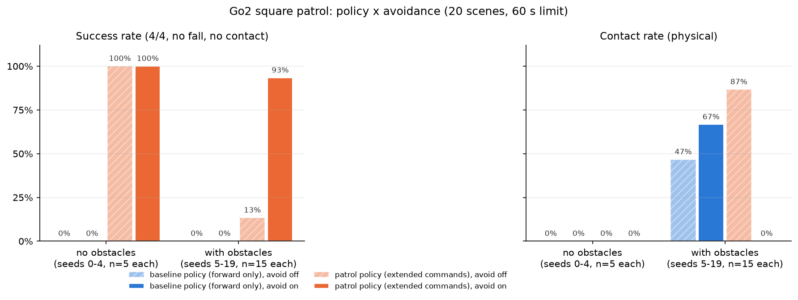

# T04 報告: 定量評価(20 配置 × 4 条件)

対象タスク: `tasks/04_evaluation.md`。実行日 2026-10-21、環境は CLAUDE.md のとおり(M1 Max / `py311_genesis` / genesis-world 1.4.4)。評価はすべて `--backend cpu`、録画なし。

## 結論

- **80 エピソード(欠損なし)を 12 分 33 秒で完走**(条件 30 分以内)
- **回避の効果**: 障害物ありで拡張方策の成功率が **13% → 93%**、接触率が **87% → 0%**。障害物なしでは回避の有無で結果が変わらない(どちらも 100%、所要 15.9 s vs 16.1 s)
- **方策拡張の効果**: 既定方策(前進のみ)は障害物の有無・回避の有無に関わらず **成功 0%**(WP0 に到達後に旋回できず直進、または最初の辺の障害物に押し付け)。拡張方策は障害物なしで 100%
- **交互作用あり**: 回避則は拡張方策と組み合わせたときだけ効く。既定方策に回避則を付けても成功率は 0% のままで、接触率はむしろ **47% → 67%** に上がった(回避則の旋回指令に方策が中途半端に追従し、停止指令には従わず前進し続けるため、経路脇の障害物に寄っていく)
- 転倒は 80 エピソード中 **0 件**
- 期待された傾向(回避ありで接触率が下がる、拡張方策で成功率が上がる)は拡張方策について明確に出た。既定方策に対しては回避則が逆効果だった点を含めてそのまま報告する

| 受け入れ条件 | 判定 | 実測 |
|---|---|---|
| 80 エピソードの `episodes.csv`(欠損なし) | ✅ | 80 行、主要列に欠損なし(`time_to_complete` は失敗分が空欄、`first_contact_s` は接触なしが空欄。仕様どおり) |
| `summary.csv` / `summary.png` | ✅ | `results/eval/` |
| 2×2 の表、解釈、失敗の型と件数 | ✅ | §2〜§4 |
| 期待と異なる結果もそのまま報告 | ✅ | 既定方策 × 回避ありで接触率が上がった(§3) |
| 80 本で 30 分以内 | ✅ | 745 s(12.4 分)。1 本あたり 5.4〜20.2 s |

## 実行したコマンド

```bash
conda activate py311_genesis
pip install pandas            # requirements.txt に記載があるが環境に未導入だった(summarize.py 用)
time python eval/run_eval.py --policies go2-walking:100,go2-patrol:299 --avoid both --seeds 0-19 --backend cpu
python eval/summarize.py      # -> results/eval/summary.csv, summary.md, summary.png
# 代表例の録画(手順 3)
python go2_patrol.py -e go2-patrol --ckpt 299 --backend cpu --seed 12 --avoid --out videos/t04_fail_seed12.mp4 --summary-csv ""
python go2_patrol.py -e go2-patrol --ckpt 299 --backend cpu --seed 16 --avoid --out videos/t04_fail_seed16_slowest.mp4 --summary-csv ""
python go2_patrol.py -e go2-patrol --ckpt 299 --backend cpu --seed 10 --avoid --out videos/t04_success_seed10.mp4 --summary-csv ""
python eval/plot_traj.py --log videos/t04_fail_seed12_log.csv --label "go2-patrol avoid" --scene results/scenes/seed_12.json --out results/eval/t04_traj_seed12.png   # 16, 10 も同様
```

## 1. 評価の定義(設計書 §4 からの変更点を含む)

| 指標 | 本評価での定義 | 設計書 §4 との違い |
|---|---|---|
| 成功 | 60 s 以内に 4/4 到達 **かつ** 転倒なし **かつ** 物理接触なし | 「物理接触なし」を追加(T03 申し送り) |
| 衝突(接触率) | `robot.get_contacts(with_entity=障害物)` が 1 ステップでもある | 設計書は LiDAR 最小距離 < 0.25 m。T03 で正面押し付けを検出できないと判明したため物理接触に変更 |
| ニアミス率 | 地面除去後の LiDAR 最小距離 < 0.25 m が 1 ステップでもある | 設計書の衝突定義を副指標として併記 |
| 所要時間 | 成功エピソードの平均シミュレーション秒数 | 同じ |
| 経路効率 | 直線距離合計 8.0 m / 走行距離(成功分の平均) | 設計書は逆数(走行距離 / 直線距離)。タスク指示に従い 8.0 / 走行距離 |
| シーン | seed 0〜4 障害物なし、5〜19 障害物あり(`eval/scenes.py`、置けた個数 3〜5) | 同じ |

方策: `go2-walking`(既定例題、ckpt 100、前進 0.5 m/s のみ)と `go2-patrol`(T01、ckpt 299、指令範囲拡張)。回避則は T03 の最終パラメータ(corridor、w_half 0.4、d_slow 1.0、d_stop 0.45、k_avoid 0.8、rate_limit 0.1)。

## 2. 結果(`results/eval/summary.csv`)

| 障害物 | 方策 | 回避 | n | 成功率 | 接触率 | ニアミス率 | 転倒率 | 平均到達 | 所要 [s](成功分) | 経路効率(成功分) |
|---|---|---|---|---|---|---|---|---|---|---|
| なし | go2-walking | なし | 5 | 0% | 0% | 0% | 0% | 1.00 | — | — |
| なし | go2-walking | あり | 5 | 0% | 0% | 0% | 0% | 1.00 | — | — |
| なし | go2-patrol | なし | 5 | **100%** | 0% | 0% | 0% | 4.00 | 15.9 | 1.07 |
| なし | go2-patrol | あり | 5 | **100%** | 0% | 0% | 0% | 4.00 | 16.1 | 1.06 |
| あり | go2-walking | なし | 15 | 0% | 47% | 47% | 0% | 0.67 | — | — |
| あり | go2-walking | あり | 15 | 0% | **67%** | 47% | 0% | 0.67 | — | — |
| あり | go2-patrol | なし | 15 | 13% | **87%** | 87% | 0% | 2.60 | 16.0 | 1.07 |
| あり | go2-patrol | あり | 15 | **93%** | **0%** | 0% | 0% | 3.87 | 33.6 | 0.99 |



2×2(障害物ありの 15 配置)に絞ると:

| 成功率 | 回避なし | 回避あり |
|---|---|---|
| 既定方策 | 0% (0/15) | 0% (0/15) |
| 拡張方策 | 13% (2/15) | **93% (14/15)** |

| 接触率 | 回避なし | 回避あり |
|---|---|---|
| 既定方策 | 47% (7/15) | 67% (10/15) |
| 拡張方策 | 87% (13/15) | **0% (0/15)** |

- 経路効率が 1 を超えるのは、到達判定 0.3 m で角を手前で曲がるため走行距離が直線距離 8.0 m より短くなるから(障害物なしで 7.5 m)。回避ありの成功分は 0.99(平均走行距離 8.1 m)で、迂回による増加は平均 0.6 m と小さい
- 回避ありの所要時間は 33.6 s(20.3〜50.4 s)で障害物なしの 2 倍。内訳は §4 の「振動」で失う時間が大半
- 拡張方策 × 回避なしの「ニアミス率 = 接触率 = 87%」は一致しているが、個々のエピソードでは seed 10・14 が接触なし・ニアミスあり、seed 11・17 が接触あり・ニアミスなし(正面押し付けで LiDAR 距離 0.3 m 前後)と食い違う。T03 で指摘した LiDAR 判定の限界が再現した

## 3. 解釈

**回避の効果(拡張方策)**: 障害物ありの 15 配置で、回避なしは 13 配置で障害物に接触し(うち 8 配置は押し付けられたまま 60 s タイムアウト、5 配置は擦りながら通過)、回避ありは 15 配置すべてで接触ゼロ、14 配置で 1 周完走した。失敗した 1 配置(seed 12)も接触・転倒はなく、時間切れ(§4)。障害物なしでは回避則が介入せず(d_front < 1.0 m になるステップが 0)、所要時間差 0.2 s は回避則の初期化による差ではなく、LiDAR 読み出しを含む経路の微小な違いと考えられる(推測)。

**方策拡張の効果**: 既定方策は 40 エピソードすべてで失敗。障害物なしでも WP0(2,0)に 3.3 s で到達した後、旋回指令に追従できず直進して時間切れ(平均到達 1.00)。障害物ありでは最初の辺に障害物がある 4 配置(seed 8, 11, 12, 17)で WP0 にも到達せず押し付けに(到達 0)。つまり **巡回には方策の指令範囲拡張が必須**で、これは T01 の 1 配置での比較が 20 配置でも成り立つことを示す。

**交互作用**: 回避則の効果は方策に依存する。既定方策に回避則を付けると接触率が 47% → 67% に **上がった**(seed 6, 7, 9, 16, 19 で新たに接触)。既定方策は vx = 0 の停止指令に従わず約 0.3 m/s で前進し続ける一方、ωz 指令にはわずかに追従する(T01: 20 s で 40°)。回避則が「減速して横へ逃げる」つもりで出す旋回指令が、減速なしの緩い旋回になり、経路脇の障害物へ寄って行く。回避則は「指令どおりに減速・旋回できる歩行方策」を前提にしており、その前提が崩れると安全側に働かない、という結果。

## 4. 失敗の型と件数

80 エピソードの内訳(成功 24、失敗 56):

| 型 | 条件 | 件数 | 説明 |
|---|---|---|---|
| A. 旋回不能(直進して時間切れ) | 既定方策 × 障害物なし | 10 | WP0 到達後に旋回できず x = 6.7 m まで直進。接触なし |
| A. 旋回不能(直進して時間切れ) | 既定方策 × 障害物あり、最初の辺に障害物なし | 22 | 同上。うち 12 件は直進中に経路脇の障害物に接触(回避なし 3、回避あり 6、残りは擦る程度) |
| B. 押し付け(接触したまま時間切れ) | 既定方策 × 最初の辺に障害物 | 8 | seed 8, 11, 12, 17 × 回避あり/なし。到達 0/4、接触 2500〜2900 ステップ |
| B. 押し付け(接触したまま時間切れ) | 拡張方策 × 回避なし | 8 | seed 5, 7, 11, 12, 15, 16, 17, 19。経路上の障害物に正面から当たり、追従則が前進し続ける |
| C. 接触して通過(4/4 だが接触あり) | 拡張方策 × 回避なし | 5 | seed 6, 8, 9, 13, 18。辺の脇の障害物を擦りながら通過(接触 2〜1238 ステップ) |
| D. 振動(停止・その場旋回の繰り返しで時間切れ) | **拡張方策 × 回避あり** | **1** | seed 12。接触・転倒なし、2/4 |
| 転倒 | — | 0 | — |

既定方策の A/B の件数は到達数で分類した(到達 1 = A、到達 0 = B)。

### D. 振動型の詳細(seed 12、`videos/t04_fail_seed12.mp4`、`results/eval/t04_traj_seed12.png`)

seed 12 は 5 個の障害物のうち 3 個が経路の真上にある(y = 0 の辺に円柱、x = 2 の辺に Box、y = 2 の辺に円柱)。ログ(`d_front`, `hit_lat`, `avoid_side` 列)から:

1. WP0 → WP1 の途中(2.05, 0.30)、進行方向 75° で Box(中心 (2.31, 0.94))が正面(横位置 0.00〜0.05 m)に入り、d_front が 0.47 m → d_stop(0.45)を割って **停止モード**(vx = 0、右へその場旋回)
2. 旋回して回廊から Box が外れると **free** になり、回避側がリセットされ、経路追従が WP1 の方へ左旋回で戻す → Box が再び回廊に入り停止モード → 右旋回 … を繰り返す。1 周期で x 方向に 5〜10 cm ずつ進み、約 25 s かけて Box の右(x = 2.95)を回り込んだ
3. WP1(46.4 s)のあと y = 2 の辺の円柱(0.93, 1.90)でも同じ振動が起き、60 s で WP2 の手前 0.32 m(到達判定 0.3 m)で時間切れ

同じ型は成功エピソードにも現れていて、最遅の seed 16(50.4 s、録画の再実行では 53.1 s)は x = 2 の辺の Box の前で約 25 s を失っている(`videos/t04_fail_seed16_slowest.mp4`)。回避ありの所要時間が 33.6 s と長い主因。

原因は回避則の状態遷移にある: 停止モードで旋回して回廊が空いた瞬間に free へ戻り、経路追従がすぐに元の方位へ戻すため、障害物の脇を抜けるだけの横変位を得る前に再び正面に入る。対策案(未実装、T03 の「調整は最大 2 つ」の範囲外なので提案のみ): (1) 回廊が空いた後も一定時間(例 1 s)または横変位が w_half + 余裕に達するまで回避側を保持して前進する「コミット」区間を入れる、(2) 停止モードの旋回を「回廊が空く」ではなく「空いた側の横位置が w_half を超える」まで続ける。

成功例の録画: `videos/t04_success_seed10.mp4`(5 個の障害物、22.0 s、接触なし。`results/eval/t04_traj_seed10.png`)。

## 5. 所要時間と再現性

- 80 エピソード 745 s(12.4 分)。1 プロセス内で `gs.init()` を 1 回行い、エピソードごとに `Go2Env` を作り直した(障害物は `scene.build()` 前にしか追加できないため)。シーン構築込みで 60 s タイムアウトのエピソードが 10〜21 s、成功エピソードが 5〜14 s。メモリ増加による問題は出なかった
- `episodes.csv` は 1 エピソードごとに追記し、(policy, avoid, seed) が済みならスキップするので中断しても再開できる
- **再現性**: 録画ありで再実行した seed 12 は評価時と同じ結果(2/4、timeout、接触なし)、seed 16 は 50.4 s → 53.1 s と所要時間が 2.7 s ずれた(到達数・接触なしは同じ)。カメラの有無で物理は変わらないはずなので、CPU バックエンドの並列実行による浮動小数の非決定性と考えられる(推測)。評価の結論(成功/接触)には影響していない

## 変更したファイルと理由

| ファイル | 変更 |
|---|---|
| `go2_patrol.py` | 本体を `run_patrol(exp_name, ckpt, seed, avoid, ..., out=None)` 関数に分離(戻り値は計測値の dict)。`out=None` で `camera_cfg=None`(録画なし)。CLI に `--no-video` を追加。`LOG_HEADER` / `SUMMARY_HEADER` を定数化。動作・出力形式は T03 と同じ |
| `eval/run_eval.py` | **新規**。`--policies`, `--avoid both/on/off`, `--seeds 0-19`, `--max-time`, `--backend`, `--out`。seed 0〜4 は障害物なし。1 エピソードごとに追記・再開可能 |
| `eval/summarize.py` | **新規**。`episodes.csv` → `summary.csv` / `summary.md` / `summary.png`(成功率・接触率の 2 面、方策で色、回避でハッチ) |
| `tasks/04_evaluation.md` | T03 後の更新(作業者による編集)を本コミットに含めた |

## 仮定したこと

- 成功の定義に `end_reason == completed` を含めた(4/4 到達と同値)
- 経路効率はタスク指示どおり 8.0 m / 走行距離(1 を超えうる)。設計書の定義(逆数)とは逆なので報告の表に注記した
- 「失敗エピソードの代表 2 つ」は、拡張方策 × 回避ありの失敗が seed 12 の 1 件だけだったので、2 つ目はタスクの指示どおり最も所要時間が長かった成功例 seed 16 を録画した(ファイル名は `t04_fail_seed16_slowest.mp4` として失敗ではないことが分かるようにした)
- 成功例の録画は 5 個の障害物があり所要が短い seed 10 を選んだ
- `pandas` が環境に無かったため `pip install pandas`(3.0.6)を実行した。requirements.txt に元々記載があり、固定版のパッケージ(genesis / torch / rsl-rl)は変えていない
- 既定方策の失敗の型は到達数で分類(到達 1 = 旋回不能、到達 0 = 押し付け)。動画での確認は seed 12・16・10 のみ

## うまくいかなかったこと

- 拡張方策 × 回避ありの seed 12 が時間切れ(振動型)。接触はないので「安全だが遅い」失敗。対策案は §4
- 既定方策に回避則を付けると接触率が上がる(§3)。方策が指令に従えない場合に回避則が逆効果になる例として報告する
- LiDAR ベースの衝突判定(ニアミス)と物理接触は 4 エピソードで食い違う(§2)。設計書 §4 の定義のままでは正面押し付けを見逃す

## 次(最終成果物: 動画・レポート)への申し送り

1. 動画素材: `videos/t04_success_seed10.mp4`(障害物あり成功、俯瞰)、`videos/t04_fail_seed12.mp4`(振動型の失敗)、T03 の `videos/t03_seed{0,1,2}.mp4`、T01 の `videos/t01_script.mp4` / `t01_square.mp4`。回避の瞬間のスロー再生は seed 10 の 4〜8 s(最初の円柱)が分かりやすい
2. 図: `results/eval/summary.png`(2×2)、`results/eval/t04_traj_seed12.png`(失敗例)、`results/t03_traj_seed*.png`、`results/t02_scan.png`(LiDAR)、`results/t01_square_traj_compare.png`(方策比較)。学習曲線は `logs/go2-patrol` の TensorBoard から
3. レポートの数値はすべて `results/eval/episodes.csv` / `summary.csv` から引けるようにしてある。表は `results/eval/summary.md` をそのまま貼れる
4. 既定方策 × 回避ありで接触が増えた件は「回避則は歩行方策が指令に従うことを前提にしている」という sim2real の論点(実機でも速度追従の遅れがあると同じことが起きる)として使える
5. 振動型の対策(回避側のコミット区間)は未実装。実装するなら `nav/avoid.py` の free 遷移にタイマーを足すだけだが、T03 の 3 配置と T04 の 20 配置で再評価が必要
