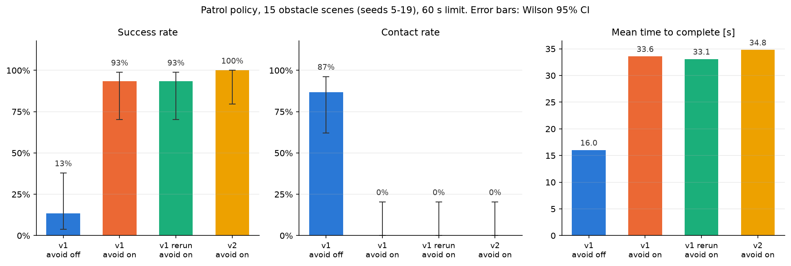
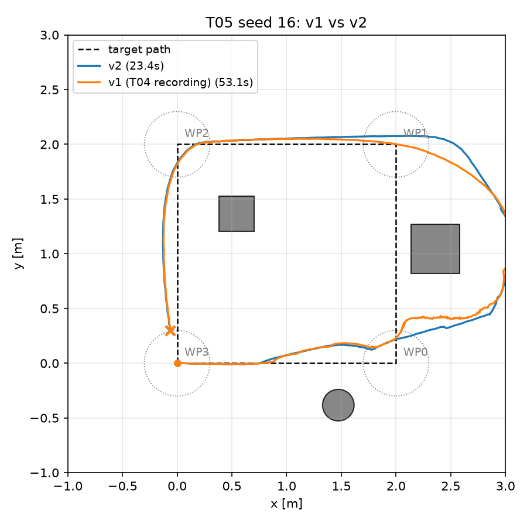
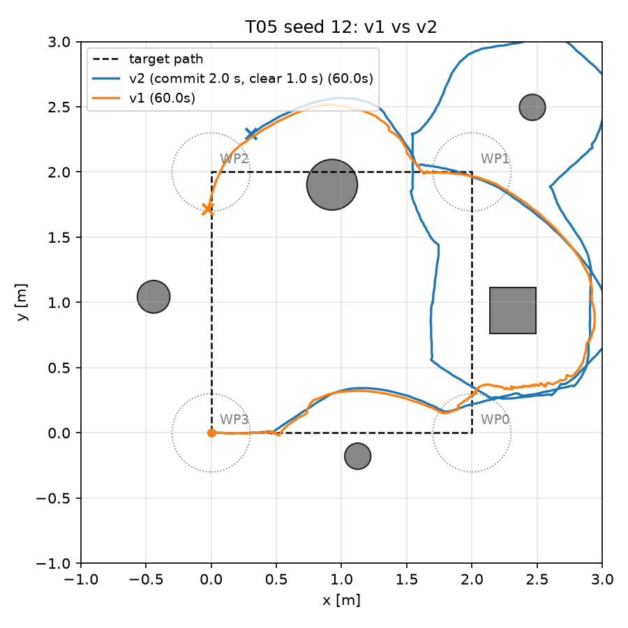

# T05 報告: 回避則 v2(振動対策)と再評価、統計検定、再現性

対象タスク: `tasks/05_avoid_v2.md`(手順 4b「再現性の計測」つき)。実行日 2026-10-21、環境は CLAUDE.md のとおり(M1 Max / `py311_genesis` / genesis-world 1.4.4)。評価はすべて `--backend cpu --no-video`。T04 の `results/eval/` は触らず、v2 は `results/eval_v2/`、v1 の再実行は `results/eval_v1_rerun/` に出した。

## 結論

- **v2(コミット区間つき回避則)は、障害物あり 15 配置で成功 15/15・接触 0・転倒 0**(v1 は 14/15)。ただし改善は seed 12 の 1 配置だけで、**McNemar 正確検定 p = 1.0、統計的な差は示せない**(Wilson 95% CI: v1 70–99%、v2 80–100%)
- **成功分の平均所要時間は v1 33.6 s → v2 34.8 s で短くならなかった**(受け入れ条件 3 は未達)。seed ごとに見ると v2 が 0.5 s 以上速い配置 7、遅い配置 7 で、振動が減って大幅に速くなる配置(seed 16: 50.4 → 23.0 s、seed 15: 42.3 → 29.9 s)と、コミットの旋回・直進で遠回りして遅くなる配置(seed 13: 24.9 → 47.7 s、seed 11: 31.5 → 52.9 s)が相殺している。経路効率(8.0 m / 走行距離)も 0.99 → 0.76 に下がった
- **再現性(手順 4b)**: v1 を同じ 20 配置で再実行すると、成功・接触が変わった配置は **0**、所要時間が 1 s 以上変わった配置は 6(最大 4.4 s、中央値 0.7 s)。評価バッチ内の揺れは小さい。一方で **バッチ(1 プロセスで 20 配置を順に実行)と単発実行の間の揺れははるかに大きい**(seed 12 は v1 単発で 3/4、バッチで 2/4、v2 はバッチで 4/4、単発で 1/4・2/4。v1 seed 13 はバッチ 24.9 s・単発 55.3 s)。v1→v2 の差(±20 s の配置がある)はバッチ内の揺れ(≤ 4.4 s)より大きいが、単発実行の揺れとは同程度で、**v2 の効果は「配置によって大きく変わる」以上のことは言えない**
- 調整候補は 2 つとも使った: T_commit 1.5 → 2.0(1.0 は悪化)、T_clear 0.6 → 1.0。最終値 T_commit 2.0 s、T_clear 1.0 s、v_clear 0.4 m/s

| 受け入れ条件 | 判定 | 実測 |
|---|---|---|
| v1 の回帰確認(seed 12 未到達、60 s、接触 0) | ✅ | 3/4、60.0 s、接触 0(T04 時は 2/4。到達数の違いは非決定性、§5) |
| v2 で 20 配置の `episodes.csv`、障害物あり成功率 ≥ v1(14/15)、接触 0、転倒 0 | ✅ | 15/15、接触 0、転倒 0 |
| 成功分の平均所要時間が v1(33.6 s)より短い | ❌ | 34.8 s(両方成功の 14 配置では 33.6 → 34.2 s)。事実として報告 |
| `summary.md` に v1/v2 の表と McNemar / Wilson CI | ✅ | `results/eval_v2/summary.md` |
| 再現性: 変わった配置の数と変わり方の表 | ✅ | §5 |
| 本報告(v2 の規則、seed ごとの比較、検定、悪化した配置の分析) | ✅ | §1〜§6 |

## 実行したコマンド

```bash
conda activate py311_genesis
# 2. 回帰確認(v1)
python go2_patrol.py -e go2-patrol --ckpt 299 --backend cpu --no-video --seed 12 --avoid --avoid-version v1 --summary-csv ""
# 3. v2 単体確認(seed 12, 16)。T_commit 1.5(既定案)→ 1.0 → 2.0 を試した
python go2_patrol.py -e go2-patrol --ckpt 299 --backend cpu --no-video --seed 12 --avoid --avoid-version v2 --t-commit {1.5,1.0,2.0} --summary-csv ""
# 4. 再評価(v2、T_commit 2.0)。T_clear 0.6(既定案)と 1.0(調整 2)
python eval/run_eval.py --policies go2-patrol:299 --avoid on --seeds 0-19 --avoid-version v2 --t-clear 0.6 --backend cpu --out results/eval_v2_tclear0.6/episodes.csv
python eval/run_eval.py --policies go2-patrol:299 --avoid on --seeds 0-19 --avoid-version v2 --t-clear 1.0 --backend cpu --out results/eval_v2/episodes.csv
# 4b. 再現性(v1 の再実行)
python eval/run_eval.py --policies go2-patrol:299 --avoid on --seeds 0-19 --avoid-version v1 --backend cpu --out results/eval_v1_rerun/episodes.csv
# 5. 比較・検定
python eval/summarize.py --compare results/eval/episodes.csv results/eval_v2/episodes.csv --rerun results/eval_v1_rerun/episodes.csv --out-dir results/eval_v2
# 6. 代表動画(俯瞰)
python go2_patrol.py -e go2-patrol --ckpt 299 --backend cpu --seed 12 --avoid --avoid-version v2 --out videos/t05_v2_seed12.mp4 --summary-csv ""
python go2_patrol.py -e go2-patrol --ckpt 299 --backend cpu --seed 16 --avoid --avoid-version v2 --out videos/t05_v2_seed16.mp4 --summary-csv ""
```

## 1. v2 の規則(v1 との差分、`nav/avoid.py` の `ObstacleAvoiderV2`)

v1(`ObstacleAvoider`)はそのまま残し、`make_avoider(version)` で切り替える。`--avoid-version {v1,v2}`(既定 v2)を `go2_patrol.py` と `eval/run_eval.py` に追加。

| 項目 | v1(T03/T04) | v2(本タスク) |
|---|---|---|
| 発動条件 | 回廊(±w_half 0.4 m)内の正面ヒットが d_slow(1.0 m)未満 | 同じ |
| 旋回方向 | 毎ステップ、最近接の正面ヒットの反対側に決め直す | 発動時に v1 と同じ規則で決め、**T_commit(2.0 s)の間は固定**。反対側が空いていても変えない。正面 d_front < d_stop かつ回避側のセクタも d_stop + side_margin 未満(袋小路)のときだけ反転 |
| ωz | 経路追従の ωz + 回避項 | コミット中は **経路追従の ωz を無視**し回避項だけ(stop モードでは ±k_avoid) |
| 正面が空いたとき | 即座に経路追従へ戻る | **T_clear(1.0 s)だけ直進(ωz = 0)**してから戻る。直進中に再び正面に障害物が入れば側を決め直して再コミット |
| vx | 経路追従の vx(目標が真横〜後方だと ≈ 0)に減速則をかける | コミット中・直進中は **max(経路追従の vx, v_clear 0.4 m/s)** に減速則をかける |
| パラメータ | d_slow 1.0, d_stop 0.45, k_avoid 0.8, rate_limit 0.1, w_half 0.4 | 同じ + T_commit 2.0 s, T_clear 1.0 s, v_clear 0.4 m/s |

`v_clear` はタスクの仕様にない追加。最初の実装(タスク記載どおり、vx は経路追従の値)では、直進フェーズで経路追従の vx が ≈ 0(目標が真横〜後方で cos(heading_err) ≤ 0)のため **その場で止まったまま 0.6 s 待つ**だけになり、seed 12 で 1/4(v1 より悪化)、seed 16 で 50.4 s(変わらず)だった。ログで直進中 vx = 0.00 を確認して修正した。「直進」には前進速度が要る、という実装上の解釈。

### 単体確認(seed 12 / 16、`--no-video`)と調整の経緯

| 設定 | seed 12 | seed 16 |
|---|---|---|
| v1 | 3/4, 60 s(T04 は 2/4) | 50.4 s |
| v2 T_commit 1.5, T_clear 0.6, vx = 経路追従(初版) | **1/4**, 60 s | 50.4 s |
| v2 T_commit 1.5, T_clear 0.6, v_clear 0.4 | 3/4, 60 s(WP1 を通り過ぎて迷走) | **24.3 s** |
| v2 T_commit 1.0(調整 1a) | 1/4, 60 s | — |
| v2 T_commit 2.0(調整 1b) | **4/4, 52.2 s** | — |
| v2 T_commit 2.0, T_clear 1.0(調整 2、最終) | バッチ 4/4 43.1 s / 録画時 **2/4** | 23.0 s(バッチ)/ 23.4 s(録画) |

## 2. 20 配置の再評価(`results/eval_v2/`)

既定方策と回避なしは T04(v1)の結果を流用。障害物あり 15 配置(seed 5〜19):

| 回避則 | 成功 | 接触 | 転倒 | 成功分の平均所要 [s] | 経路効率(成功分) |
|---|---|---|---|---|---|
| v1(T04) | 14/15 = 93% (CI 70–99%) | 0/15 | 0 | 33.6 | 0.99 |
| v1 再実行(4b) | 14/15 = 93% | 0/15 | 0 | 33.1 | 0.99 |
| v2 T_clear 0.6(調整前) | 14/15 = 93% | 0/15 | 0 | 36.3 | 0.76 |
| **v2 T_clear 1.0(最終)** | **15/15 = 100%** (CI 80–100%) | 0/15 | 0 | **34.8** | 0.76 |

障害物なし 5 配置は v1/v2 とも 5/5、16.1 s(回避則が介入しないので同一)。



### seed ごとの比較

| seed | 障害物 | v1 (T04) | v1 再実行 | v2 T_clear 0.6 | v2 T_clear 1.0(最終) | 最終 − v1 [s] |
|---|---|---|---|---|---|---|
| 5 | 4 | 4/4 38.9 | 4/4 38.4 | 4/4 54.0 | 4/4 30.5 | −8.4 |
| 6 | 4 | 4/4 22.4 | 4/4 23.4 | 4/4 29.9 | 4/4 40.0 | **+17.6** |
| 7 | 4 | 4/4 44.6 | 4/4 40.2 | 4/4 38.6 | 4/4 36.5 | −8.1 |
| 8 | 3 | 4/4 30.0 | 4/4 27.1 | 4/4 26.2 | 4/4 25.7 | −4.3 |
| 9 | 4 | 4/4 24.1 | 4/4 24.0 | 4/4 31.7 | 4/4 26.3 | +2.2 |
| 10 | 5 | 4/4 22.0 | 4/4 22.1 | 4/4 30.1 | 4/4 27.9 | +5.9 |
| 11 | 3 | 4/4 31.5 | 4/4 30.9 | 4/4 26.7 | 4/4 52.9 | **+21.4** |
| 12 | 5 | 2/4 60.0 | 2/4 60.0 | 1/4 60.0 | **4/4 43.1** | −16.9(成功) |
| 13 | 5 | 4/4 24.9 | 4/4 25.7 | 4/4 52.4 | 4/4 47.7 | **+22.8** |
| 14 | 3 | 4/4 20.3 | 4/4 20.2 | 4/4 51.0 | 4/4 26.5 | +6.2 |
| 15 | 4 | 4/4 42.3 | 4/4 43.0 | 4/4 31.0 | 4/4 29.9 | −12.4 |
| 16 | 3 | 4/4 50.4 | 4/4 47.6 | 4/4 24.6 | 4/4 23.0 | **−27.5** |
| 17 | 4 | 4/4 48.4 | 4/4 51.3 | 4/4 36.5 | 4/4 47.0 | −1.4 |
| 18 | 5 | 4/4 20.3 | 4/4 22.0 | 4/4 28.3 | 4/4 27.4 | +7.1 |
| 19 | 5 | 4/4 50.0 | 4/4 47.2 | 4/4 46.5 | 4/4 37.7 | −12.3 |

## 3. 統計検定(`results/eval_v2/summary.md`、scipy 不使用、`math.comb`)

対応ありの比較(同じ seed)。McNemar 正確検定は不一致ペア (b, c) の二項検定(両側)、成功率の区間は Wilson 95% CI。

**(a) v1 回避なし vs v1 回避あり**(障害物あり 15 配置)
- 成功率 13% (CI 4–38%) vs 93% (CI 70–99%)。不一致: 回避ありのみ成功 12、回避なしのみ 0 → **p = 0.0005**
- 接触率 87% (CI 62–96%) vs 0% (CI 0–20%)。不一致: 13 vs 0 → **p = 0.0002**
- 回避の効果は統計的に明確

**(b) v1 回避あり vs v2 回避あり**
- 成功率 93% (CI 70–99%) vs 100% (CI 80–100%)。不一致: v2 のみ成功 1(seed 12)、v1 のみ 0 → **p = 1.0**
- 接触率 0% vs 0%。不一致 0 → p = 1.0
- 所要時間(両方成功 14 配置)33.6 s vs 34.2 s。v2 が 0.5 s 以上速い 7、遅い 7
- **v2 の改善は統計的に示せない**。15 配置で 1 配置の差では、不一致ペアが 1 つしかなく検定力がない。差を示すには同程度の難しさの配置を増やす(seed 20〜49 など)必要がある

## 4. v2 で悪化した配置の分析

所要時間が 10 s 以上延びたのは seed 6(+17.6)、11(+21.4)、13(+22.8)。

- **seed 13**(5 個、x = 2 の辺と y = 2 の辺に障害物): v1 は経路脇の障害物を「減速 → 少し左右に振る」だけで通過するが、v2 は発動のたびに 2.0 s のコミットで大きく旋回し、1.0 s 直進するので、辺を外れて外側へ回り込む。バッチでは 24.9 → 47.7 s。ただし単発実行では v1 55.3 s・v2 36.7 s と逆転しており(§5)、この配置は v1 も安定していない
- **seed 11**(3 個): 同様に、辺の脇の円柱に対するコミット旋回で回り道(31.5 → 52.9 s)。単発では v1 30.7 s・v2 27.3 s で差なし
- **seed 6**(4 個、x = 2 の辺の脇に円柱): バッチ 22.4 → 40.0 s。単発では v1 22.7・v2 24.5 s で差なし

共通する機構: v1 の「毎ステップ側を決め直して経路追従と足し合わせる」は、障害物が経路脇にある(通過できる)場合には小さな揺れで済む。v2 のコミットはこの場合でも最低 2.0 s 回避側へ旋回し続けるため、通過できる場面で遠回りになる。経路効率 0.99 → 0.76 はこの遠回りの分。逆に障害物が経路の真上(seed 12, 16)にあるときはコミットが効く。v2 の改善案(未実施): コミット時間を固定ではなく「横変位が w_half + 余裕に達したら終了」にする(T05 申し送りと同じ)。これなら経路脇の障害物では短いコミットで済む。




(seed 16 は v2 で Box の前の振動が消えて 23 s で完走。seed 12 の図は録画時の単発実行で、v2 も 2/4 に終わっている。バッチでは 4/4 だった)

## 5. 再現性(手順 4b、`results/eval_v1_rerun/`)

v1 回避あり・拡張方策を同じ 20 配置でもう 1 回、同じ手順(`run_eval.py`、1 プロセスで seed 順)で実行:

| 指標 | T04 | 再実行 | 変わった配置 |
|---|---|---|---|
| 成功(障害物あり 15) | 14/15 | 14/15 | **0** |
| 接触 | 0/15 | 0/15 | **0** |
| 所要時間(成功分平均) | 33.6 s | 33.1 s | 1 s 以上変わった配置 6(最大 4.4 s = seed 7、中央値 0.7 s) |
| seed 12 | 2/4, 60 s | 2/4, 60 s | 同じ |

seed ごとの差(再実行 − T04): 5: −0.5、6: +1.0、7: −4.4、8: −2.9、9: −0.1、10: +0.1、11: −0.6、12: 0、13: +0.7、14: −0.2、15: +0.7、16: −2.8、17: +2.9、18: +1.8、19: −2.8。

**評価バッチどうしの揺れは小さい**(成功/接触は不変、所要時間 ≤ 4.4 s)。しかし **単発実行(`go2_patrol.py` を 1 配置だけ実行)はバッチと大きく違う**ことが本タスクで分かった:

| 配置 | バッチ内(v1 / v2) | 単発(v1 / v2) |
|---|---|---|
| seed 12 | 2/4 (T04・再実行) / 4/4 43.1 s | 3/4 (T05 回帰確認), 2/4 (T04 録画), 3/4 (T06) / 1/4, 2/4(録画), 3/4, 4/4 52.2 s(T_clear 0.6) |
| seed 13 | 24.9, 25.7 s / 47.7 s | 55.3 s / 36.7 s |
| seed 16 | 50.4, 47.6 s / 23.0 s | 53.1 s(録画) / 24.3, 23.4 s |
| seed 6 | 22.4, 23.4 s / 40.0 s | 22.7 s / 24.5 s |

同じプロセス内で順に実行すると結果が揃い、プロセスを変えると変わる。初期状態(JIT コンパイル順、スレッド数、乱数)の違いが CPU バックエンドの浮動小数演算に影響し、障害物の前で停止・旋回を繰り返す場面(カオス的に分岐しやすい)で増幅されると考えられる(推測)。seed 16 の v2 改善(23〜24 s)はバッチ・単発とも一致しているので信頼できる。seed 12 は「成功するかしないかが揺れる」配置で、v2 の 15/15 はこの揺れの範囲内と見るべき。

**v1→v2 の差の評価**: バッチ内の揺れ(≤ 4.4 s)に対して v1→v2 の差は ±8〜28 s の配置が 9 つあり、v2 が挙動を確かに変えていることは言える。ただし方向が配置ごとに逆で、平均では相殺する。

## 6. 代表動画

- `videos/t05_v2_seed12.mp4`: v2、俯瞰。**録画時は 2/4 で失敗**(バッチでは 4/4)。x = 2 の辺の Box を右に回り込んだ後、WP1 の 0.3 m 判定円に入れず外側を大回りして y = 2 の辺の円柱で再び止まる
- `videos/t05_v2_seed16.mp4`: v2、俯瞰、23.4 s で完走。v1/v2 で最も差が出た配置(−27.5 s)。Box の前でコミット旋回 → 直進で右へ抜ける様子が見える。T04 の `videos/t04_fail_seed16_slowest.mp4`(v1、53.1 s)と対比できる

## 変更したファイルと理由

| ファイル | 変更 |
|---|---|
| `nav/avoid.py` | `ObstacleAvoiderV2`(§1)と `make_avoider(version, **kwargs)` を追加。v1 クラスは無変更 |
| `go2_patrol.py` | `run_patrol(..., avoid_version="v2")`、CLI `--avoid-version {v1,v2}`(既定 v2)、`--t-commit`(2.0)、`--t-clear`(1.0)。ログ CSV に `committed` 列を追加。MCAP の `/nav/state.committed` に v2 の状態(1 = コミット、2 = 直進)が入るようにした |
| `eval/run_eval.py` | `--avoid-version`, `--t-commit`, `--t-clear`。`episodes.csv` に `avoid_version` 列を追加(T04 の CSV には無い。比較時は v1 扱い) |
| `eval/summarize.py` | `--compare V1 V2 [--rerun RERUN]`: seed ごとの比較表、McNemar 正確検定、Wilson CI、再現性の表、`summary.md/csv/png` |
| `results/eval_v2/` | 最終 v2(T_commit 2.0, T_clear 1.0)の episodes.csv、summary.*、軌跡図(seed 6, 11, 12, 13, 16) |
| `results/eval_v2_tclear0.6/` | 調整前(T_clear 0.6)の episodes.csv と summary(比較用に残した) |
| `results/eval_v1_rerun/` | v1 再実行の episodes.csv |
| `results/t06_foxglove_seed10.png` | T06 のスクリーンショット(ユーザー撮影)。指示により本コミットに含めた。`docs/foxglove_layout.json` は変更されていなかった |
| `tasks/05_avoid_v2.md` | 本タスクの仕様(作業者作成) |

## 仮定したこと

- 「直進」フェーズとコミット中の vx は `max(経路追従の vx, v_clear=0.4)` に減速則をかけた(タスク記載の「vx は回避則の減速に従う」の解釈。経路追従の vx そのままでは前進しない)
- コミット中の ωz は stop モードで ±k_avoid、slow モードで side · k_avoid · (1 − d_front/d_slow)(v1 の回避項と同じ大きさ、経路追従の項なし)
- 調整の数え方: T_commit の 1.0 / 2.0 を候補 1(1 回)、T_clear 1.0 を候補 2(1 回)とした。v_clear の追加は仕様の解釈の修正で調整には数えていない
- 統計検定の対象は障害物あり 15 配置(障害物なしは全条件 100% で差が出ない)
- 既定方策・回避なしの v2 評価は行わず、T04 の結果を流用(回避則の変更が影響しないため)
- `episodes.csv` には T_commit / T_clear の値が入っていない(フォルダ名で区別)

## うまくいかなかったこと

- 成功分の平均所要時間は v1 より短くならなかった(33.6 → 34.8 s)。配置によって ±20 s の改善・悪化が相殺する
- v2 の成功率の改善(14→15)は検定で示せない(p = 1.0)
- 初版 v2(タスク記載どおりの vx)は v1 より悪化した。`v_clear` で修正
- v1 再実行のバッチが 18/20 で segmentation fault(exit 139)で落ちた。`run_eval.py` の再開機能で残り 2 本を別プロセスで実行して補完(結果の列に差はない)。1 プロセスで多数のシーンを build し続けることによる Genesis 側の問題と考えられる(推測、再現性未確認)
- 単発実行とバッチ実行で結果が大きく違う(§5)。録画した seed 12 の v2 は失敗例になった

## 次(最終成果物)への申し送り

1. レポートの「系統的な改良」の主張は、**「v2 は正面障害物の前での振動を解消した(seed 16: 50 → 23 s、再現あり)が、経路脇の障害物では遠回りになり平均では改善しない。成功率 14/15 → 15/15 は検定で差を示せない(p = 1.0)」** の形で書くのが実測に忠実
2. 統計的に差を示すには配置数を増やす(seed 20〜49 の 30 配置を追加すれば 45 配置)。`run_eval.py --seeds 20-49` で v1/v2 とも約 5 分ずつ
3. 再現性の主張は「同じプロセス順で実行すれば ≤ 4.4 s で再現、プロセスを変えると成功/失敗が変わる配置がある(seed 12)」と書く。seed 12 を代表例に使うのは避ける
4. v2 の次の改良案: コミット終了条件を時間ではなく横変位(w_half + 余裕)にする。経路脇の障害物での遠回り(seed 11, 13)を減らせる見込み
5. 動画素材: `videos/t05_v2_seed16.mp4`(v2 成功、振動解消)と `videos/t04_fail_seed16_slowest.mp4`(v1、振動)の対比が最も分かりやすい。seed 12 は録画が失敗例なので「残った失敗の型」として使う
6. `--avoid-version` の既定は v2。T04 の数値を再現するときは `--avoid-version v1` を明示する
