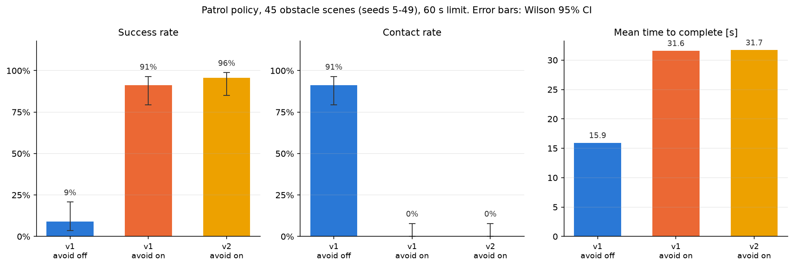
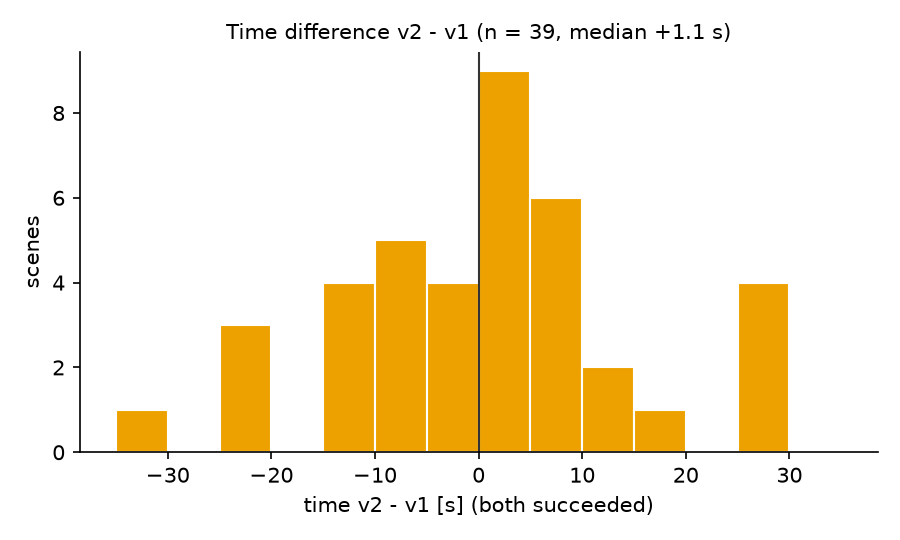

# T07 報告: 評価の拡大(45 配置)と再現性の切り分け

対象タスク: `tasks/07_scale_eval.md`。実行日 2026-10-21、環境は CLAUDE.md のとおり(M1 Max / `py311_genesis` / genesis-world 1.4.4)。評価は `--backend cpu --no-video`。既存の `results/eval*` と `results/scenes/seed_00..19` は変更していない(`git status` で確認。新規ファイルのみ)。

## 結論

1. **再現性(手順 1)**: 「カメラの有無が物理に影響」ではなく **真の非決定性**。seed 12・v2 を 5 条件 × 3 回実行したところ、**どの条件でも同一条件の 3 回が一致しなかった**(例: `--no-video` 別プロセスで 3/4・4/4・2/4、録画ありで 2/4・4/4・4/4)。録画あり/なし・カメラのみ・MCAP の間に系統差はない。同一プロセス内の 3 回連続(評価バッチの形態)は 3 回とも 4/4 だったが所要時間は 38.9〜46.3 s で揺れた。したがって評価と録画の条件を揃える対策は不要(効果もない)で、45 配置評価は T04/T05 と同じ `run_eval.py`(no-video、1 プロセス)で回した。各配置 1 回の結果は確率的な標本として扱う
2. **45 配置(seed 5〜49)の 3 条件**: v1 回避なし 成功 9%・接触 91%、v1 回避あり 成功 91% [CI 79–96%]・接触 0%、v2 回避あり 成功 96% [85–99%]・接触 0%。回避の効果は McNemar p < 0.0001(成功・接触とも)。**v1 → v2 は不一致 6 配置(v2 だけ成功 4、v1 だけ成功 2)で p = 0.69、所要時間は中央値 +1.1 s(符号検定 p = 0.51、Wilcoxon p = 0.76)。配置を 3 倍にしても v1/v2 の差は検定で示せない**
3. **15 配置の結論と変わらなかった点**: 回避則の効果が明確で、v1/v2 の差は小さく統計的に示せない、成功分の所要時間はほぼ同じ、経路効率は v2 が低い(1.00 → 0.81)。**変わった点**: 15 配置では v2 に失敗がなかったが、45 配置では **v2 で新たに失敗する配置が 2 つ**(seed 25、26)現れた。v1 の失敗 4 配置はすべて v2 で成功しており、「v2 は経路上を塞ぐ障害物に強く、経路脇に障害物が並ぶ配置で遠回り・迷走する」というトレードオフが 45 配置で言語化できた(§5)

| 受け入れ条件 | 判定 | 実測 |
|---|---|---|
| 再現性の切り分け表(4 条件 × 3 回)と結論 | ✅ | §1(5 条件 × 3 回、`results/repro_seed12.csv`) |
| `results/eval_50/episodes.csv` 135 本(欠損なし) | ✅ | 135 行(off 45 / v1 45 / v2 45)、転倒 0、主要列に欠損なし |
| `summary.md` に 3 条件の表・CI・McNemar・所要時間比較 | ✅ | `results/eval_50/summary.md`、`summary.png`、`time_diff_hist.png` |
| 本報告(結果、15 配置との差、失敗配置の分析、トレードオフ) | ✅ | §2〜§5 |

## 実行したコマンド

```bash
conda activate py311_genesis
# 1. 再現性の切り分け(seed 12, v2, 5 条件 × 3 回。a〜d は別プロセス、e は同一プロセス内で 3 回)
python eval/repro_check.py --seed 12 --reps 3 --conds abcde --out results/repro_seed12.csv
# 2. シーン生成(seed 20〜49。既存 0〜19 は触らない)
python eval/scenes.py --seed 20 21 ... 49
# 3. 評価(45 配置 × 3 条件 = 135 本。segfault 時は再開ループで続行)
python eval/run_eval.py --policies go2-patrol:299 --avoid both --seeds 5-49 --avoid-version v1 --backend cpu --out results/eval_50/episodes.csv
python eval/run_eval.py --policies go2-patrol:299 --avoid on   --seeds 5-49 --avoid-version v2 --backend cpu --out results/eval_50/episodes.csv
# 4. 集計
python eval/summarize.py --compare3 results/eval_50/episodes.csv --scenes 5-49 --out-dir results/eval_50
```

## 1. 再現性の切り分け(`results/repro_seed12.csv`)

seed 12、拡張方策、v2 回避あり(T_commit 2.0 s、T_clear 1.0 s)。a〜d は `go2_patrol.py` を別プロセスで起動、e は `run_patrol()` を 1 プロセス内で 3 回連続(評価バッチと同じ形態)。

| 条件 | 1 回目 | 2 回目 | 3 回目 | 成功 |
|---|---|---|---|---|
| a. `--no-video`(別プロセス) | 3/4 timeout 60.0 s | **4/4 42.4 s** | 2/4 timeout 60.0 s | 1/3 |
| b. 録画あり(俯瞰) | 2/4 timeout 60.0 s | **4/4 43.1 s** | **4/4 42.7 s** | 2/3 |
| c. 録画あり + `--mcap` | 1/4 timeout 60.0 s | **4/4 43.1 s** | **4/4 43.3 s** | 2/3 |
| d. `--no-video --camera-only`(カメラを作るが録画しない) | **4/4 49.3 s** | 2/4 timeout 60.0 s | 1/4 timeout 60.0 s | 1/3 |
| e. `--no-video` 同一プロセス内 ×3 | **4/4 38.9 s** | **4/4 46.3 s** | **4/4 43.8 s** | 3/3 |

接触は 15 回すべて 0。走行距離は成功時 10.7〜13.1 m、失敗時 13.5〜15.6 m。

**判定: 真の非決定性**。根拠: (1) 同一条件の 3 回が a・b・c・d のすべてで一致しない(到達数が 1/4〜4/4 まで変わる)。(2) 条件間に系統差がない: 成功した回の所要時間は条件によらず 42.4〜43.3 s に揃い(b・c の 2 回目は 43.1 s で一致)、失敗の仕方も条件に依存しない。(3) カメラを作るだけの d も a と同程度に揺れる。したがって T05 で観察した「単発とバッチで違う」はカメラの有無ではなく、実行ごとの揺れがそのまま出ていたもの。T05 の「バッチ同士は再現する(所要時間差 ≤ 4.4 s)」は、e で 3 回とも成功しつつ所要時間が 7 s 幅で揺れたことから、**同一プロセス内でも完全には再現せず、たまたま成功/失敗の境界を越えなかった**と解釈するのが妥当。

seed 12 の v2 成功率は 15 回の合計で 9/15 = 60%。この配置は「成功するかどうかが確率的に決まる」配置で、評価バッチの 1 回の結果(T05: 成功、T07: 成功)は標本の 1 つに過ぎない。

揺れの発生源は本タスクの範囲外だが、CPU バックエンドの並列実行(スレッド間の浮動小数の加算順序)が、障害物の前で停止・旋回する場面(状態が分岐しやすい)で増幅されると考えられる(推測)。確認するなら `gs.init` のスレッド数を 1 にして同じ 3 回を取るのが次の手。

**評価条件への反映**: カメラの有無は影響しないので、45 配置評価は T04/T05 と同じ `run_eval.py`(no-video、1 プロセスで seed 順)で回した。T04/T05 の結果と整合: T04 の v1(14/15)・T05 の v2(15/15)は本評価の seed 5〜19 の部分(v1 14/15、v2 15/15)と一致する。ただし個々の配置の成功/失敗には上記の揺れが含まれており、**1 配置の差を根拠に v1/v2 を論じてはいけない**。集計値(成功率と CI)で比較する。

## 2. 45 配置の結果(`results/eval_50/summary.md`)

| 条件 | n | 成功率 [Wilson 95% CI] | 接触率 [95% CI] | ニアミス率 | 転倒 | 平均到達 | 所要 [s](成功分) | 経路効率(成功分) |
|---|---|---|---|---|---|---|---|---|
| v1 回避なし | 45 | 4/45 = **9%** [4–21%] | 41/45 = **91%** [79–96%] | 82% | 0 | 2.78 | 15.9 | 1.07 |
| v1 回避あり | 45 | 41/45 = **91%** [79–96%] | 0/45 = **0%** [0–8%] | 0% | 0 | 3.84 | 31.6 | 1.00 |
| v2 回避あり | 45 | 43/45 = **96%** [85–99%] | 0/45 = **0%** [0–8%] | 0% | 0 | 3.93 | 31.7 | 0.81 |



対応あり比較(同じ seed):

| 比較 | 指標 | 不一致ペア | McNemar 正確 p |
|---|---|---|---|
| v1 回避なし vs v1 回避あり | 成功 | なしのみ 0、ありのみ 37 | **< 0.0001** |
| v1 回避なし vs v1 回避あり | 接触 | なしのみ 41、ありのみ 0 | **< 0.0001** |
| v1 回避あり vs v2 回避あり | 成功 | v1 のみ 2、v2 のみ 4 | 0.6875 |
| v1 回避あり vs v2 回避あり | 接触 | 0、0 | 1.0 |

所要時間(v1 あり vs v2 あり、両方成功した 39 配置): v1 平均 30.9 s、v2 平均 31.6 s。差(v2 − v1)の中央値 **+1.1 s**、平均 +0.7 s、範囲 −33.3〜+28.6 s。v2 が 0.5 s 以上速い配置 16、遅い配置 21 → 符号検定 p = 0.51、Wilcoxon 符号順位検定(正規近似)p = 0.76。



差の分布は 0 を中心に **両側に裾が広い**(−33 s と +29 s の両端)。v2 は「平均的に速い」のではなく「配置によって大きく速くも遅くもなる」。

### 15 配置(T04/T05)との対応

| 指標 | 15 配置(seed 5–19) | 45 配置(seed 5–49) | 変化 |
|---|---|---|---|
| v1 回避なし 成功 / 接触 | 13% / 87% | 9% / 91% | 同じ傾向、CI が狭まった |
| v1 回避あり 成功 | 93% [70–99%] | 91% [79–96%] | CI 幅 29 → 17 ポイント |
| v2 回避あり 成功 | 100% [80–100%] | 96% [85–99%] | **v2 に失敗が出た**(2 配置)。CI 幅 20 → 14 ポイント |
| v1 vs v2 成功 McNemar | p = 1.0(不一致 1) | p = 0.69(不一致 6) | 示せないまま |
| v1 vs v2 所要(両方成功) | 33.6 vs 34.2 s(中央値 +0.4) | 30.9 vs 31.6 s(中央値 +1.1) | 同じ |
| 経路効率 v1 / v2 | 0.99 / 0.76 | 1.00 / 0.81 | 同じ |
| seed 5–19 の部分(本評価) | — | v1 14/15、v2 15/15 | T04/T05 と一致 |

新規の seed 20〜49(30 配置)だけ見ると v1 27/30、v2 28/30(v2 の失敗 25・26 は新規配置、v1 の失敗 28・37・47 も新規配置)。

## 3. 失敗配置の一覧

| 条件 | seed | 障害物 | 到達 | 終了理由 | 接触 | 経路上の障害物(表面クリアランス < 0.2 m) |
|---|---|---|---|---|---|---|
| v1 回避あり | 12 | 5 | 2/4 | timeout | 0 | 3 個(y=0 辺、x=2 辺、y=2 辺) |
| v1 回避あり | 28 | 4 | 2/4 | timeout | 0 | **4 個**(4 辺すべて) |
| v1 回避あり | 37 | 3 | 3/4 | timeout | 0 | 2 個(y=0 辺、x=2 辺) |
| v1 回避あり | 47 | 3 | 2/4 | timeout | 0 | 2 個(x=2 辺の Box が経路に 0.17 m 食い込む、y=2 辺) |
| v2 回避あり | 25 | 5 | 3/4 | timeout | 0 | 1 個(y=0 辺)+ 脇 2 個 |
| v2 回避あり | 26 | 5 | 2/4 | timeout | 0 | 2 個(x=0 辺、y=0 辺)+ 脇 2 個 |

- 回避ありの失敗は 6 件すべて「接触なし・転倒なしの時間切れ」。回避なしの失敗 41 件は 20 件が押し付けの時間切れ、21 件が接触しつつ完走(T04 と同じ型)
- **v1 で失敗し v2 で成功**: seed 12, 28, 37, 47(4 配置)。いずれも経路を塞ぐ障害物が 2 個以上あり、v1 は「停止 → 旋回 → 戻る」の振動で時間を失う。v2 はコミット旋回 + 直進で脇を抜ける(所要 27〜39 s)
- **v1 で成功し v2 で失敗**: seed 25, 26(2 配置)。経路を塞ぐ障害物は 1〜2 個だが、**経路脇(0.2〜0.5 m)に障害物が 2 個ずつ**ある。v2 はこれらにもコミットで反応して経路の外側へ出て、ウェイポイントの判定円(0.3 m)に入り損ねて大回りする(T05 の seed 12 録画と同じ型)。v1 は小さく揺れるだけで通過する(35 s、54 s)

経路を塞ぐ障害物の数(表面クリアランス < 0.2 m)で層別すると:

| 経路上の障害物数 | 配置数 | v1 成功率 | v2 成功率 | v1 所要 [s] | v2 所要 [s] |
|---|---|---|---|---|---|
| 0 | 8 | 100% | 100% | 20.7 | 24.7 |
| 1 | 16 | 100% | 94% | 29.5 | 30.3 |
| 2 | 16 | 88% | 94% | 41.5 | 37.1 |
| 3 | 4 | 75% | 100% | 43.4 | 42.4 |
| 4 | 1 | 0% | 100% | 60.0 | 38.6 |

(所要は失敗 = 60 s を含む平均)。**経路上の障害物が 0〜1 個なら v1 が速く確実、2 個以上なら v2 が確実**という構造がはっきりする。

## 4. 実行時間

- v1 条件(回避なし + 回避あり、90 本): 726 s(8.1 s/本)。segfault なし
- v2 条件(45 本): 2989 s。ただし内訳は 42 本が 5〜17 s/本で、**seed 34、42、49 の 3 本だけ wall 812〜932 s**(sim は 21〜25 s で正常)。3 本とも成功で結果に異常はない。シミュレーション時間に対する wall 時間の比が通常 0.24 のところ 35 前後で、プロセスが外的要因で止まっていたと考えられる(システムのスリープ/他の負荷。原因は未特定、推測)。これを除くと 45 本で約 6 分
- 合計 wall 62 分(見込み 25 分を超過。超過分はすべて上記 3 本の停止)

## 5. v1 / v2 のトレードオフ(言語化)

| 観点 | v1(毎ステップ側を決め直す) | v2(2.0 s コミット + 1.0 s 直進) |
|---|---|---|
| 確実性(成功率) | 91% [79–96%]。経路を塞ぐ障害物が 2 個以上あると振動で時間切れ(4/45) | 96% [85–99%]。塞がれた経路は抜けられるが、脇に障害物が並ぶと外側へ出て迷走(2/45) |
| 安全性(接触) | 0% | 0%(同じ) |
| 速度(成功分の所要) | 30.9 s。易しい配置(経路上 0〜1 個)で 20〜30 s | 31.6 s。易しい配置で +4〜+9 s 遅く、難しい配置で −20〜−33 s 速い |
| 経路効率 | 1.00(ほぼ最短) | 0.81(コミット旋回と直進で 1.2 倍の距離) |
| 挙動の予測しやすさ | 障害物のすぐ脇で小さく揺れる。実機では揺れが歩行の乱れになりうる | 大きく迂回する。実機ではなめらかだが巡回エリアの外に出るリスク |
| 統計的な優劣 | — | 成功率・所要時間とも **差を示せない**(p = 0.69 / 0.51) |

まとめ: **v2 は「難しい配置を落とさない」代わりに「易しい配置で遠回りする」**。巡回の目的が「決められた経路を正確に回る」なら v1、「障害物があっても一周を確実に終える」なら v2。両者の中間(コミット時間を横変位で打ち切る)が T05 申し送りの改良案で、本評価の層別表(経路上 2 個以上で v2 が有利、0〜1 個で v1 が有利)がその設計の根拠になる。

## 変更したファイルと理由

| ファイル | 変更 |
|---|---|
| `eval/repro_check.py` | **新規**。再現性の切り分け(条件 a〜e × N 回、CSV 出力) |
| `go2_patrol.py` | `run_patrol(..., camera_only=False)`、CLI `--camera-only`(条件 d 用) |
| `eval/run_eval.py` | 再開キーに `avoid_version` を含める(同じ CSV に v1 回避あり / v2 回避あり を共存させるため)。`--camera-only` を追加 |
| `eval/summarize.py` | `--compare3 CSV --scenes 5-49`: 3 条件の表(Wilson CI)、McNemar、所要時間の対応あり比較(符号検定、Wilcoxon 符号順位検定の正規近似)、失敗一覧、`summary.png`、`time_diff_hist.png` |
| `results/scenes/seed_20..49.json` | **新規**(30 配置)。既存 00〜19 は変更なし |
| `results/eval_50/` | episodes.csv(135 本)、summary.md/csv/png、time_diff_hist.png |
| `results/repro_seed12.csv` | 再現性の切り分け結果 |
| `tasks/07_scale_eval.md` | 本タスクの仕様(作業者作成) |

## 仮定したこと

- 再現性の切り分けに、タスクの 4 条件に加えて e(同一プロセス内で 3 回)を足した。T05 の観察(バッチ内は再現する)を直接確かめるため
- 「カメラの有無が原因なら対策を 1 つ試す」は、原因がカメラではないと判定したので実施していない
- 45 配置評価の条件は T04/T05 と同じ(no-video、1 プロセスで seed 順)。評価 1 回 = 1 標本と位置づけ、集計値で比較する
- 「経路上の障害物」は障害物の表面から最寄りの辺までのクリアランスが 0.2 m 未満、「経路脇」は 0.2〜0.5 m と定義した(T01 の軌跡が辺から 0.1〜0.15 m 外側に膨らむことを考慮)
- Wilcoxon 符号順位検定は正規近似(タイ補正)で実装した(n = 39 なら十分)。差が ±0.5 s 以内の 2 配置は符号検定から除外
- `repro_check.py` の出力先は `/tmp` ではなく scratch を使い、動画・MCAP はコミットしていない

## うまくいかなかったこと

- v1/v2 の差は 45 配置でも検定で示せなかった(成功 p = 0.69、所要 p = 0.51)。差を出すには、層別表から「経路上の障害物 2 個以上」の配置だけを増やす(現状 21 配置)か、1 配置を複数回実行して成功確率を推定する必要がある
- v2 の実行中に 3 本が外的要因で 15 分ずつ止まり、合計 62 分かかった
- 非決定性の発生源は特定していない(スレッド数 1 での確認は未実施)

## 次への申し送り

1. レポートの数値は 45 配置版(`results/eval_50/summary.md`)に置き換えるのがよい。15 配置版(T04/T05)との違いは「v2 にも失敗が出た」「CI が狭まった」の 2 点
2. 非決定性があるので、動画の seed と評価の seed の結果が一致しないことがある。動画は「代表例」として扱い、成功率の数値と結び付けない
3. 1 配置あたりの成功確率を出すなら `eval/repro_check.py --conds e --reps 10` で 10 回連続実行できる(1 配置 10 回で約 2 分)
4. 回避則の次の改良は層別表に基づき「経路上の障害物が多いときだけ長くコミットする」(横変位で打ち切る)方向。易しい配置で v1 の速さ、難しい配置で v2 の確実性を狙う
