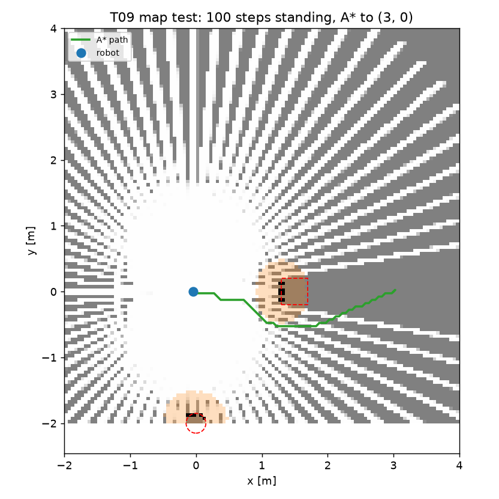
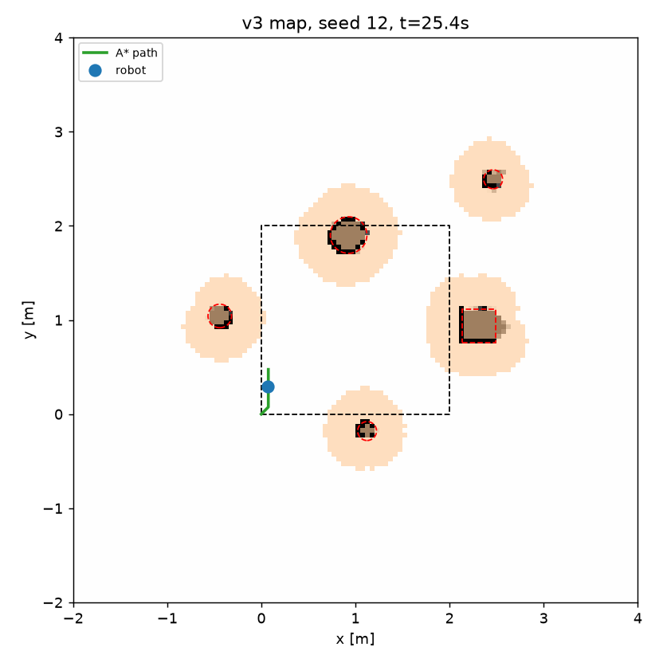
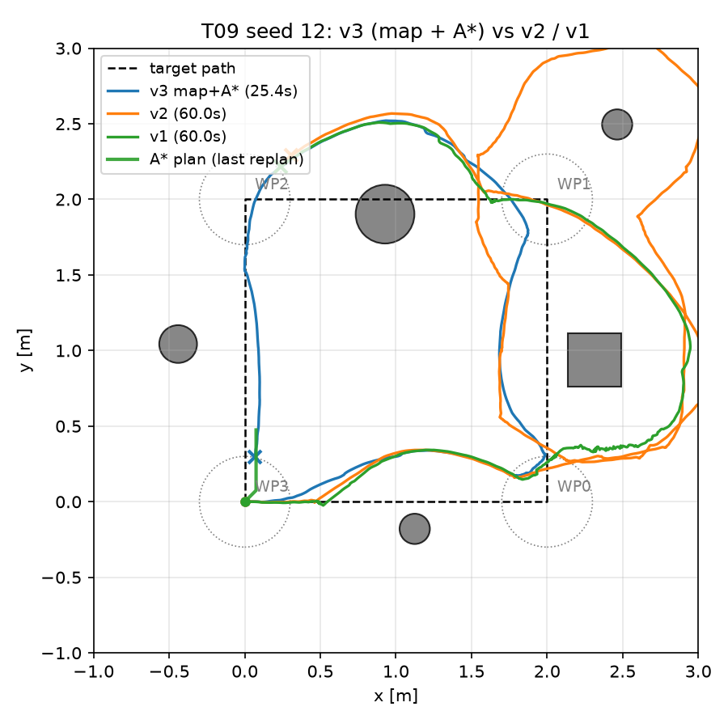
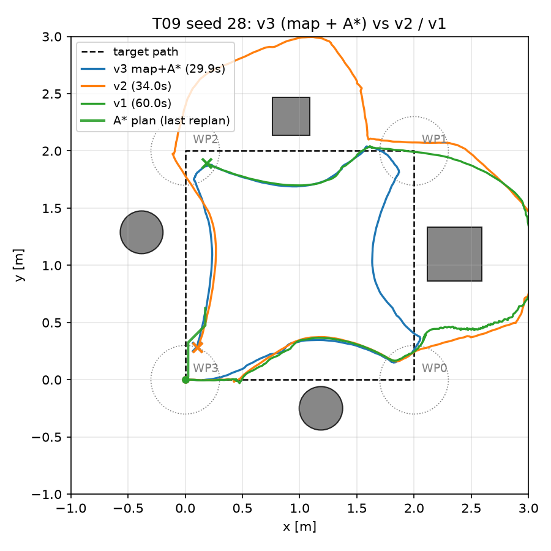

# T09 報告: 占有格子地図 + A* 大域計画(v3)

対象タスク: `tasks/09_map_planner.md`(余力タスク)。実行日 2026-10-21、環境は CLAUDE.md のとおり(M1 Max / `py311_genesis` / genesis-world 1.4.4)。評価・録画は `--backend cpu`。**v3 は `--avoid-version v3` を指定したときだけ有効**で、v1/v2 の既定動作・結果・動画は変更していない(§6 で回帰確認)。

## 結論

受け入れ条件は **すべて満たした**。調整候補は使っていない。

| 受け入れ条件 | 判定 | 実測 |
|---|---|---|
| `t09_map_test.png` で障害物位置に占有セル、周囲は空き | ✅ | 占有 13 セル(Box 正面 8、Cylinder 5、それ以外 0)。Box 正面 x = 1.28〜1.33(期待 1.30)、Cylinder 手前 y = −1.93〜−1.88(期待 −1.85) |
| seed 12, 25, 26, 28 で各 2 回中 2 回 4/4・接触 0 | ✅ | 8/8 成功、接触 0(所要 20.8〜45.0 s) |
| 45 配置: 成功率 ≥ v2(96%)、接触 0%、成功分の所要時間 ≤ v1、経路効率 ≥ 0.95 | ✅ | **成功 45/45 = 100%** [CI 92–100%]、接触 0%、**所要 24.2 s**(v1 31.6 s)、**経路効率 1.05** |
| 本報告(設計、地図の例、4 条件の表、失敗配置の分析、真の姿勢の限界) | ✅ | §1〜§7。v3 の失敗配置は 0 |

**v3 は v1 の速さと v2 の確実性を両立した**: 45 配置すべてで 1 周を完走し(v1 41/45、v2 43/45)、成功分の所要時間は v1 より中央値 3.4 s・平均 7.7 s 短い(符号検定 p < 0.0001、v3 が速い配置 34 / 遅い配置 3)。経路効率は 1.05 で v1(1.00)と同等、v2(0.81)より良い。成功率の差は v1 に対し McNemar p = 0.125、v2 に対し p = 0.5 で、**成功率だけでは統計的に示せない**(v1/v2 の失敗がもともと少ない)が、所要時間の差は明確。

## 実行したコマンド

```bash
conda activate py311_genesis
# 1. 地図の単体テスト(T02 の既知配置)
python eval/map_test.py --backend cpu --out results/t09_map_test.png
# 2〜3. 失敗配置 4 つ(v1 の失敗 12, 28, 37, 47 のうち 12, 28 と v2 の失敗 25, 26)。各 2 回(1 回目は録画・俯瞰寄せ)
python go2_patrol.py -e go2-patrol --ckpt 299 --backend cpu --seed 12 --avoid --avoid-version v3 --camera overhead-close --out videos/t09_v3_seed12.mp4 --summary-csv ""   # 25, 26, 28 も
python go2_patrol.py -e go2-patrol --ckpt 299 --backend cpu --no-video --seed 12 --avoid --avoid-version v3 --summary-csv ""
python eval/plot_traj.py --log videos/t09_v3_seed12_log.csv videos/t05_v2_seed12_log.csv videos/t04_fail_seed12_log.csv --label "v3 map+A*" v2 v1 \
    --scene results/scenes/seed_12.json --plan videos/t09_v3_seed12_plan.csv --out results/t09_traj_seed12.png
# 4. 45 配置 × v3 を results/eval_50 に追加、4 条件で集計
python eval/run_eval.py --policies go2-patrol:299 --avoid on --seeds 5-49 --avoid-version v3 --backend cpu --out results/eval_50/episodes.csv
python eval/summarize.py --compare3 results/eval_50/episodes.csv --scenes 5-49 --out-dir results/eval_50
# 5. 動画差し替え候補
ffmpeg -i videos/t09_v3_seed28.mp4 -c:v libx264 -crf 23 -pix_fmt yuv420p -an videos/raw/v3_seed28_close.mp4
```

## 1. 設計(実装したもの)

実機 Go2 の「自己位置推定 → costmap / planner → 速度指令 → 歩行」の 3 層のうち、自己位置推定は **Genesis の真の姿勢**(base の位置・yaw)で代用している(SLAM なし。§7)。

| 層 | 実装 | 内容 |
|---|---|---|
| 地図 | `nav/grid_map.py` `GridMap` | 分解能 0.05 m、x, y ∈ [−2, 4] m(120 × 120)。log-odds: 地面除去後のヒット点のセル +0.85、センサからヒット点までのレイ上 −0.4(res/2 間隔のサンプル点で近似、1 点 −0.2)、max_range のレイは空きのみ。地面除去で max_range に置換されたレイは床に当たった距離までを空きにする。クリップ ±5、占有 > 0.5、未知 = 0 は通行可 |
| 膨張 | `GridMap.inflated(r)` | 占有セルを半径 0.35 m(7 セル)の円板で膨張した通行不可マスク |
| 計画 | `nav/planner.py` `astar`, `Planner` | 8 近傍 A*(対角 √2、ユークリッド・ヒューリスティック、角をかすめない)。開始セルが通行不可なら最寄りの通行可セルから。経路が無ければ膨張 0.25 m で再試行、それでも無ければ None(= 経路追従がウェイポイントを直接狙う v1 の挙動) |
| ローカル目標 | `Planner.local_goal` | 経路上の最寄り点から 0.8 m 先。`WaypointFollower.command_to(pos, yaw, target)` で速度指令にする(到達判定はウェイポイント本体のみ) |
| 再計画 | `go2_patrol.run_patrol` | 1.0 s(50 ステップ)ごと、またはウェイポイント切替時 |
| 下層 | `nav/avoid.py` v1 | 反応的回避をそのまま適用(d_stop 0.45 m)。計画があるので発動は減る |
| 可視化 | `nav/mcap_logger.log_grid` | `--mcap` 時に `/map`(Foxglove `Grid`、uint8: 0 空き / 50 未知 / 100 占有)と `/plan`(`PosesInFrame`)を 1 s ごと |

コスト: 地図更新 0.59 ms/step(立位テスト)、A* 4 ms/回(120 × 120、Python heapq)。45 配置の評価は 1 本平均 7.6 s(wall)で v1/v2(7.6〜8.5 s)と同じ。

## 2. 地図の単体テスト(`results/t09_map_test.png`)

T02 と同じ配置(正面 1.3 m に Box、右 1.85 m に Cylinder)で立位 100 ステップ:

```
[map_test] occupied cells=13 (box region 8, cylinder region 5, elsewhere 0); free cells=7971; unknown=6416; update 0.59 ms/step
[map_test] box occupied x range 1.28..1.33 (front face at 1.30 expected)
[map_test] cylinder occupied y range -1.93..-1.88 (near face at -1.85 expected)
[map_test] A* (0,0)->(3,0): found, 63 points, inflate 0.35 in 4.0 ms
```



Box 正面・Cylinder 手前の面だけが占有になり(LiDAR から見える面)、レイの通った扇形が空き、影は未知のまま。A* は (3, 0) へ Box の膨張領域を避けて下側から回る経路を出した。

歩行後の地図の例(seed 12、25.4 s):



巡回中に 4 方向から見るので障害物は輪郭全体が占有になる。地図の占有セルは 46〜75 個/配置で、偽の占有(障害物の無い場所)は出ていない。

## 3. 失敗配置 4 つでの確認(手順 3)

| seed | 障害物 | v1(T07) | v2(T07) | **v3 1 回目(録画)** | **v3 2 回目** | 計画 |
|---|---|---|---|---|---|---|
| 12 | 5(経路上 3) | 2/4 timeout | 4/4 35.8 s | **4/4 25.4 s**、接触 0、走行 7.81 m | **4/4 25.3 s** | 27 回、経路なし 0 |
| 25 | 5(経路上 1、脇 2) | 4/4 54.4 s | 3/4 timeout | **4/4 45.0 s**、接触 0、走行 8.95 m | **4/4 24.5 s** | 46 回、経路なし 0 |
| 26 | 5(経路上 2、脇 2) | 4/4 35.1 s | 2/4 timeout | **4/4 20.8 s**、接触 0、走行 7.31 m | **4/4 21.4 s** | 23 回、経路なし 0 |
| 28 | 4(経路上 4) | 2/4 timeout | 4/4 38.6 s | **4/4 29.9 s**、接触 0、走行 7.58 m | **4/4 31.1 s** | 31 回、経路なし 0 |

8 回すべて成功・接触 0。膨張 0.25 m への再試行も 0 回。seed 25 の 1 回目(45.0 s)は非決定性で下層の回避が発動して時間を使った回(2 回目は 24.5 s)。




(緑の細線が最後の再計画時の A* 経路。v3 は経路を塞ぐ障害物の **内側**(正方形の中)を通り、v1 の振動も v2 の外側への大回りも起きていない)

## 4. 45 配置 × 4 条件(`results/eval_50/summary.md`)

| 条件 | n | 成功率 [Wilson 95% CI] | 接触率 | 転倒 | 平均到達 | 所要 [s](成功分) | 経路効率(成功分) |
|---|---|---|---|---|---|---|---|
| v1 回避なし | 45 | 4/45 = 9% [4–21%] | 91% | 0 | 2.78 | 15.9 | 1.07 |
| v1 回避あり | 45 | 41/45 = 91% [79–96%] | 0% | 0 | 3.84 | 31.6 | 1.00 |
| v2 回避あり | 45 | 43/45 = 96% [85–99%] | 0% | 0 | 3.93 | 31.7 | 0.81 |
| **v3 地図 + A\*** | 45 | **45/45 = 100%** [92–100%] | **0%** | 0 | 4.00 | **24.2** | **1.05** |


対応あり比較(同じ seed):

| 比較 | 成功(不一致ペア → McNemar p) | 所要時間(両方成功した配置) |
|---|---|---|
| v1 あり vs v3 | v1 のみ 0、v3 のみ 4 → p = 0.125 | n = 41、v1 31.6 s → v3 23.9 s、中央値 −3.4 s、v3 が速い 34 / 遅い 3 → 符号検定 **p < 0.0001**、Wilcoxon z = −4.41 **p < 0.0001** |
| v2 あり vs v3 | v2 のみ 0、v3 のみ 2 → p = 0.5 | n = 43、v2 31.7 s → v3 24.3 s、中央値 −6.1 s、v3 が速い 36 / 遅い 5 → 符号検定 **p < 0.0001**、Wilcoxon z = −4.91 **p < 0.0001** |
| v1 あり vs v2 あり(T07 再掲) | 2 vs 4 → p = 0.69 | 中央値 +1.1 s、p = 0.51 |

- v1 で失敗し v3 で成功: seed 12, 28, 37, 47。v2 で失敗し v3 で成功: seed 25, 26。v3 で新たに失敗した配置: **なし**
- v3 の所要時間は 17.4〜45.8 s、経路効率 0.90〜1.11、LiDAR 最小距離 0.37 m 以上(ニアミス 0)
- v3 が v1 より 0.5 s 以上遅かった配置は 3 つ(seed 13 +15.6 s、34 +9.7 s、45 +10.0 s)。いずれも成功しており、下層の反応的回避が発動して減速した回と考えられる(推測。経路は見つかっている)

経路を塞ぐ障害物の数(T07 の定義: 表面クリアランス < 0.2 m)で層別した所要時間(失敗 = 60 s を含む平均):

| 経路上の障害物数 | 配置数 | v1 | v2 | **v3** | v3 成功 |
|---|---|---|---|---|---|
| 0 | 7 | 20.5 | 24.5 | **19.1** | 7/7 |
| 1 | 17 | 29.1 | 30.0 | **21.5** | 17/17 |
| 2 | 16 | 41.5 | 37.1 | **27.4** | 16/16 |
| 3 | 4 | 43.4 | 42.4 | **29.7** | 4/4 |
| 4 | 1 | 60.0 | 38.6 | **31.7** | 1/1 |

T07 で「0〜1 個なら v1、2 個以上なら v2」だったトレードオフが、v3 では全層で最速になり解消した。障害物が増えても所要時間の伸びが緩い(0 個 19 s → 4 個 32 s)。

## 5. v3 の失敗配置の分析

45 配置 + 4 配置 × 2 回の 53 エピソードで失敗 0、接触 0、経路なし 0、膨張縮小への再試行 0 だったため、分析対象の失敗がない。懸念点として残るのは:
- 非決定性(T07)により、同じ配置でも下層の回避が発動する回は 10〜20 s 遅くなる(seed 25 の 45.0 s vs 24.5 s)。成功/失敗が変わった例は観察していない
- 障害物の間隔は生成時に表面間 1.2 m 以上と決めているので、膨張 0.35 m × 2 = 0.70 m の通路幅が常に確保される。より密な配置では A* の経路なし → 膨張 0.25 m の再試行 → 直線(v1)の順に退化する設計だが、その経路は今回一度も通っていない(未検証)

## 6. v1 / v2 への影響(回帰確認)

- `go2_patrol.run_patrol` の v3 固有の処理は `avoid_version == "v3"` のときだけ実行される(地図の生成・更新、再計画、ローカル目標)。v1/v2 では `gmap`/`planner` が None で、呼び出しも増えていない
- seed 10 を v1・v2 で再実行: 回避則のパラメータ出力が T05 と同一、どちらも 4/4 完走(22.0 s / 31.3 s)
- `results/eval_50/episodes.csv` には v3 の 45 行を **追記**しただけで、既存の 135 行は変えていない。`summary.md/csv/png` は 4 条件版に更新(v1/v2 の数値は T07 と同じ)
- 既定の `--avoid-version` は v2 のまま。`eval/run_eval.py` の選択肢に v3 を追加(初回の評価は選択肢に無くて起動に失敗したため)

## 7. 限界(明記)

- **真の姿勢を使っている**: 地図の更新・A* の開始点・ローカル目標の追従はすべて Genesis の base 位置と yaw をそのまま使う。実機では LiDAR SLAM / オドメトリの誤差が地図に累積するので、この結果は「自己位置が正確なら planner 層はこれで足りる」という上限
- 地図は静止障害物を前提にした log-odds(動く障害物は消えるまで時間がかかる)
- A* は経路長だけを最小化し、膨張領域の外なら障害物のすぐ脇を通る。実機の costmap のような距離に応じたコストは入れていない
- 未知セルを通行可とするため、まだ見ていない場所に障害物があれば計画は失敗し、再計画(1 s)と下層の回避で対応する。今回の 45 配置では経路なしが 0 回だったので、この退化経路は未検証

## 変更したファイルと理由

| ファイル | 変更 |
|---|---|
| `nav/grid_map.py` | **新規**。占有格子(§1)、PNG 出力、Foxglove 用 uint8 |
| `nav/planner.py` | **新規**。A*、最寄り通行可セル、`Planner`(再試行、ローカル目標) |
| `eval/map_test.py` | **新規**。地図の単体テスト(§2) |
| `go2_patrol.py` | `--avoid-version v3`、`--replan-s`、`--lookahead`、`--inflate`。`WaypointFollower.command_to()` と `target`。v3 時は `<out>_plan.csv`(最終経路)と `<out>_map.png` を出力。戻り値に `v3_stats` |
| `nav/mcap_logger.py` | `log_grid()`: `/map`(Grid)と `/plan`(PosesInFrame) |
| `eval/run_eval.py` | `--avoid-version` に v3 を追加 |
| `eval/plot_traj.py` | `--plan` で計画経路を重ねる |
| `eval/summarize.py` | `--compare3` を 4 条件対応(v3 があれば v1/v2 との McNemar、所要時間比較、失敗の対応表、4 本の棒グラフ) |
| `results/t09_*.png`, `results/eval_50/*` | 成果物(地図テスト、4 配置の地図と軌跡、4 条件の集計) |
| `videos/t09_v3_seed{12,25,26,28}.mp4`, `videos/t09_v3_seed*_plan.csv`, `videos/raw/v3_seed28_close.mp4` | v3 の録画(俯瞰寄せ)、計画経路、動画差し替え候補 |
| `tasks/09_map_planner.md` | 本タスクの仕様(作業者作成) |

## 仮定したこと

- レイ上の空き更新は Bresenham ではなく res/2 間隔のサンプル点(1 セルに約 2 点、1 点 −0.2 で合計 −0.4)で近似した。numpy でベクトル化でき 0.6 ms/step
- 地面除去で max_range に置換されたレイは「床に当たった距離まで空き」とした(5 m まで空きにすると床の向こうの障害物を消してしまう)
- A* の目標セルが膨張領域内なら最寄りの通行可セルを目標にし、経路の終点にはウェイポイントの正確な座標を足した
- 「v3 = 地図 + A* + v1 下層」の v1 は T03/T04 のパラメータそのまま(`--d-slow` 等の CLI 引数は v3 でも下層に効く)
- 手順 3 の 4 配置は seed 12, 25, 26, 28(タスク指定)。v1 の失敗 37, 47 は 45 配置評価の中で確認(v3 で成功)
- `docs/report/` に未追跡のファイルがあるが作業者のものと判断し、本コミットには含めていない

## うまくいかなかったこと

- 45 配置評価の初回は `run_eval.py` の `--avoid-version` の選択肢に v3 が無く、3 回とも起動に失敗した(修正して再実行、351 s)
- それ以外は調整なしで受け入れ条件を満たした

## 申し送り(動画・レポートへの反映は人間の判断)

1. 動画の差し替え候補: `videos/raw/v3_seed28_close.mp4`(29.9 s、俯瞰寄せ)。ショット 10 を「v1 振動 → v2 コミット → v3 地図+A*」の 3 連にするか、C5 の後に v3 のショットを足す。カードの数値は `results/eval_50/summary.md` の 4 条件表から
2. レポートの「系統的な改良」は v1 → v2 → v3 の 3 段で、v3 の所要時間の改善は統計的に明確(p < 0.0001)。成功率は 91 → 96 → 100% だが検定では差を示せない(p = 0.125)、と書く
3. Foxglove で `--mcap` 付きの v3 実行を開くと `/map`(Grid)と `/plan` が見える。`docs/foxglove_layout.json` にはまだ追加していない(3D パネルで `/map` を有効にすれば表示される)
4. 密な配置(障害物間隔 < 0.7 m)での「経路なし → 膨張縮小 → 直線」の退化経路は未検証
