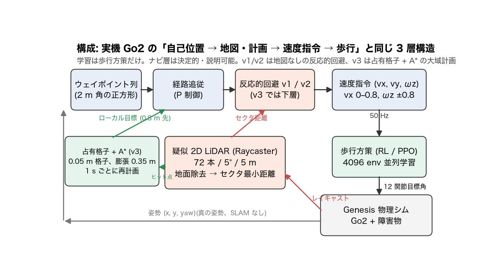
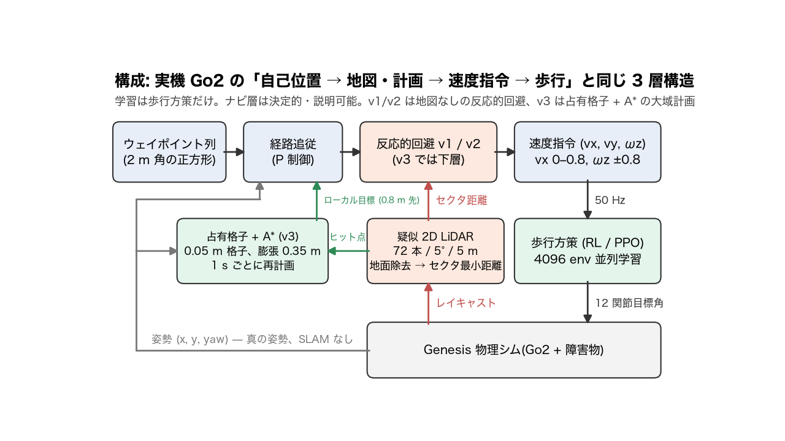

# T11 報告: 構成図の作り直し + 動画 v2.1 + README 仕上げ + クリーンクローン検証

対象タスク: `tasks/11_arch_readme.md`。実行日 2026-10-21、環境は CLAUDE.md のとおり。構成図は作業者提供の `scripts/make_arch.py` をそのまま使い、ヒラギノでの描画を見てラベル 1 つの fontsize だけ微調整した。動画は構成図のカット(ショット 2)以外を変えていない。

## 結論

| 受け入れ条件 | 判定 | 実測 |
|---|---|---|
| `figs/arch.png`: ラベルが矢印・箱に重ならず、矢印が箱の辺に接続、左右余白 ≥ 100 px | ✅ | §1(前後比較)。余白 左 183 / 右 147 px |
| 動画が再生成され 60〜180 s、構成図以外は T10 と同一(ショット表の長さが一致) | ✅ | 129.0 s、1280×720。ショット 16 本の長さは T10 と同一(§2) |
| README に結果表・構成・環境・再現手順・構成表・限界・開発ログ・ライセンス、個人情報なし | ✅ | §3。grep 0 件 |
| クリーンクローンで `go2_patrol.py`(v3、seed 10)が動く | ✅ | `logs/` なしで `checkpoints/` を読み 4/4、21.0 s、接触 0(§4) |
| `git status` がクリーン(`.vscode/`、`videos/t01_square_baseline.mp4` を除く)、push 済み | ✅ | `.vscode/` は `.gitignore` に追加。`t01_square_baseline.mp4` のみ未追跡 |
| 本報告(前後比較、README の章立て、検証出力、変更ファイル) | ✅ | §1〜§5 |

## 実行したコマンド

```bash
conda activate py311_genesis
python scripts/make_arch.py                    # figs/arch.png を上書き(ヒラギノ)
python scripts/check_margins.py                # カード 19 枚 + figs/arch.png
python scripts/make_video.py --v1-seed28-start 14 --v2-seed28-start 6 --v3-seed28-start 9.7
ffmpeg -i "videos/final/PAI最終課題_3164.mp4" -vf "fps=1/5,scale=320:-1,tile=6x5" -frames:v 1 results/t10_contact.png
# クリーンクローン検証
git clone --depth 1 file://$(pwd) /tmp/go2-clone && cd /tmp/go2-clone
python go2_patrol.py -e go2-patrol --ckpt 299 --backend cpu --no-video --seed 10 --avoid --avoid-version v3 --summary-csv ""
python eval/summarize.py --compare3 results/eval_50/episodes.csv --scenes 5-49 --out-dir /tmp/go2-clone-summary
python scripts/check_margins.py
```

## 1. 構成図の前後比較

| 前(T10、`make_figs.arch()`) | 後(T11、`scripts/make_arch.py`) |
|---|---|
|  |  |

前の図の問題: 斜めの矢印(LiDAR → 回避、Genesis → LiDAR、地図 → 経路追従)にラベルが重なる、姿勢のフィードバック線が箱の脇を通って接続先が曖昧、「ヒット点」ラベルが箱の縁にかかる。

後の図(作業者の設計): 矢印はすべて縦・横の直交、ラベルは矢印の右または上、姿勢(真の姿勢、SLAM なし)は灰の折れ線で「経路追従」と「占有格子 + A*」の両方に入る。ヒラギノで描いた結果、「ローカル目標 (0.8 m 先)」(fontsize 11)の右端が隣の「セクタ距離」に 5 px まで接近したので **fontsize を 10 に下げた**(箱の配置・他のラベルは無変更)。余白検査: 左 183 px、右 147 px(`check_margins.py --extra figs/arch.png`、白背景の図は右下のピクセルを背景色として判定するよう改修)。

`scripts/make_figs.py` の `arch()` は本体を削除し、`make_arch.main("figs/arch.png")` を呼ぶだけにした(`python scripts/make_figs.py` で古い図に戻らない)。

## 2. 動画 v2.1

`videos/final/PAI最終課題_3164.mp4` を上書き: 129.0 s、1280×720、30 fps、H.264、3.8 MB。`results/t10_contact.png` も更新。

| # | ショット | 長さ [s] | T10 との差 |
|---|---|---|---|
| 1 | C0 タイトル | 5.0 | 同一 |
| 2 | 構成図(figs/arch.png) | 6.0 | **図のみ差し替え** |
| 3 | C1h + 学習曲線 | 8.0 | 同一 |
| 4 | 台本(2 倍速) | 7.0 | 同一 |
| 5 | C2h + 軌跡比較 | 8.0 | 同一 |
| 6 | seed10 追従(等速) | 12.0 | 同一 |
| 7 | C3 | 4.0 | 同一 |
| 8 | seed10 俯瞰(2 倍速) | 12.0 | 同一 |
| 9 | Foxglove 静止画 | 6.0 | 同一 |
| 10a | v1 seed28(2 倍速) | 10.0 | 同一 |
| 10b | v2 seed28(2 倍速) | 10.0 | 同一 |
| 10c | v3 seed28(2 倍速) | 10.0 | 同一 |
| 10d | seed28 軌跡図(静止) | 6.0 | 同一 |
| 11 | C4h + 結果(4 条件) | 10.0 | 同一 |
| 12 | C5 | 7.0 | 同一 |
| 13 | C6 まとめ | 8.0 | 同一 |
| | 合計 | 129.0 | T10 と同じ |

カード・バナー・素材・切り出し位置は変更なし(`make_cards.py` は再実行していない。`make_video.py` は同じ引数)。

## 3. README(提出版)の章立て

1. タイトルと概要(動画・レポートの URL は `(提出後に URL を記載)` のプレースホルダ、ファイル名 `PAI最終課題_3164` に言及)
2. 結果: 45 配置 × 4 条件の表(成功率 [Wilson 95% CI]、接触率、所要、経路効率)+ `results/eval_50/summary.png`、v3 vs v1/v2 の所要時間の対応あり比較(符号検定 p < 0.0001)、成功率の検定(p = 0.125 / 0.5)、既定方策 0%、転倒 0
3. 構成: `figs/arch.png` と 3 層(歩行 / 知覚 / ナビゲーション)の表、v1 / v2 / v3 の違いの表
4. 環境: Metal で学習・CPU で評価、固定バージョン、Linux + CUDA は未検証と明記
5. 再現手順: 学習(省略可、`checkpoints/` 同梱、`--ckpt-dir`)、台本録画、巡回(`--avoid-version v1|v2|v3`、`--camera`、`--mcap`)、評価(`run_eval.py` ×3 → `summarize.py --compare3`)、Foxglove、動画の再生成(`make_figs.py` → `make_arch.py` → `make_cards.py` → `check_margins.py` → `make_video.py`)
6. リポジトリ構成の表(`checkpoints/`、`figs/`、`scripts/`、`docs/report/` を追加)
7. 既知の制約・限界(真の姿勢 / 静止障害物 / CPU の非決定性 / 2D LiDAR / Metal は 1 env で遅い / 衝突判定)
8. 開発ログ: T01〜T11 と `reports/NN` の対応表
9. ライセンス・使用 OSS(Apache-2.0、Genesis 例題、rsl-rl BSD-3-Clause、foxglove-sdk MIT。`pip show` の License-Expression で確認)

数値はすべて `results/eval_50/summary.md` と `reports/` から転記。個人情報の grep(`@`、所属、氏名)は 0 件。

## 4. クリーンクローン検証

```
$ git clone --depth 1 file://$(pwd) /tmp/go2-clone && cd /tmp/go2-clone
$ ls logs
ls: logs: No such file or directory
$ ls checkpoints/go2-patrol
cfgs.pkl  model_299.pt
$ python go2_patrol.py -e go2-patrol --ckpt 299 --backend cpu --no-video --seed 10 --avoid --avoid-version v3 --summary-csv ""
[go2_patrol] v3: plans=22 no-path=0 retry(inflate 0.25)=0 local-goal steps=1044 occupied cells=61
[go2_patrol] wrote (no video) go2_patrol_log.csv: 1050 steps, sim 21.0s, wall 4.0s, waypoints reached 4/4, end reason: completed
[go2_patrol] collision steps=0 first=None; contact steps=0 first=None; path length=7.32 m
(real 24.6 s、JIT 込み)
$ python eval/summarize.py --compare3 results/eval_50/episodes.csv --scenes 5-49 --out-dir /tmp/go2-clone-summary
→ summary.md は results/eval_50/summary.md と一致(diff なし)
$ python scripts/check_margins.py
[check_margins] all OK (min right margin 100 px)
```

- `logs/` は gitignore のためクローンに無い。`go2_patrol.py` と `go2_record.py` は `logs/<exp>` に `cfgs.pkl` が無ければ `checkpoints/<exp>` を使うようにした(`resolve_ckpt_dir()`、`--ckpt-dir` で明示も可)。調整候補 2 に相当するが、`logs/` を前提にしていることは最初から分かっていたので検証前に実装した
- 検証後に `/tmp/go2-clone` と `/tmp/go2-clone-summary` を削除した
- 検証はコミット後のクローンで行い、本報告と前後比較の画像はそのコミットに追記した(`--amend`、push 前)

## 5. 変更したファイル

| ファイル | 変更 |
|---|---|
| `scripts/make_arch.py` | 作業者提供。「ローカル目標」ラベルの fontsize 11 → 10 のみ変更 |
| `scripts/make_figs.py` | `arch()` を `make_arch.main()` の呼び出しに置換 |
| `scripts/check_margins.py` | 背景色を右下ピクセルから取る(白背景の図に対応)、`--extra`(既定 `figs/arch.png`、左右とも ≥ 100 px)、表に左余白を追加 |
| `figs/arch.png` | 新しい構成図 |
| `videos/final/PAI最終課題_3164.mp4`, `results/t10_contact.png` | 動画 v2.1 とコンタクトシート |
| `go2_patrol.py`, `go2_record.py` | `checkpoints/<exp>` へのフォールバック、`--ckpt-dir` |
| `README.md` | 提出版に全面改訂(§3) |
| `.gitignore` | `.vscode/` を追加 |
| `docs/report/` | 作業者が更新した PDF・HTML・`figs/arch_crop.png`(内容は編集していない) |
| `results/t11_arch_before.png` | 前後比較用に T10 の構成図を保存 |
| `tasks/11_arch_readme.md`, `reports/11_arch_readme.md` | 本タスク |

## 仮定したこと

- 構成図の「微調整」は fontsize 1 つだけ(箱・矢印・他ラベルは作業者の設計のまま)
- `check_margins.py` の背景色判定を右下ピクセル基準に変えたのは、白背景の `figs/arch.png` を同じ関数で検査するため。カード・帯の判定結果は T10 と同じ
- README の OSS ライセンスは `pip show` の License-Expression(rsl-rl-lib BSD-3-Clause、foxglove-sdk MIT)に基づく
- 「クリーンクローンで動く」の確認は `go2_patrol.py`(v3)・`summarize.py`・`check_margins.py` の 3 つ(タスクのコマンドどおり)。学習・録画・`run_eval.py` はクローンでは実行していない(同じ読み込み経路を使う `go2_record.py` のフォールバックはコード上で対応)
- `videos/t01_square_baseline.mp4` はタスクの指示どおり未追跡のまま

## うまくいかなかったこと

- `check_margins.py` の初版はカードの背景色固定だったため白背景の構成図を「全面が描画」と判定した(左 20 / 右 0 px)。背景色の取り方を変えて解決
- それ以外は調整なし

## 申し送り

- README の動画・レポートの URL は提出後に人間が記入する(`(提出後に URL を記載)` を検索)
- 構成図を直すときは `scripts/make_arch.py` を編集 → `python scripts/make_arch.py` → `python scripts/check_margins.py` → `python scripts/make_video.py ...`(`make_figs.py` からも同じ関数が呼ばれる)
