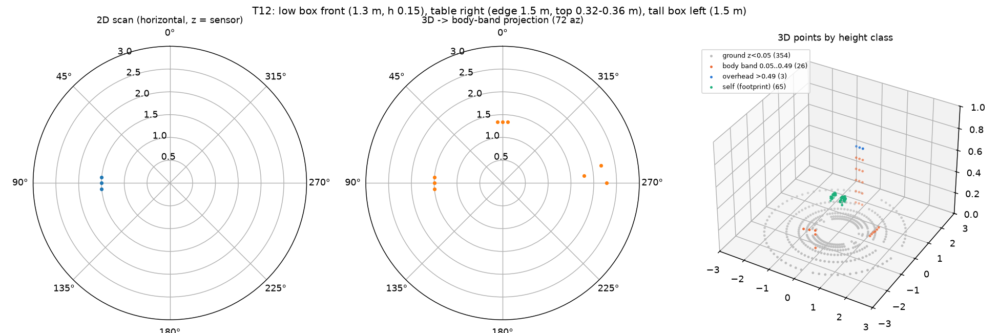
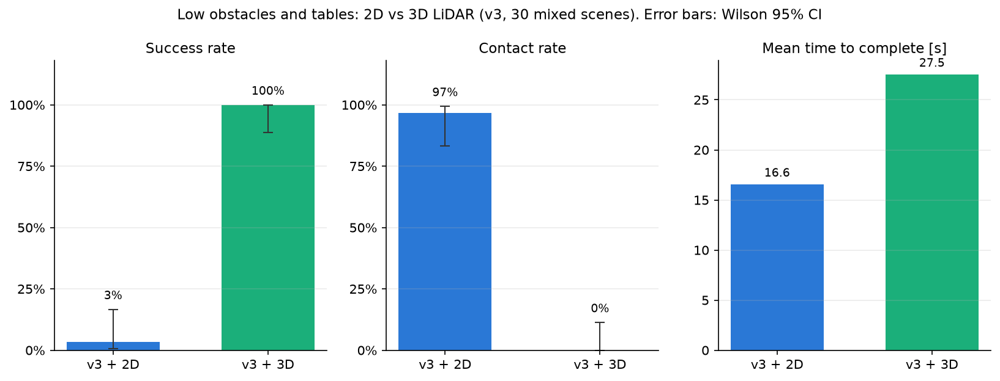
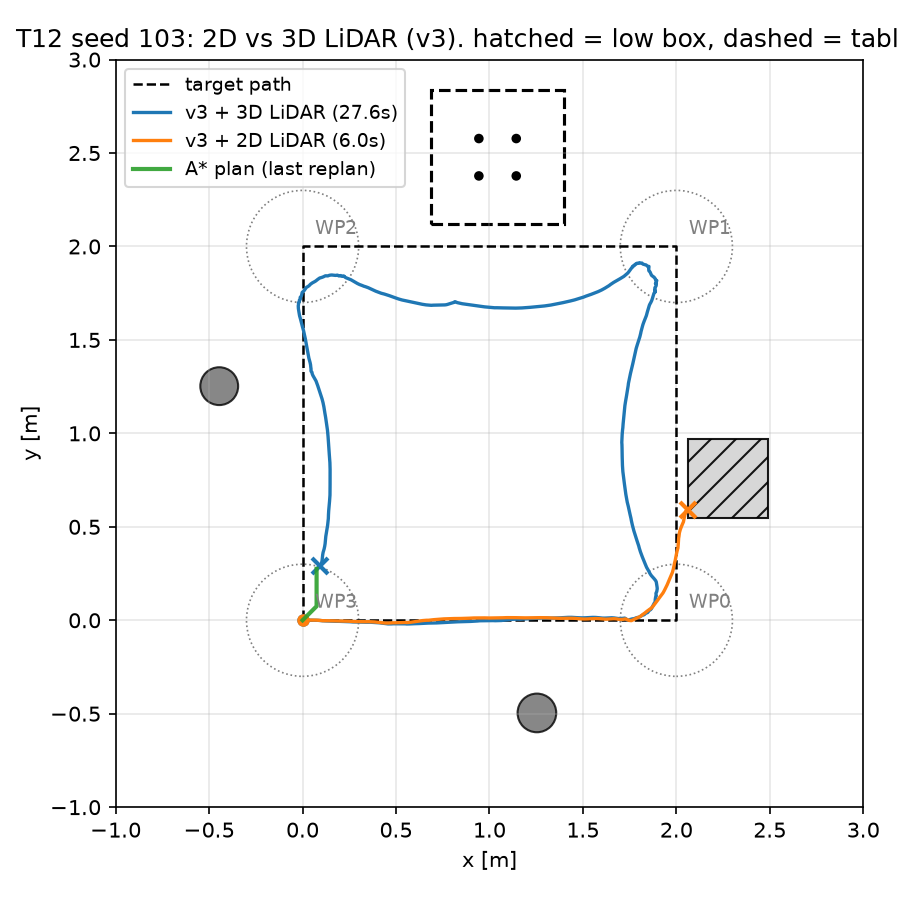
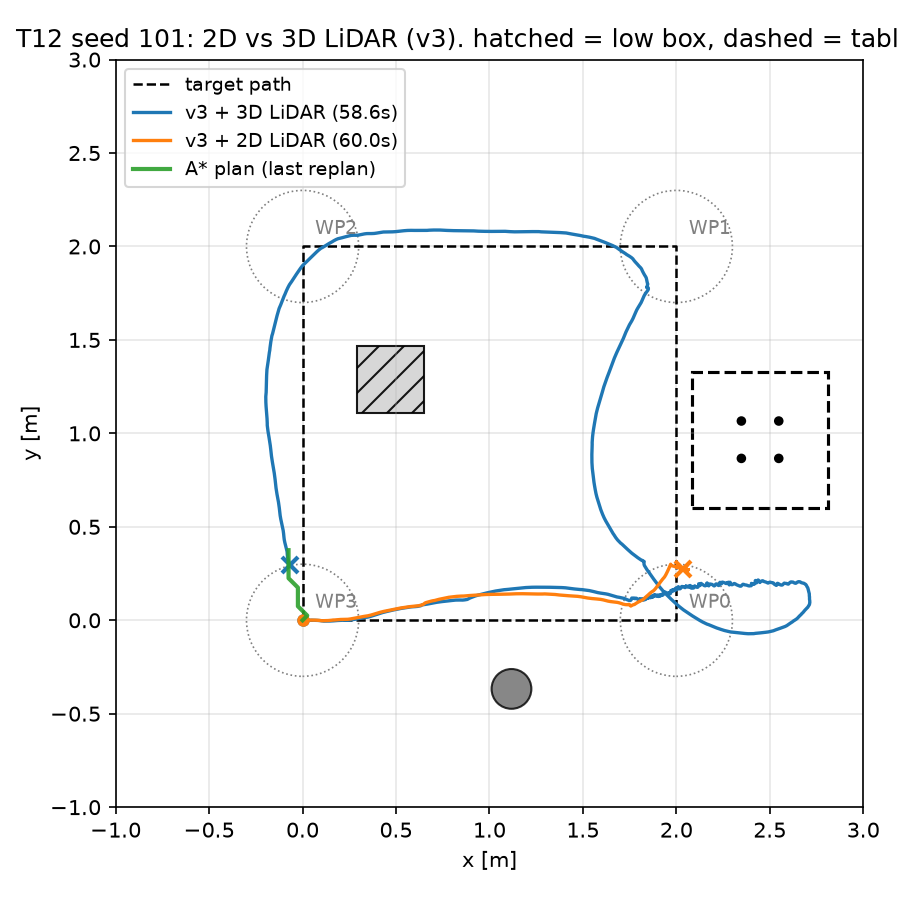

# T12 報告: 3D 疑似 LiDAR と「高さ方向で通行可否が変わる障害物」

対象タスク: `tasks/12_lidar3d.md`(余力タスク、期限 10/26)。実行日 2026-10-21、環境は CLAUDE.md のとおり(M1 Max / `py311_genesis` / genesis-world 1.4.4)。評価・録画は `--backend cpu`。**3D は `--lidar 3d` でのみ有効**で、既定(`--lidar 2d`)の v1/v2/v3 の挙動・`results/eval_50/`・seed 0〜49 のシーンは変更していない(§8 で回帰確認)。

## 結論

- 2D スキャン面(z ≈ 0.44 m)より下にある **低い箱(高さ 0.15 m)** と **テーブルの天板(0.316〜0.356 m)** は 2D では見えず、v3 + 2D は混合配置 30 配置で **成功 1/30(3%)、接触 29/30(97%)、転倒 6/30**。3D パターン(72 × 16 層)の点群を胴体の高さ帯で分類して 72 本に投影した v3 + 3D は **成功 30/30(100%)、接触 0/30、転倒 0**。対応あり McNemar 正確検定 p < 0.0001(成功・接触とも)。**受け入れ条件「3D の接触率が 2D より低い(p < 0.05)」を満たした**
- 3D の追加コストは **+0.7 ms/step**(2D 2.0 → 3D 2.7 ms/step、CPU)で、16 層をそのまま採用
- ナビ層(v1 下層、v3 の地図 + A*)と歩行方策は変えていない。変えたのは LiDAR の読み出し(投影)だけ
- 崖(手順 6)は **未実施**(余力条件の 10/24 までに手順 1〜5 を終えたが、崖は台の構築・センサ基準の変更が必要で、提出物に影響しない範囲で切り捨てた)
- 調整候補は未使用

| 受け入れ条件 | 判定 | 実測 |
|---|---|---|
| 幾何の実測表と寸法の根拠 | ✅ | §1 |
| `results/t12_lidar3d_test.png`: 2D で低い箱・天板が見えず 3D で見える、3D のコスト | ✅ | §2(正面の低い箱: 2D 5.00 m / 3D 1.34 m、右のテーブル: 2D 5.00 m / 3D 1.79 m、左の高い箱: 両方 1.50 m)、+0.7 ms/step |
| 30 配置 × 2 条件の表・CI・McNemar・タイプ別の失敗内訳、3D の接触率 < 2D(p < 0.05) | ✅ | §4(p < 0.0001) |
| 代表配置 2 つの動画(2D/3D)、軌跡図、MCAP(3D 点群 + IMU) | ✅ | §5(seed 103 低い箱、seed 101 テーブル) |
| v1/v2/v3 の既存結果・動画に影響なし(seed 10 を 2D で再実行、`results/eval_50/` 不変) | ✅ | §8 |
| 本報告 | ✅ | |

## 実行したコマンド

```bash
conda activate py311_genesis
python eval/geom_test.py --backend cpu                                   # 手順 1: 幾何の実測 → results/t12_geometry.csv
python eval/lidar3d_test.py --backend cpu --out results/t12_lidar3d_test.png   # 手順 2: 単体テストとコスト
python eval/scenes.py --seed 100 ... 129                                 # 手順 3: 混合配置(seed ≥ 100 は mixed プロファイル)
python eval/run_eval.py --policies go2-patrol:299 --avoid on --seeds 100-129 --avoid-version v3 --lidar 2d --backend cpu --out results/eval_3d/episodes.csv
python eval/run_eval.py --policies go2-patrol:299 --avoid on --seeds 100-129 --avoid-version v3 --lidar 3d --backend cpu --out results/eval_3d/episodes.csv
python eval/summarize.py --compare-lidar results/eval_3d/episodes.csv --scenes 100-129 --out-dir results/eval_3d
python go2_patrol.py -e go2-patrol --ckpt 299 --backend cpu --seed 103 --avoid --avoid-version v3 --lidar {2d,3d} --camera overhead-close --out videos/t12_{2d,3d}_seed103.mp4 --mcap ... --summary-csv ""   # seed 101 も
python eval/plot_traj.py --log videos/t12_3d_seed103_log.csv videos/t12_2d_seed103_log.csv --label "v3 + 3D LiDAR" "v3 + 2D LiDAR" --scene results/scenes/seed_103.json --plan videos/t12_3d_seed103_plan.csv --out results/t12_traj_seed103.png
python go2_patrol.py -e go2-patrol --ckpt 299 --backend cpu --no-video --seed 10 --avoid --avoid-version v3 --summary-csv ""   # 回帰確認(既定 2d)
```

## 1. 幾何の実測(`results/t12_geometry.csv`、`eval/geom_test.py`)

| 状態 | 量 | 実測 [m] |
|---|---|---|
| 立位(100 ステップ後) | base リンク原点 z | 0.288 |
| 立位 | センサ z(base z + 0.15) | **0.438** |
| 立位 | 胴体の最高点 z(`robot.get_AABB()` の max z、最高リンク = base) | **0.346** |
| 立位 | 足先の最低点 z(calf リンク AABB の min z) | −0.001 |
| 台本歩行(14 s、700 ステップ) | 遊脚の最大高さ(calf AABB の min z の最大値) | **0.022** |
| 台本歩行 | 胴体の最高点 z の最大値 | 0.390 |
| 台本歩行 | base z の範囲 | 0.306〜0.318 |
| 台本歩行 | ピッチの最大絶対値 | 4.2° |

(足先リンクは URDF の fixed joint で calf に統合されているため calf の AABB で代用。歩行中は base が立位より 2〜3 cm 高い)

これに基づく寸法(`eval/scenes.py` の定数):

| 障害物 | 寸法 | 根拠 |
|---|---|---|
| 低い箱 `lowbox` | 高さ **0.15 m**、幅 0.3〜0.5 m | センサ面 0.44 m より 0.29 m 下(2D で見えない)、遊脚 0.022 m より上(踏むと転倒か接触) |
| テーブル `table` | 天板の下面 **0.316 m** = 立位の胴体最高点 0.346 − 0.03、厚さ 0.04 → 上面 **0.356 m**、天板 0.7〜0.8 m 角、脚は半径 0.02 m の円柱 4 本を天板中央から ±0.10 m に | 上面 0.356 < センサ z − 0.03 = 0.408(2D で見えない条件を満たす。余裕 8 cm、ピッチ 4° なら距離 1.1 m まで見えない)。下面 0.316 < 胴体最高点 0.346(歩行中 0.390)なので胴体が天板に当たる。脚を中央寄りにしたのは、2D で脚だけが見えて膨張 0.35 m で避けても胴体(半幅 0.15)が天板の張り出し(脚から 0.25〜0.30 m)の下に入るようにするため(調整候補 2 を設計段階で採用) |

センサ取付高さは既定の 0.15 m のままで条件が成り立ったので、`pos_offset` は変えていない。

## 2. 3D パターンと高さ帯の投影(`nav/lidar.py`)

- `make_lidar_cfg(mode="3d")`: `SphericalPattern(fov=(360, 60), n_points=(72, 16))`。仰角は −30, −26, …, −2, +2, …, +30°(**中心 0°、4° 刻み、水平ちょうどのレイは無い**。実測で確認)
- `read_scan_3d(env)`: 点群 (72 × 16, 3) を高さで分類 → 地面(z < 0.05)/ 胴体帯(0.05 ≤ z ≤ 0.39 + 0.10 = 0.49)/ 頭上(> 0.49、無視)。方位 k ごとに胴体帯の点の **最小水平距離** を `scan2d[k]`(無ければ max_range)、その点を `pts2d[k]` にして、既存の `sector_min` / `ObstacleAvoider` / `GridMap.update` にそのまま渡す。空き更新用の `raw2d[k]` は地面を含む全ヒットの最小水平距離
- **自己ヒットの除外**: 下向きのレイが自分の股関節・脚(x 0.11〜0.20、z 0.24〜0.34)に当たり、正面 0.16 m の偽障害物になった。胴体フレームで footprint(x −0.47〜0.35、y ±0.23。実測 AABB + 0.05)内の非地面点を `CLS_SELF` として除外して解決
- コスト(立位 100 ステップ、CPU): 2D 2.00 ms/step(step 1.96 + read 0.04)、3D 2.67 ms/step(step 2.41 + read 0.25)。**差 +0.67〜0.75 ms** で閾値 5 ms を大きく下回るので 16 層を採用

### 単体テスト(`eval/lidar3d_test.py`、`results/t12_lidar3d_test.png`)

既知配置: 正面 1.3 m に低い箱、右 1.5 m にテーブルの縁(脚は 2.0 ± 0.1 m)、左 1.5 m に高い箱(0.6 m)。立位 100 ステップ。

| 方向 | 幾何期待 [m] | 2D スキャン [m] | 3D 投影 [m] |
|---|---|---|---|
| 正面(低い箱、面 x = 1.3) | 1.34 | **5.00(見えない)** | **1.34** |
| 右(テーブル天板の縁 y = −1.5) | 1.50 | **5.00(見えない。脚も 5° 刻みの間に落ちた)** | **1.79** |
| 左(高い箱、面 y = 1.5) | 1.50 | 1.50 | 1.50 |



- 3D のテーブル距離 1.79 m は縁(1.50 m)より 0.29 m 遠い。4° 刻みの層が天板の上面に当たる位置が縁より奥になるため(仰角 −2° の層は 2.3 m 先で、−6° の層は 0.8 m 先で上面の高さに達する)。**張り出し物の検出距離は層の粗さの分だけ遅れる**(§6)
- 点群の分類数(半径 3 m): 地面 354、胴体帯 26、頭上 3、自機 65

## 3. 混合配置(`eval/scenes.py --profile mixed`、seed 100〜129)

- 各配置: 低い箱 1〜2、テーブル 1、高い障害物 1〜2。既定配置と違い、テーブル(外接半径 ≈ 0.5 m)が入るよう **領域 4 m 角(−1〜3 m)、障害物間の表面間隔 0.8 m**(既定は 3 m 角・1.2 m)。ウェイポイントの表面クリアランス 0.5 m、初期位置 1.0 m は同じ
- 低い箱が 1 つ以上置け、かつ **経路上(表面クリアランス < 0.2 m)に低い箱かテーブルが 1 つ以上**来るまで配置をやり直す(平均 9 回)
- 結果: 30 配置すべてでテーブルが経路上、22 配置では低い箱も経路上。置けた障害物は平均 3.3 個
- `make_obstacle_spec(seed)` は `seed ≥ 100` のとき自動で mixed、それ以外は従来どおり(seed 0〜49 の JSON は `git diff` で不変を確認)

## 4. 30 配置 × 2 条件(`results/eval_3d/summary.md`)

拡張方策 × v3(地図 + A*、下層 v1)、60 s 上限。成功 = 4/4 かつ転倒なし かつ接触なし。

| 条件 | n | 成功率 [Wilson 95% CI] | 接触率 [95% CI] | 転倒 | 平均到達 | 所要 [s](成功分) | 経路効率(成功分) |
|---|---|---|---|---|---|---|---|
| v3 + 2D LiDAR | 30 | 1/30 = **3%** [1–17%] | 29/30 = **97%** [83–99%] | 6/30 | 1.50 | 16.6 | 1.08 |
| v3 + 3D LiDAR | 30 | 30/30 = **100%** [89–100%] | 0/30 = **0%** [0–11%] | 0/30 | 4.00 | 27.5 | 1.06 |



- 対応あり McNemar 正確検定(n = 30): 成功 2D のみ 0 / 3D のみ 29 → **p < 0.0001**、接触 2D のみ 29 / 3D のみ 0 → **p < 0.0001**
- 所要時間の比較は両方成功した配置が 1 つ(seed 119)しかないため意味を持たない(2D 16.6 s vs 3D 17.6 s)

失敗の内訳(障害物タイプ別、エピソード数):

| 条件 | 低い箱に接触 | テーブル天板に接触 | テーブル脚に接触 | 高い障害物に接触 | 転倒 | 時間切れ(接触なし) | 成功 |
|---|---|---|---|---|---|---|---|
| v3 + 2D | 7 | 23 | 0 | 0 | 6 | 0 | 1 |
| v3 + 3D | 0 | 0 | 0 | 0 | 0 | 0 | 30 |

- 2D の失敗はすべて「見えない障害物への接触」: 最初の接触は平均 6.7 s(最初の辺か最初の角で当たる)。**低い箱に当たった 7 配置のうち 6 配置は踏んで転倒**(接触から 0.5〜2 s 後)、天板に当たった 23 配置は胴体が天板の下面に押し付けられたまま時間切れ(到達 1〜2)。脚に先に当たった配置は 0(脚が 2D の回廊判定に入ると減速するが、天板に先に胴体が当たる)
- 2D で唯一成功した seed 119 は、経路上のテーブルを v1 下層が脚で検知して減速・旋回し、たまたま天板に当たらずに抜けた回
- 3D は 30 配置で接触 0・転倒 0。LiDAR 最小距離 0.39 m 以上(ニアミス 0)。所要は 17.6〜59.9 s(平均 27.5 s)で、seed 118(59.9 s)と seed 101(58.1 s)は上限ぎりぎり。経路効率 1.06

## 5. 代表配置(動画・軌跡図・MCAP)

| seed | 経路上の障害物 | 2D(`videos/t12_2d_seedNNN.mp4`) | 3D(`videos/t12_3d_seedNNN.mp4`) |
|---|---|---|---|
| **103** | 低い箱(x = 2 の辺)、テーブル(y = 2 の辺の外) | 5.5 s に低い箱に接触、**6.0 s に転倒**(1/4) | 4/4、27.7 s、接触 0 |
| **101** | テーブル(x = 2 の辺)、低い箱は正方形の内側 | 5.9 s に天板に接触し押し付けられたまま 60 s(1/4) | 4/4、**58.6 s**、接触 0(テイク 2。テイク 1 は接触なしで 3/4 時間切れ。評価バッチでは 58.1 s で成功) |




(斜線 = 低い箱、破線の正方形 + 黒点 = テーブルの天板と脚、緑 = 最後の A* 経路)

- seed 103: 3D は低い箱を地図に入れて x = 2 の辺の内側を通り、テーブル(y = 2 の辺の外側)にも寄らずに完走
- seed 101: 3D は x = 2 の辺のテーブルを検知して内側を回るが、WP0 付近で x = 2.0〜2.7 の間を行き来して 30 s 以上を使った。§2 のとおり **天板の検出距離が縁より 0.3〜0.8 m 遠い**ため、近づくたびに地図の占有が伸びて再計画が揺れる(推測。ログでは plan 回数が多く、経路効率 0.83)。ここが 3D 化の残課題
- MCAP(`results/mcap/t12_3d_seed103.mcap` 8.4 MB、`t12_3d_seed101.mcap` 17.5 MB): §7

## 6. 3D でも遅い配置の分析

失敗(接触・転倒・時間切れ)は 0 だが、所要 40 s 超が 2 配置(seed 118: 59.9 s、seed 101: 58.1 s)。両方ともテーブル(天板 0.73〜0.74 m)が経路上にある配置で、低い箱の有無では差がない(低い箱が経路上の 22 配置の平均 27.5 s、無い 8 配置の平均 27.5 s)。原因は §5 と同じ「張り出し物の検出遅れと、それに伴う占有格子の伸び縮み」。対策案(未実施): (1) 垂直視野を 60° → 40° に絞って層間隔を 2.7° にする、(2) 天板の高さ帯の点は水平距離ではなく「縁の推定位置」(同じ方位の 1 層上のレイとの交点)で投影する、(3) 占有格子の log-odds の減衰を遅くする。調整候補 1(低い箱の停止距離)は不要だった(低い箱への接触 0)

## 7. MCAP(SLAM 実験の素材)

`--lidar 3d --mcap` で既存チャンネルに加えて:

| トピック | スキーマ | 内容 |
|---|---|---|
| `/lidar/points3d` | `foxglove.PointCloud`(x, y, z float32 + `cls` uint8、stride 13) | 全点群(world)。`cls`: 0 地面 / 1 胴体帯 / 2 頭上 / 4 自機(ヒットなしは除く)。毎ステップ |
| `/imu` | json(`Imu`) | 胴体フレームの角速度(観測 `base_ang_vel`)と線加速度(`base_lin_vel` の差分 / dt − 9.81 × projected_gravity。重力込み)。毎ステップ |
| 既存 | `/tf`, `/lidar/scan`(投影後の 72 本), `/lidar/scan_raw`, `/lidar/points`(投影後のヒット点), `/map`, `/plan`, `/obstacles`(低い箱・テーブルの天板と脚も描画), `/trajectory`, `/nav/state` | |

seed 103 の 3D MCAP: 27.7 s、`/lidar/points3d` 1,385 メッセージ・非圧縮 9 MB、ファイル 8.4 MB。seed 101: 58.6 s、17.5 MB。Foxglove で開けることは人間が確認する(`/lidar/points3d` を `cls` でカラーマップすると高さ帯が見える)。**真の姿勢の TF が入っているので、SLAM の推定結果と比較する正解として使える**。

## 8. 既存への影響(回帰確認)

- `--lidar` の既定は `2d`。2D のときの読み出し(`read_scan_full`)・地図更新・回避則・MCAP の既存チャンネルは変更なし。3D 固有の処理は `lidar == "3d"` の分岐内だけ
- seed 10 を v3・既定(2D)で再実行: 4/4、20.7 s、接触 0(T09/T11 と同じ挙動)
- `results/eval_50/`、`results/scenes/seed_00..49.json` は変更なし(`git status`)。シーン生成は `seed ≥ 100` のときだけ mixed プロファイル
- 作業中に `rm results/scenes/seed_1*.json` が seed 10〜19 の JSON も消したが、コミット済みだったので `git checkout` で完全に復元した(内容は決定的に再生成されるので同一)
- `eval/run_eval.py` の `episodes.csv` に `lidar`, `first_contact_type`, `contact_types` 列を追加。再開キーに `lidar` を含めた。既存の CSV(列が無い)は `2d` として読む

## 9. 崖(手順 6)

未実施。手順 1〜5 は完了したが、崖は床面を 0.3 m の台にして `base_init_pos` と地面判定・胴体帯の基準をずらす必要があり、提出物に影響しない範囲で切り捨てた。`read_scan_3d(floor_z=...)` は床面の高さを引数で受けるので、台の上面を `floor_z` に渡せば地面判定は対応できる。下向きレイが期待床面より 0.10 m 以上低い所に当たった場合の「崖」分類は未実装。

## 10. 限界

- 自己位置は引き続き Genesis の真の姿勢(SLAM なし)。点群の world 座標もその姿勢で得ている
- 静止障害物のみ。低い箱・テーブルも固定
- 3D の張り出し物(天板)は層の粗さ(4°)の分だけ検出が遅れる(§2、§6)。実機の 3D LiDAR(例: 垂直 90 層)ならこの遅れは小さい
- 自己ヒットの除外は footprint の矩形で行っており、脚が大きく外に出る歩容(急旋回)では脚の一部が障害物として残りうる(今回の 60 エピソードでは偽停止は観察されなかった)
- 胴体帯の上限(0.49 m)は立位・通常歩行の実測に基づく。しゃがむ・跳ぶ歩容には合わない

## 変更したファイルと理由

| ファイル | 変更 |
|---|---|
| `nav/lidar.py` | `make_lidar_cfg(mode)`、`lidar_mode()`、`classify_points()`、`read_scan_3d()`、自己ヒット除外の定数 |
| `eval/geom_test.py` | **新規**。手順 1 の実測 |
| `eval/lidar3d_test.py` | **新規**。手順 2 の単体テストとコスト計測 |
| `eval/scenes.py` | `lowbox` / `table` タイプ、`make_mixed_spec()`、`--profile mixed`、`path_clearance()`。`spec_to_morphs` で天板 + 脚 4 本 |
| `go2_patrol.py` | `--lidar 2d|3d`、3D 時の `read_scan_3d`、接触相手の種類の記録(`first_contact_type`, `contact_types`)、`fell`、MCAP の 3D 点群・IMU 出力 |
| `eval/run_eval.py` | `--lidar`、列の追加、再開キー |
| `eval/summarize.py` | `--compare-lidar`(2 条件の表・CI・McNemar・符号検定・タイプ別の失敗内訳・seed ごとの表・図) |
| `nav/mcap_logger.py` | `log_points3d()`、`log_imu()`、`/obstacles` に低い箱・テーブルを描画 |
| `nav/grid_map.py`, `eval/plot_traj.py` | 低い箱(薄い灰の斜線)・テーブル(天板の輪郭 + 脚)の描画 |
| `results/scenes/seed_100..129.json` | 混合配置 30 |
| `results/eval_3d/` | episodes.csv(60 本)、summary.md/csv/png |
| `results/t12_*.png`, `results/t12_geometry.csv` | 幾何・単体テスト・地図・軌跡図 |
| `results/mcap/t12_3d_seed101.mcap`, `t12_3d_seed103.mcap` | 3D 点群 + IMU 入りの MCAP |
| `videos/t12_{2d,3d}_seed{101,103}.mp4`, `videos/raw/t12_*_close.mp4`, `videos/t12_3d_seed*_plan.csv` | 代表配置の動画(俯瞰寄せ)と差し替え候補、計画経路 |
| `tasks/12_lidar3d.md` | 本タスクの仕様(作業者作成) |

## 仮定したこと

- 胴体帯の上限は「歩行中の胴体最高点 0.390 + 0.10」、下限は「床面 + 0.05」。立位の実測(0.346)ではなく歩行中の値を使った(歩行中に base が 2〜3 cm 上がるため)
- テーブルの脚は天板中央から ±0.10 m(タスクの候補 2「脚を天板の中央寄りに」を設計段階で採用)。天板は 0.7〜0.8 m 角
- 混合配置の領域と障害物間隔は既定配置と変えた(4 m 角、0.8 m)。テーブルの外接半径が大きく、既定の 3 m 角・1.2 m では低い箱が 1 つも置けなかったため
- 3D でのテーブルの投影距離は、天板の上面に当たった点の水平距離(縁の推定はしていない)
- IMU の線加速度は胴体フレームの速度差分 + 重力で、回転による見かけの加速度は含めていない(素材としての近似)
- 代表配置の 3D 録画は成功した回を採用(seed 101 はテイク 2)。評価バッチの数値は 1 回の実行

## うまくいかなかったこと

- 3D の最初の実装で自機の股関節に当たる偽障害物(正面 0.16 m)が出た。footprint で除外して解決
- 混合配置の最初の生成では領域・間隔が既定のままでテーブルしか置けなかった(低い箱 0)。領域と間隔を緩めて解決
- 作業中に seed 10〜19 のシーン JSON を誤って削除し、git から復元した
- seed 101 の 3D 録画テイク 1 が時間切れ(非決定性)。テイク 2 を採用
- 崖は未実施

## 申し送り

1. 動画・レポートに載せるなら seed 103 の対比(2D: 低い箱を踏んで転倒 6 s / 3D: 完走 27.7 s)が最も分かりやすい。`videos/raw/t12_{2d,3d}_seed103_close.mp4`(0.2 / 0.6 MB)
2. 張り出し物の検出遅れ(§6)が 3D の残課題。垂直視野を絞るか、縁の推定を入れる
3. 崖をやる場合は `read_scan_3d(floor_z=0.3)` と `base_init_pos` の z を +0.3、台は 4 つの Box で構成する
4. MCAP の `/lidar/points3d` + `/imu` + 真の `/tf` で、提出後に SLAM(例: 2D の slam_toolbox 相当を自作)の評価ができる
