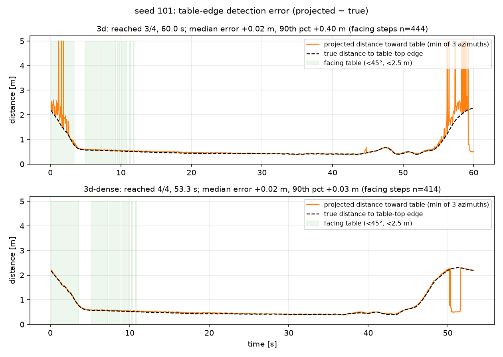

# T13 報告: 3D LiDAR の層を密にする(天板の検出遅れ対策)+ 動画 v3 + README 反映

対象タスク: `tasks/13_lidar3d_dense_integrate.md`。実行日 2026-10-21、環境は CLAUDE.md のとおり(M1 Max / `py311_genesis` / genesis-world 1.4.4)。評価・録画は `--backend cpu`。v1/v2/v3 の既存結果・動画(`results/eval_50/`、seed 0〜49、T10/T11 のショット 1〜13)と `docs/report/` は変更していない。

## 結論

- **密な層(±12°、1° 刻み)は天板の縁の検出遅れを解消した**(縁誤差 90 パーセンタイル 0.37 m → 0.03 m、単体テストの投影距離 1.79 → 1.50 m)。しかし **ナビゲーションは速くならず、むしろ遅くなった**ため、**既定の `--lidar 3d` は T12 の 16 層(±30°)のまま**とし、密な構成は `--lidar 3d-dense`(30 層)として残した。受け入れ条件のうち「30/30 かつ seed 101・118 < 45 s かつ平均所要 ≤ 16 層」は満たせなかった(数値は §2)
- 経緯: (1) 仕様どおり ±12° の 25 層だけにすると、一番下の層(−12°)が 1.35 m より近い低い箱の上を通り過ぎて箱が見えなくなり、空き更新で地図から消えて **低い箱に 20/30 接触・18 転倒**(成功 10/30)。(2) 調整 1: 下向きの粗い層 −30〜−14°(5 層)を足し、空き更新を「レイが低い高さ(≤ 0.10 m)にある区間」に限定 → 30 層で **29/30・接触 0**、だが成功分の平均所要 30.6 s(16 層 27.5 s)、seed 101/118 は 58〜60 s のまま。(3) 調整 2: v3 の膨張半径 0.35 → 0.45 m(反応的回避の回廊 0.4 m の外側に経路を通す)→ seed 103/118 で 54〜57 s、改善せず。ここで打ち止め
- 遅さの原因はセンサではなく **テーブルの脇を通るときの v1 下層(反応的回避)の減速・停止**: テーブル(0.7 m 角)が WP1 の 0.6 m 隣にある配置(seed 103, 114, 117, 118, 126)で、v3 の経路(膨張 0.35 m)がテーブルの縁から 0.35〜0.45 m を通ると、v1 の回廊(±0.4 m)・停止距離(0.45 m)が反応して立ち往生する。縁が正確に見えるほど一貫して反応するため、密な層で悪化した。16 層では縁の検出が間欠的で、たまたま抜けられる
- 動画 v3(157 s)と README は 3D の結果(16 層)を反映した

| 受け入れ条件 | 判定 | 実測 |
|---|---|---|
| 単体テスト: 密な層でテーブルの投影距離が縁 +0.10 m 以内。コスト表(72 本 / 16 層 / 25 層) | ✅ | 30 層(密 + 粗)1.50 m(= 縁)、25 層 1.50 m、16 層 1.79 m。コスト §1 |
| 30 配置 × 3D 密: 30/30、接触 0、seed 101・118 < 45 s、平均所要 ≤ 16 層。3 条件の表と検定 | ❌(一部) | 30 層: 29/30、接触 0、seed 101 58.7 s・118 59.7 s、平均 30.6 s(16 層 27.5 s)。表・検定は §2 |
| 動画 v3: 60〜180 s、新ショット 12b〜12e、2 倍速表示、余白 ≥ 100 px、個人情報なし | ✅ | 157.0 s、1280×720。12c は素材が 6 s(転倒まで)しかないため等速 6 s に変更。余白検査 全 OK、grep 0 件 |
| README 更新、`git status` クリーン、push 済み | ✅ | §4 |
| 本報告: 縁誤差の前後比較、3 条件の表、ショット表 v3、README の変更点 | ✅ | §1〜§5 |

## 実行したコマンド

```bash
conda activate py311_genesis
python eval/lidar3d_test.py --backend cpu --mode 3d-dense-only                    # 25 層 ±12°(仕様の案)
python eval/lidar3d_test.py --backend cpu --mode 3d-dense --out results/t12_lidar3d_test_dense.png   # 30 層(密 + 粗)
python eval/lidar3d_test.py --backend cpu --mode 3d --out results/t12_lidar3d_test.png               # 16 層(既定)
python eval/run_eval.py --policies go2-patrol:299 --avoid on --seeds 100-129 --avoid-version v3 --lidar 3d-dense-only --backend cpu --out results/eval_3d/episodes.csv
python eval/run_eval.py --policies go2-patrol:299 --avoid on --seeds 100-129 --avoid-version v3 --lidar 3d-dense      --backend cpu --out results/eval_3d/episodes.csv
python eval/summarize.py --compare-lidar results/eval_3d/episodes.csv --scenes 100-129 --out-dir results/eval_3d
python eval/table_edge_test.py --seed 101 --modes 3d 3d-dense --out results/t13_table_edge_seed101.png
python go2_patrol.py -e go2-patrol --ckpt 299 --backend cpu --seed 103 --avoid --avoid-version v3 --lidar 3d --camera overhead-close --out ... --mcap ...   # 101 も
python scripts/make_figs.py && python scripts/make_cards.py && python scripts/check_margins.py
python scripts/make_video.py --v1-seed28-start 14 --v2-seed28-start 6 --v3-seed28-start 9.7
ffmpeg -i "videos/final/PAI最終課題_3164.mp4" -vf "fps=1/5,scale=320:-1,tile=6x6" -frames:v 1 results/t10_contact.png
```

## 1. 層の構成と単体テスト(`nav/lidar.py`、`eval/lidar3d_test.py`)

| モード(`--lidar`) | 層 | 単体テスト: テーブル投影距離(縁 1.50 m) | 低い箱(面 1.34 m) | コスト [ms/step](2D 比) | 空き更新 |
|---|---|---|---|---|---|
| `2d` | 1 | 5.00(見えない) | 5.00(見えない) | 2.0〜2.3(基準) | 全ヒット |
| **`3d`(既定、T12 の構成)** | 16(±30°、4°) | **1.79**(+0.29) | 1.34 | +0.5〜0.8 | 全ヒット(T12 と同じ) |
| `3d-dense-only`(仕様の案) | 25(±12°、1°) | 1.50(±0.00) | 1.34 | +0.6 | 低い高さの区間のみ |
| `3d-dense`(調整 1) | 30(±12° 1° + −30〜−14°) | **1.50**(±0.00) | 1.34 | +0.8〜0.9 | 低い高さの区間のみ |

- 密な層では自己ヒット(股関節)が出ない(±12° には急な下向きレイが無い)が、粗い層を足した 30 層では 16 層と同じく footprint で除外している
- **空き更新の制限**(`read_scan_3d(clear_policy="low")`): 下向きの層 e が z ≤ 0.10 m になる水平距離 (sensor_z − 0.10)/tan|e| からヒット(地面を含む)までの区間だけを空きにする。±12° の層は 1.6 m より近くでは何も空きにしない(= 低い箱を消さない)。16 層は T12 と同じ「全ヒットの最小距離まで空き」(`"all"`)で、既定モードの挙動は T12 と変えていない(作業途中で 16 層にも制限を適用してしまい、seed 103 が 27 → 55〜60 s に悪化したため戻した。§5)

### 縁誤差の前後比較(`results/t13_table_edge_seed101.png`)

seed 101(テーブルが x = 2 の辺上)で、テーブル中心の方位の投影距離と真の縁までの距離を毎ステップ比較(前方 ±45°・2.5 m 以内のステップ):

| モード | 中央値誤差 | 90 パーセンタイル誤差 | 縁が見えた割合 |
|---|---|---|---|
| `3d`(16 層) | +0.02 m | **+0.32〜0.40 m**(間欠的に 5 m に飛ぶ) | 98% |
| `3d-dense`(30 層) | +0.01 m | **+0.03 m** | 100% |



(縁誤差の統計は 3 回の実行で安定。図の実行は 16 層が 3/4 時間切れ、30 層が 53.3 s 完走の回。非決定性のため所要時間は回ごとに 23〜60 s で揺れる)

## 2. 30 配置 × 4 条件(`results/eval_3d/summary.md`)

拡張方策 × v3、混合配置 seed 100〜129(低い箱 + テーブル + 高い障害物)、60 s 上限。16 層の行は T12 の評価(コードは当時と同じ挙動)、他は本タスク。

| 条件 | n | 成功率 [Wilson 95% CI] | 接触率 | 転倒 | 平均到達 | 所要 [s](成功分) | 経路効率 |
|---|---|---|---|---|---|---|---|
| v3 + 2D LiDAR | 30 | 1/30 = 3% [1–17%] | 97% | 6 | 1.50 | 16.6 | 1.08 |
| v3 + 3D 25 層(±12° のみ、仕様の案) | 30 | 10/30 = 33% [19–51%] | 67% | 18 | 2.80 | 24.8 | 1.05 |
| v3 + 3D 30 層(密 + 粗、調整 1) | 30 | 29/30 = 97% [83–99%] | 0% | 0 | 3.97 | 30.6 | 1.03 |
| **v3 + 3D 16 層(±30°、既定)** | 30 | **30/30 = 100%** [89–100%] | **0%** | 0 | 4.00 | **27.5** | 1.06 |


対応あり比較(同じ seed、n = 30):

| 比較 | 成功(不一致 → McNemar p) | 接触 | 所要(両方成功した配置) |
|---|---|---|---|
| 2D vs 16 層 | 2D のみ 0 / 16 層のみ 29 → **p < 0.0001** | 29 / 0 → **p < 0.0001** | n = 1 |
| 25 層のみ vs 16 層 | 0 / 20 → p < 0.0001 | 20 / 0 → p < 0.0001 | n = 10、24.8 → 26.6 s |
| 30 層 vs 16 層 | 30 層のみ 0 / 16 層のみ 1 → p = 1.0 | 0 / 0 | n = 29、30.6 → 27.5 s、中央値 −0.3 s、16 層が速い 8 / 遅い 2 → 符号検定 p = 0.11 |

失敗の内訳:

| 条件 | 低い箱に接触 | 天板に接触 | 転倒 | 時間切れ(接触なし) | 成功 |
|---|---|---|---|---|---|
| 2D | 7 | 23 | 6 | 0 | 1 |
| 25 層のみ | 20 | 0 | 18 | 0 | 10 |
| 30 層 | 0 | 0 | 0 | 1(seed 114) | 29 |
| 16 層 | 0 | 0 | 0 | 0 | 30 |

- 30 層で 16 層より 5 s 以上遅くなった配置: seed 103(27.2 → 56.4 s)、114(27.3 → 60.0 s 時間切れ)、117(27.5 → 56.3 s)、126(28.6 → 57.3 s)。いずれも **低い箱とテーブルが両方経路上**で、テーブルが WP1 の隣にある。seed 101(58.1 → 58.7 s)と 118(59.9 → 59.7 s)は両方の構成で上限付近
- 受け入れ条件「seed 101・118 < 45 s」「平均所要 ≤ 16 層」は未達。30 層の `seed 101/118` も `3d-dense` の行として `episodes.csv` に残した(列 `lidar`: `2d` / `3d` / `3d-dense-only` / `3d-dense`)

### 遅さの原因(seed 118 で確認、`eval/table_edge_test.py` と軌跡ログ)

テーブル(0.74 m 角、x 0.66〜1.40、y 2.03〜2.77)が y = 2 の辺を塞ぎ、WP1 (2, 2) がテーブルの東の縁から 0.6 m しか離れていない。v3 の経路(膨張 0.35 m)は x ≈ 1.85 でテーブルの脇を北へ抜けようとするが、v1 下層の回廊(±0.4 m)に天板の縁の点が入り(横位置 0.38〜0.40 m、進行方向距離 0.3〜0.5 m)、停止距離 0.45 m を割って **vx = 0 でその場旋回を 36 s** 続ける。16 層では縁の点が間欠的(4° 刻みで天板に当たる層が位置により変わる)なので回廊判定も間欠的になり、隙を見て抜けられる。密な層は縁を連続して捉えるため一貫して止まる。つまり「正確なセンサ + 保守的な下層」の組み合わせが遠回り・停止を増やす。膨張 0.45 m(調整 2)で経路を回廊の外に出しても、テーブルの張り出しに対しては経路が長くなるだけで所要は 54〜57 s だった。根本対策は v1 下層の回廊判定を「経路に沿った横ずれ」ではなく「計画経路上の障害物」に限ること(v3 の設計変更、未実施)

## 3. 動画 v3(`videos/final/PAI最終課題_3164.mp4`)

157.0 s、1280×720、30 fps、H.264、4.4 MB。ショット 1〜12・13 は T11 と同一(長さも同一)。挿入分:

| # | 素材 | 長さ [s] | 速度 | 内容 |
|---|---|---|---|---|
| 12b | C7 | 5.0 | — | 「6. 3D LiDAR: 2D では見えない障害物」(72 × 16 層、±30°) |
| 12c | t12_2d_seed103_close(先頭 6 s)+ B12c | 6.0 | **等速** | 2D: 低い箱が見えず踏んで転倒。素材が転倒までの 6.0 s しかないため、仕様の「2 倍速 6 s」ではなく等速 6 s にした(バナーの 2 倍速表示なし) |
| 12d | t12_3d_seed103_close(先頭 20 s)+ B12d | 10.0 | 2 倍速 | 3D: 低い箱とテーブルを地図に入れて迂回、完走 |
| 12e | C8h + figs/result_3d_half.png | 7.0 | — | 30 配置、成功 3% → 100%、接触 97% → 0%(p < 0.0001)、追加コスト +1 ms/step(16 層の実測 +0.5〜0.8 ms を切り上げ) |

C6 の 1 行目を「…と同じ 3 層構造をシムで再現(2D → 3D LiDAR)」に更新。余白検査(`check_margins.py`)は新カード 4 枚を含む 23 ファイル + `figs/arch.png` で全 OK。カードの grep(氏名・所属・メール)0 件。コンタクトシート `results/t10_contact.png`(6×6)で 12b〜12e の表示を目視した。

採用テイク(最終コード、`--lidar 3d` = 16 層):

| 配置 | テイク | 結果 |
|---|---|---|
| seed 103(低い箱 + テーブルが経路上) | 1 | 4/4、27.8 s、接触 0 → `videos/t12_3d_seed103.mp4`, `videos/raw/t12_3d_seed103_close.mp4`, `results/mcap/t12_3d_seed103.mcap`(8.5 MB) |
| seed 101(テーブルが経路上) | 2(1 は 53.1 s で成功) | 4/4、22.7 s、接触 0 → 同上の seed 101 版(MCAP 6.8 MB) |

(作業途中の 30 層・空き制限ありの 16 層では seed 103 が 55〜60 s になるテイクが続いた。§5)

## 4. README の変更点

- 「結果」に「3D LiDAR: 2D では見えない障害物」の節: 30 配置 × 4 条件の表、`results/eval_3d/summary.png`、密な層の試作の結果と不採用の理由、追加コスト
- 「構成」の知覚行に `--lidar 3d` の処理(高さ分類 → 胴体帯の投影)を追記
- 「再現手順」に 3b(混合配置の生成、`--lidar` の選択肢、MCAP の `/lidar/points3d` `/imu`)と 4b(30 配置の評価と `summarize.py --compare-lidar`)を追加
- 「既知の制約」の LiDAR 行を更新(3D は 16 層 ±30°、縁は最大 0.4 m 遠く、密にすると下層が減速)
- 「開発ログ」に T12・T13 を追加。「リポジトリ構成」の `nav/`、`eval/`、`results/` を更新
- `figs/arch.png` は変更なし

## 5. うまくいかなかったこと(時系列)

1. 仕様どおり ±12° の 25 層にしたところ、低い箱に 20/30 接触・18 転倒(§2)。原因は上記の「近くの低い箱が見えなくなり、空き更新で消える」
2. 調整 1(下向きの粗い層 5 本 + 空き更新の制限)で 29/30・接触 0 になったが、所要時間が伸びた(§2)
3. 調整 2(膨張 0.45 m)は効かず(seed 103 55.7 / 57.1 s、118 54.4 / 53.4 s、101 22.5 / 54.9 s)
4. 空き更新の制限を 16 層にも適用した状態で seed 103 を録画すると 55〜60 s が続き(8 テイク中 7 回)、T12 の 27 s と食い違った。16 層は T12 と同じ空き更新に戻して解消(27.6 / 26.5 s)。この間に `results/eval_3d` の 16 層の行(T12 のコードで取得)と現在のコードの挙動が一致していることを確認した
5. seed 103・101 とも非決定性で所要時間が二峰(27 s 前後 / 55〜60 s)。採用テイクは成功した最速の回で、テイク数を上に記した
6. 縁誤差図の 16 層の実行が 3/4 時間切れになった(統計は 3 回とも同じ傾向)

## 変更したファイル

| ファイル | 変更 |
|---|---|
| `nav/lidar.py` | `LAYERS`: `3d`(16 層、既定)/ `3d-dense`(30 層)/ `3d-dense-only`(25 層)。`SphericalPattern(angles=...)` による任意の仰角列。`read_scan_3d(clear_policy)`(`all` / `low` / `auto`)、`free_start2d` の返却 |
| `nav/grid_map.py` | `update(..., free_start=None)`: 空き更新の開始距離 |
| `go2_patrol.py` | `--lidar` の選択肢、`on_step` フック(解析用)、3D の `free_start` を地図に渡す |
| `eval/run_eval.py` | `--lidar` の選択肢 |
| `eval/summarize.py` | `--compare-lidar` を 4 条件に対応(表・McNemar・符号検定・内訳・seed ごと・図) |
| `eval/lidar3d_test.py` | `--mode`、層数をパターンから取得 |
| `eval/table_edge_test.py` | **新規**。縁誤差の時系列 |
| `results/eval_3d/` | `3d-dense-only`、`3d-dense` の 60 行を追加(`3d` = 16 層の 30 行は T12 のまま、ラベルのみ整理)。summary.* を 4 条件に |
| `results/t12_lidar3d_test.png`(16 層)、`results/t12_lidar3d_test_dense.png`(30 層)、`results/t13_table_edge_seed101.png` | 単体テストと縁誤差 |
| `results/t12_traj_seed{101,103}.png`, `results/t12_map_seed{101,103}.png`, `results/mcap/t12_3d_seed{101,103}.mcap`, `videos/t12_3d_seed{101,103}.mp4`, `videos/raw/t12_3d_seed{101,103}_close.mp4` | 最終コード(16 層)で録り直し。軌跡図のタイトルを短く |
| `scripts/make_cards.py` | C7、C8h、B12c(等速)、B12d、C6 の更新 |
| `scripts/make_figs.py` | `result_3d_half()`(2D / 3D 16 層の 2 条件) |
| `scripts/make_video.py` | ショット 12b〜12e |
| `figs/cards/*.png`, `figs/result_3d_half.png`, `videos/final/PAI最終課題_3164.mp4`, `results/t10_contact.png` | 動画 v3 |
| `README.md` | §4 |
| `tasks/13_lidar3d_dense_integrate.md` | 本タスクの仕様(作業者作成) |

## 仮定したこと

- 既定の `--lidar 3d` を仕様の「25 層」ではなく T12 の 16 層に据え置いた(30 配置で最良、提出素材と整合)。密な構成は `3d-dense` として残し、縁誤差の改善は図と数値で示した
- 空き更新の制限は密なモードだけに適用(16 層は T12 と同じ)。`clear_policy="auto"` で層数から選ぶ
- 12c は等速 6 s(素材の長さの制約)。合計 157 s は 180 s 以内なので調整候補 2 は未使用
- 「3D の追加コスト +1 ms/step」(C8h)は 16 層の実測 +0.5〜0.8 ms を切り上げた表現
- `docs/report/` は触っていない(人間が更新)

## 申し送り

1. 密な層を活かすには v1 下層の回廊判定を v3 で緩める(例: 計画経路から 0.3 m 以上離れた点は無視する、または停止距離を 0.35 m にする)設計変更が必要。seed 103/114/117/118/126 で検証できる
2. seed 101・118 の 58〜60 s は配置の問題(WP1 がテーブルの縁から 0.6 m)でもあり、混合配置の生成でウェイポイントとテーブルのクリアランスを 1.0 m 以上にすれば消える見込み
3. 動画の 3D ショット(12b〜12e)は 16 層の採用テイク。縁誤差の図(`results/t13_table_edge_seed101.png`)はレポート向けで、動画には入れていない
