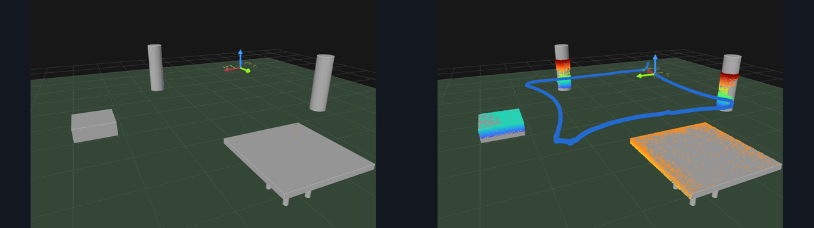
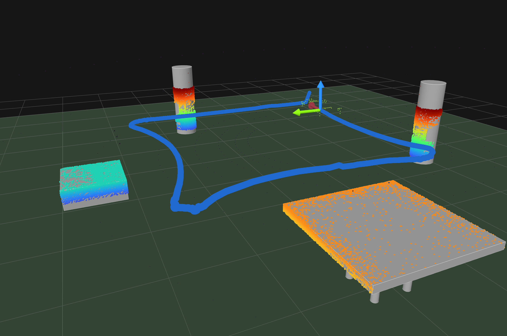

# T14 報告: Foxglove 3D 点群の画面収録を動画に追加(動画 v4)+ docs/report のコミット

## 受け入れ条件の判定

| 条件 | 判定 | 根拠 |
|---|---|---|
| `foxglove_3d_seed103.mp4`: 1280×720、見出しバー・アイコン列なし、静止区間なし | ✅ | 1280×720、30 fps、27.5 s、1.0 MB。先頭・末尾フレームは下図 |
| 動画 v4: 60〜180 s、12f が 12d と 12e の間で「2倍速」表示、ショット 9 が 4 s、余白検査 OK、個人情報 grep 0 件 | ✅ | 168.8 s、1280×720、5.1 MB。`check_margins.py` 全 OK(B12f 含む)。grep 0 件。コンタクトシートで 12f の位置と 2倍速バッジを目視 |
| `results/t14_foxglove3d_seed103.png` がある | ✅ | 2692×1784(crop のみ、縮小なし)。収録の 28.2 s(末尾の静止区間の直前、点群が積み上がった状態) |
| README 更新、`docs/report/` を含めて push、`git status` は 2 ファイル以外クリーン | ✅ | 下記コミット。未追跡は `videos/raw/foxglove_3d_seed103.mov`(`.gitignore` の `*.mov` で非表示)と `videos/t01_square_baseline.mp4` |
| 本報告: crop 実測値、使った区間、ショット表 v4、変更ファイル | ✅ | 下記 |

## 実行したコマンド

```bash
conda activate py311_genesis
mv "videos/raw/画面収録 2026-10-21 19.28.05.mov" videos/raw/foxglove_3d_seed103.mov
ffmpeg -i videos/raw/foxglove_3d_seed103.mov -frames:v 1 f0.png              # 境界の測定(numpy で画素値を読む)
ffmpeg -i videos/raw/foxglove_3d_seed103.mov -vf "crop=2692:1784:8:66,scale=673:446,freezedetect=n=0.0005:d=0.3" -an -f null -
ffmpeg -ss 0.80 -to 28.30 -i videos/raw/foxglove_3d_seed103.mov \
  -vf "crop=2692:1784:8:66,scale=1280:720:force_original_aspect_ratio=decrease,pad=1280:720:(ow-iw)/2:(oh-ih)/2:color=0x141820,fps=30,format=yuv420p" \
  -c:v libx264 -preset medium -crf 23 -an -movflags +faststart videos/raw/foxglove_3d_seed103.mp4
ffmpeg -ss 28.2 -i videos/raw/foxglove_3d_seed103.mov -frames:v 1 -vf "crop=2692:1784:8:66" results/t14_foxglove3d_seed103.png
python scripts/make_cards.py && python scripts/check_margins.py
python scripts/make_video.py --v1-seed28-start 14 --v2-seed28-start 6 --v3-seed28-start 9.7
ffmpeg -i "videos/final/PAI最終課題_3164.mp4" -vf "fps=1/5,scale=320:-1,tile=6x6" -frames:v 1 results/t10_contact.png
```

## 1. 素材の整形

### crop の実測値(原寸 2802×1860、先頭フレームの画素値で測定)

| 辺 | 境界 | 削った量 | 内容 |
|---|---|---|---|
| 上 | y = 0〜3 画面の外、4〜5 紫の枠線、6〜63 見出しバー(RGB 26,33,34)、64〜65 区切り線。3D 表示は y = 66 から(RGB 22,22,22) | **66 px** | 目安 70〜80 px より少し小さい。66 で見出しバーと区切り線は完全に除ける |
| 右 | x = 2726〜2782 ツールアイコン列、2800〜2801 紫の枠線。x ≤ 2724 は背景のみ | **102 px**(x < 2700 を残す) | アイコン列の左に 26 px の余裕 |
| 左 | x = 0〜3 画面の外、4〜5 紫の枠線、6〜7 枠の内側の影 | **8 px** | 目安 2〜4 px より大きい(枠の外側に画面の縁が 4 px あるため) |
| 下 | y = 1850〜1851 紫の枠線、1852〜1859 画面の外 | **10 px** | 同上 |

→ `crop=2692:1784:8:66`(幅・高さとも偶数)。縮小後は 1088×720 で、左右に 96 px ずつ背景色 0x141820 のパディング。

### 使った区間

`freezedetect`(n = 0.0005, d = 0.3 s、crop 後に 1/4 縮小して判定)の結果:

| 区間 | 内容 |
|---|---|
| 0.00〜0.78 s | 再生前の静止 → **除外** |
| 5.77〜7.52 s、12.50〜12.80 s、13.47〜13.85 s、22.92〜23.62 s、24.10〜24.40 s | 0.3〜0.4 s の短い静止(再生中にロボットがほぼ止まっている/描画更新の間隔)→ 再生中なので**残した** |
| 28.32 s〜末尾(29.75 s) | 再生後の静止 → **除外** |

→ **0.80〜28.30 s(27.5 s)** を使用。2 倍速で 13.75 s。

| 先頭フレーム(0.80 s) | 末尾フレーム(28.30 s) |
|---|---|



見出しバー(「3D」の文字)、右上のアイコン、右端のアイコン列、紫の枠線はいずれも映っていない。

## 2. 動画 v4

- 帯 B12f: 仕様の長い文は 22 px まで縮めないと 2倍速バッジの手前に収まらなかった(他の帯は 33〜34 px)ため、**仕様の短縮案「Foxglove: 3D 点群(高さで色分け)が低い箱・天板・円柱をなぞる(seed 103)」を採用**(26 px)
- 12f の長さは素材の長さから自動で決める(`probe` で 27.5 s → `dur = 27.5 / 2`)。`--foxglove3d`(既定 `videos/raw/foxglove_3d_seed103.mp4`)が無ければ 12f を飛ばす
- ショット 9: `videos/raw/foxglove_seed10.mov` は従来どおり無いので静止画の代替ショット。6 s → 4 s
- 調整候補は使っていない(合計 ≤ 180 s。2 倍速でも点の積み上がりはコンタクトシートと抜き出しフレームで読めると判断)

### ショット表 v4

| # | ショット | 長さ [s] |
|---|---|---|
| 1 | C0 タイトル | 5.0 |
| 2 | 構成図 | 6.0 |
| 3 | C1 + 学習曲線 | 8.0 |
| 4 | 台本(2 倍速) | 7.0 |
| 5 | C2 + 軌跡比較 | 8.0 |
| 6 | seed10 追従(等速) | 12.0 |
| 7 | C3 | 4.0 |
| 8 | seed10 俯瞰(2 倍速) | 12.0 |
| 9 | Foxglove 静止画(**6 → 4 s**) | 4.0 |
| 10a | v1 seed28(2 倍速) | 10.0 |
| 10b | v2 seed28(2 倍速) | 10.0 |
| 10c | v3 seed28(2 倍速) | 10.0 |
| 10d | seed28 軌跡図(静止) | 6.0 |
| 11 | C4 + 結果(4 条件) | 10.0 |
| 12 | C5 | 7.0 |
| 12b | C7 3D LiDAR | 5.0 |
| 12c | 2D seed103(等速) | 6.0 |
| 12d | 3D seed103(2 倍速) | 10.0 |
| **12f** | **Foxglove 3D 点群(2 倍速、新規)** | **13.75** |
| 12e | C8h + 3D 結果 | 7.0 |
| 13 | C6 まとめ | 8.0 |
| | **合計** | **168.8** |

(T13 の 157.0 s − 2 + 13.75 = 168.75 s で見積もりどおり)

### 余白検査・個人情報

- `check_margins.py`: B12f を含む全カード・帯 + `figs/arch.png` で all OK(B12f: 右余白 100 px、2倍速バッジの右端)。`check_margins.py` はディレクトリを glob するので B12f は自動で対象になる。docstring に B12f を明記した
- 変更したテキスト(README、`scripts/*.py`、`.gitignore`、タスク)を氏名・メールの文字列で grep して 0 件。表示する識別子は従来どおり `PAI最終課題_3164` と GitHub URL のみ。Foxglove の収録範囲(crop 後)にはアプリの UI 文字列も無い

### コンタクトシート(`results/t10_contact.png`、5 s ごと)


12d(3D seed103、2 段の帯)の次に 12f が 3 コマ(帯 B12f + 2倍速)、その次に 12e(C8h + 3D 結果)。

## 3. 図

`results/t14_foxglove3d_seed103.png`(2692×1784、収録 28.2 s のフレーム、crop のみ)。



## 4. README

- 「3D LiDAR」の節(見出しに T14 を追加)に 1 行と画像
- 再現手順 5(Foxglove)に 3D の表示設定(表示フレーム world、フォローモード固定、`/lidar/points` Turbo・z・0〜0.5・減衰 60 s、`/lidar/points3d` 減衰 0・ポイントサイズ 2、`/map` フラット色・半透明、変換のラベル オフ・軸スケール 0.6)を追記。設定値はタスクの記載をそのまま転記(実測ではない。トピック名は `nav/mcap_logger.py` で存在を確認)
- 手順 6 に Foxglove 3D 素材の注記、開発ログに T14 の行

## 変更したファイル

| ファイル | 理由 |
|---|---|
| `videos/raw/foxglove_3d_seed103.mp4`(新規) | 整形した Foxglove 3D 収録(1.0 MB) |
| `.gitignore` | `*.mov` を追加(原本 .mov をコミットしない) |
| `scripts/make_cards.py`, `figs/cards/B12f.png`(新規) | 帯 B12f |
| `scripts/make_video.py` | ショット 12f(素材が無ければ飛ばす)、`--foxglove3d` 引数、ショット 9 を 4 s |
| `scripts/check_margins.py` | docstring に B12f |
| `videos/final/PAI最終課題_3164.mp4`, `results/t10_contact.png` | 動画 v4、コンタクトシート |
| `results/t14_foxglove3d_seed103.png`(新規), `results/t14_clip_first_last.png`(新規) | レポート用の図、本報告の先頭・末尾フレーム |
| `README.md` | §4 |
| `docs/report/`(report.html、PDF、`figs/` の 3 枚) | 人間が更新したレポート v3。内容は変えずにそのままコミット |
| `tasks/14_foxglove3d_video.md` | タスク仕様(従来どおりコミット) |

## うまくいかなかったこと・仮定

- crop の目安(上 70〜80 px、右 90〜110 px、左下 2〜4 px)に対し、実測は上 66 / 右 102 / 左 8 / 下 10 px。上は 66 px で区切り線まで除けるので目安より小さくした。左・下は Retina 収録の窓の外側(画面の縁)が 4〜8 px 入っていたため目安より大きい
- 収録途中の 0.3〜0.4 s の静止は「再生前後の静止区間」ではないと解釈して残した
- B12f は長い方の文が 22 px になったので短縮案を採用

## 次タスクへの申し送り

- レポート(`docs/report/`)に `results/t14_foxglove3d_seed103.png` を入れるのは人間の作業
- 動画は 168.8 s で上限まで 11 s の余裕
- クリーンクローンでは `videos/raw/foxglove_3d_seed103.mp4` がコミットされているので 12f も再生成される
