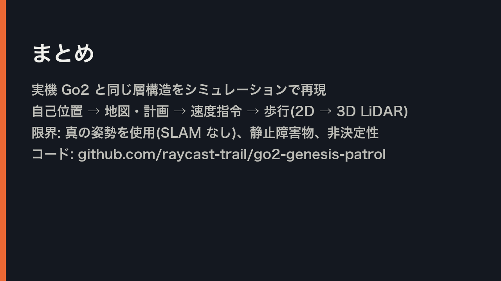
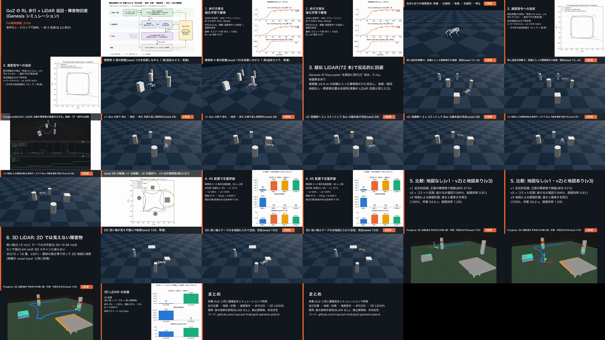

# T17 報告: まとめカード C6 の折り返し修正と動画の再生成

## 受け入れ条件の判定

| 条件 | 判定 | 根拠 |
|---|---|---|
| C6 が 4 行で、単語の途中で折り返していない | ✅ | 下の画像。自動折り返しは 0 か所(下記の検出スクリプトで確認) |
| 余白検査 OK、動画 60〜180 s、構成・長さは T16 と同じ | ✅ | `check_margins.py` all OK。動画 168.8 s(T16 と同じ)、ショット 21 個の構成も同じ |
| 個人情報の検査 0 件 | ✅ | grep `none`、ffprobe のタグは encoder 等のみ |
| push 済み、`gh` は元のアカウントに戻っている | ✅ | `6be23a7` を push(リモートの main と一致)。push の前だけ raycast-trail に切り替え、その後元に戻した |
| `reports/17_c6_fix.md`(日本語) | ✅ | 本ファイル |

## C6(修正後)



修正前は 1 行目が「…と同じ 3 層構 / 造をシムで再現(2D → 3D LiDAR)」と単語の途中で自動折り返しされていた。タスク指定の 4 行に明示的に分けた(line_size 33 px は従来どおり)。

1. 実機 Go2 と同じ層構造をシミュレーションで再現
2. 自己位置 → 地図・計画 → 速度指令 → 歩行(2D → 3D LiDAR)
3. 限界: 真の姿勢を使用(SLAM なし)、静止障害物、非決定性
4. コード: github.com/raycast-trail/go2-genesis-patrol

## ほかのカードの確認と修正(手順 2)

全カード(C0〜C7、C1h・C2h・C4h・C8h)と全バナー(B4〜B12f の 12 枚)を、一覧画像にして目視で確認した。あわせて、`make_cards.py` の `wrap()` が 2 行以上を返した箇所を記録するスクリプトで機械的にも洗い出した。このスクリプトは scratchpad に置いた使い捨てで、リポジトリには入れていない。カードの出力は通常の実行と同じ。

修正前に自動折り返しが起きていたのは 6 枚・13 か所。単語・数値・括弧の途中で切れていたものを、文言は変えずに明示的な改行で直した。

| カード | 修正前(「/」が自動折り返し位置) | 修正後(「/」が明示的な改行) |
|---|---|---|
| C2 | …しか学んでいない → 旋回でき / ず直進 | …しか学んでいない / → 旋回できず直進 |
| C3 | …(5° 刻み、5 m)。地面除去 / あり | …(5° 刻み、5 m)。/ 地面除去あり ※ |
| C4(タイトル) | 4. 45 配置で定量評価(障害物 3〜5 個を乱 / 数配置) | 4. 45 配置で定量評価 / (障害物 3〜5 個を乱数配置) |
| C1h(タイトル) | 1. 歩行方策を強化学習で獲 / 得 | 1. 歩行方策を / 強化学習で獲得 |
| C1h | 最終: エピソード長 991 / 1000、lin_v / el 追従 0.97 | 最終: エピソード長 991 / 1000、/ lin_vel 追従 0.97 |
| C2h | 指令範囲を広げて再学習: vx 0〜0.8 m/ / s、ωz ±0.8 rad/s | 指令範囲を広げて再学習: / vx 0〜0.8 m/s、ωz ±0.8 rad/s |
| C8h | 30 配置(低い箱 + テーブル + 高い障害 / 物) | 30 配置 / (低い箱 + テーブル + 高い障害物) |
| C8h | 成功 3% → 100%、接触 97% → 0%( / p < 0.0001) | 成功 3% → 100%、接触 97% → 0% / (p < 0.0001) |

※ C3 は語の境目での折り返しだったが、「あり」だけが次の行に残って読みにくかったので、「。」の位置で区切った。

残した自動折り返し(3 か所)は、どれも語の境目で切れていて読める:

- C1h「4096 体並列・300 イテレーション・ / 約 9 分(M1 Max, Metal)」
- C1h「PPO(rsl-rl)。報酬: 速度指令への追従 + / 姿勢の安定」
- C2h「既定例題の方策は「前進 0.5 m/s」しか / 学んでいない → 旋回できず直進(橙)」

バナーはすべて 1 行で、折り返しはない(`banner()` は 1 行に収まらなければエラーになる仕様)。

なお、C2 と C4(全幅版)は今の動画のショットでは使われていない(ショット 5・11 は分割版の C2h・C4h)。ただし手順 2 の対象なので、同じ基準で直した。

### コードの変更

- `card()` の本文と `half_card()` のタイトル・本文で、`\n` による明示的な改行を使えるようにした。`card()` のタイトルは以前から `\n` に対応している。区切りのない行は従来どおり `wrap()` で描くので、修正しなかったカードの PNG は変わっていない(`git status` で変化したカードは上の 7 枚だけ)
- 各カードの文言に `\n` を入れた(上の表)

## 実行したコマンド(conda 環境 `py311_genesis`)

```bash
python scripts/make_cards.py
python scripts/check_margins.py          # [check_margins] all OK (min right margin 100 px)
python scripts/make_video.py --v1-seed28-start 14 --v2-seed28-start 6 --v3-seed28-start 9.7   # T16 と同じ引数
ffmpeg -i "videos/final/PAI最終課題_3164.mp4" -vf "fps=1/5,scale=320:-1,tile=6x6" -frames:v 1 results/t10_contact.png
```

### 動画

| 項目 | T16 | T17 |
|---|---|---|
| 長さ | 168.8 s | 168.8 s(168.77 s) |
| ショット数 | 21 | 21(長さも各ショットで同じ) |
| 解像度 / fps / コーデック | 1280×720 / 30 / H.264 | 同じ |
| サイズ | 5.1 MB | 5.1 MB |

コンタクトシート(`results/t10_contact.png`)で、修正後の C1h・C2h・C3・C8h・C6 が入っていることを目視で確認した。



## 個人情報の検査

```bash
git ls-files -z | xargs -0 grep -a -i -l -E "$PII_PATTERN" || echo "none"
# → none(tasks/17_c6_fix.md と本報告を含む)
ffprobe -v error -show_entries format_tags:stream_tags -of compact "videos/final/PAI最終課題_3164.mp4"
# format: major_brand / minor_version / compatible_brands / encoder=Lavf62.12.100
# stream: language=und / handler_name=VideoHandler / encoder=Lavc62.28.100 libx264
```

動画・コンタクトシート・全カード PNG を `strings` でも調べた(上の語、旧表記以外の名の語、ホスト名)。0 件。

## コミットと push

| コミット | 内容 | 作者 |
|---|---|---|
| `6be23a7` | T17: explicit line breaks in C6 and other cards, regenerate final video | raycast-trail(noreply) |
| (本報告) | T17: report | raycast-trail(noreply) |

```bash
gh auth switch -u raycast-trail && git push origin main && gh auth switch -u <元のアカウント>
```

push 後の `gh auth status`: 元のアカウントが active、raycast-trail は active でない(ログインは残っている)。旧リポジトリには何も push していない。

## 変更したファイル

| ファイル | 理由 |
|---|---|
| `scripts/make_cards.py` | C6 を 4 行に。ほかのカードに明示的な改行。`card()`・`half_card()` で `\n` を使えるように |
| `figs/cards/C6.png`, `C2.png`, `C3.png`, `C4.png`, `C1h.png`, `C2h.png`, `C8h.png` | 再生成 |
| `videos/final/PAI最終課題_3164.mp4` | 再生成(YouTube にアップロードする版) |
| `results/t10_contact.png` | コンタクトシートの更新 |
| `tasks/17_c6_fix.md` | タスク定義(未追跡だったのでコミット) |

## うまくいかなかったこと

特になし。

## 次タスクへの申し送り

- この動画をそのまま YouTube にアップロードしてよい。アップロード後、README と提出用の行の「(提出後に URL を記載)」を差し替える
- カードの文言を変えるときは、自動折り返しに頼らず `\n` で区切るとよい(`card()`・`half_card()` の両方で使える)
